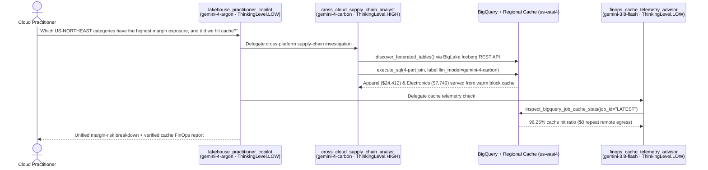

# Google Cloud Borderless Lakehouse POC + Tiered Gemini 4 ADK (`Argon`, `Carbon` & `3.8 Flash`)


[](https://github.com/cmanikandan/gcp-borderless-lakehouse-adk/actions/workflows/ci.yml)
[](LICENSE)
[](https://adk.dev/integrations/bigquery/)
[](https://aistudio.google.com/docs/whats-new-gemini-4-carbon)

> **Proof-of-Concept (POC) Disclaimer**: This repository is an educational **Proof of Concept (POC)** built from a cloud practitioner's perspective to explore and test cross-cloud lakehouse federation, regional caching, and agentic analytics end to end. It is **not** a drop-in production template. Before deploying to production, always consult the official [**Google Cloud Lakehouse documentation**](https://docs.cloud.google.com/lakehouse/docs/about-cross-cloud-data-access), [**Databricks Unity Catalog documentation**](https://docs.databricks.com/en/data-governance/unity-catalog/index.html), and [**AWS Glue & S3 documentation**](https://docs.aws.amazon.com/glue/latest/dg/aws-glue-programming-etl-format-iceberg.html) for production security hardening, IAM least-privilege policies, networking, and service limits.

---

## Why Google Cloud Lakehouse?

**Google Cloud Lakehouse** (powered by BigLake and BigQuery) provides an open, cloud-spanning data foundation built around five core advantages:

1. **Open-Format Interoperability on Apache Iceberg**: First-class support for **Apache Iceberg** (and Delta Lake tables with Iceberg UniForm enabled) via an open Iceberg REST Catalog—so **BigQuery**, **Google Cloud Managed Service for Apache Spark**, and open-source **Apache Spark** query the exact same snapshots without format lock-in or duplicate copies.
2. **Zero-ETL Cross-Cloud Federated Catalogs (GA)** (`--catalog-type="federated"`): Continuously synchronize Iceberg metadata in the background from **Databricks Unity Catalog**, **AWS Glue Data Catalog** (including Amazon S3 Table Buckets), **Snowflake Horizon Catalog**, and **Workday Data Lake**, making external tables queryable in place without brittle ETL pipelines.
3. **Intelligent Cross-Cloud Caching (GA)** (`--cross-cloud-cache="enabled"` & `crossCloudCacheOptions`): Opt-in regional block-level Parquet caching inside Google Cloud (`$0` additional Google Cloud fee) keeps active column blocks close to compute—verifying remote metadata and ACLs on every read while slashing repeat cross-cloud egress fees and accelerating subsequent BI and AI queries.
4. **Unified Governance, Credential Vending & Identity Federation**: Automatic short-lived storage credential vending eliminates static cloud keys on worker clusters, optional **Cross-Cloud Interconnect** and **VPC Service Controls** protect the network perimeter, and **User Identity Federation** propagates end-user OIDC identities into **Databricks Unity Catalog** for row/column enforcement and `system.access.audit` logging.
5. **Agent-Ready Data Foundation**: Federated tables behave like native tables in BigQuery (including zero-shot time-series forecasting with `AI.FORECAST` / TimesFM 2.0), enabling **Google Agent Development Kit (`google-adk` 2.x)** multi-agent teams across **Gemini 4 Argon**, **Gemini 4 Carbon**, and **Gemini 3.8 Flash** to reason across multi-platform datasets while Intelligent Caching absorbs iterative agent query bursts.

---

## 30-Second Offline Quickstart (Zero Cloud Credentials Needed)

Want to verify the tiered Google ADK 2.x multi-agent topology (`gemini-4-argon` + `gemini-4-carbon` + `gemini-3.8-flash`), unit tests, preflight diagnostics, and Intelligent Cache FinOps simulator locally before provisioning any cloud resources?

```bash
make install          # Installs Python 3.11+ environment via uv
make test             # Runs pytest suite + bash syntax + XML/SVG diagram checks
make doctor           # Validates CLIs, region pairing & Gemini 4 model/decode guardrails
make inspect-agent    # Prints tiered Gemini 4 Argon / Carbon / 3.8 Flash ADK hierarchy
make demo-finops      # Simulates Cold vs. Warm cache telemetry & 30-day agentic egress ROI
```

---

## POC Use Case: *OmniRetail Horizon* Supply Chain & Margin Risk

In this POC, we provision three independent platforms from scratch and join them in place without building a single ETL pipeline:

| Domain Dataset | Platform & Governance | Table Format | Query Path in BigQuery |
| :--- | :--- | :--- | :--- |
| **Live Customer Orders** | **Google Cloud BigQuery** (`us-east4`) | Native BigQuery | `` `<PROJECT_ID>.commerce_core.orders` `` |
| **Supplier Risk & SKU Margins** | **Standalone Databricks Portal** (*14-day Free Trial* or Standard Workspace Unity Catalog) | Delta + Iceberg UniForm | `` `<PROJECT_ID>.dbx_unity_merch.supply_chain.*` `` |
| **Carrier Shipment Telemetry** | **AWS Cloud** (*AWS Glue Data Catalog + Amazon S3*, `us-east-1`) | Apache Iceberg v2 on S3 | `` `<PROJECT_ID>.aws_glue_logistics.fulfillment.shipment_events` `` |

---

## Reference Architecture & Multi-Engine Flow


*(Editable XML and high-DPI vector SVG diagram sources are included in [`docs/diagrams/`](docs/diagrams/).)*

---

## Repository Structure

```text
gcp-borderless-lakehouse-adk/
├── AGENTS.md                                                 # AI coding & runtime agent guardrails
├── Makefile                                                  # One-command developer workflows (test, doctor, adk-web)
├── README.md                                                 # End-to-end setup, testing & teardown guide
├── blog/
│   ├── discuss_google_dev_post.md                            # Google Developer Program forums article
│   └── medium_blog_post.md                                   # Medium edition
├── docs/
│   ├── diagrams/                                             # Editable XML + vector .svg diagram sources
│   └── images/                                               # Lossless .png & .jpg docs.cloud.google.com-style diagrams
├── infra/
│   ├── aws-glue/
│   │   ├── 00_bootstrap_aws_s3_glue_iceberg.sh               # Creates S3 bucket, Glue DB & Athena Iceberg v2 table
│   │   ├── athena_seed_iceberg.sql                           # Idempotent Athena Engine v3 Iceberg DDL & MERGE INTO
│   │   ├── setup_glue_federation.sh                          # Secretless OIDC IAM role + Glue / S3 Tables sync
│   │   ├── permissions_policy.json                           # Least-privilege Glue + S3 + S3 Tables read policy
│   │   └── trust_policy_placeholder.json                     # Google OIDC trust template (aud + sub locked)
│   ├── databricks-unity/
│   │   ├── README.md                                         # Click-by-click Standalone Databricks Portal guide
│   │   ├── 00_prepare_uc_external_storage.sh                 # Creates external GCS bucket & binds Databricks SA
│   │   ├── databricks_uc_setup.sql                           # Creates UC schema, Delta UniForm tables & grants
│   │   └── setup_unity_federation.sh                         # Regional Secret Quickstart OR 2-phase OIDC Federation
│   ├── gcp-bigquery/
│   │   ├── setup_bigquery_native.sh                          # Enables GCP APIs & seeds native BigQuery orders
│   │   └── setup_bq_cross_cloud_connection_cache.sh          # 2nd GA cache surface: BigQuery Cross-Cloud Connection
│   ├── networking/
│   │   └── setup_cci_service_directory.sh                    # Optional Private Cross-Cloud Interconnect + VPC-SC notes
│   └── teardown_all.sh                                       # One-command POC uninstall across GCP, AWS & DBX
├── sql/
│   ├── 01_seed_bigquery_orders.sql                           # Native BigQuery orders table DDL + idempotent MERGE
│   ├── 02_cross_cloud_supply_chain_join.sql                  # 4-part 3-platform SQL join
│   ├── 03_verify_databricks_user_audit.sql                   # Audits OIDC tokens & table reads in system.access.audit
│   └── 04_finops_org_cache_audit.sql                         # Fleet-wide INFORMATION_SCHEMA.JOBS_BY_PROJECT cache ROI
├── spark/
│   ├── cross_cloud_margin_risk_job.py                        # PySpark 2.3 job via Iceberg REST vended credentials
│   └── submit_managed_spark_batch.sh                         # Serverless Managed Spark submit + optional Cloud NAT
├── src/lakehouse_agent/
│   ├── config.py                                             # Tiered Gemini 4 Argon/Carbon/3.8 Flash & region config
│   ├── catalog_discovery.py                                  # BigLake Iceberg REST API 4-part table/snapshot discovery
│   ├── cache_telemetry.py                                    # Parses objectStorageStats (supports job_id="LATEST")
│   └── agent.py                                              # Google ADK 2.x multi-model Coordinator & sub-agents
├── scripts/
│   ├── preflight_doctor.py                                   # Local & cloud readiness diagnostics
│   ├── run_cross_cloud_join.sh                               # Cold vs. Warm SQL join runner (--nouse_cache / --glue-only)
│   ├── demo_agent_cache_finops.py                            # Offline & live job cache FinOps analyzer
│   └── run_agent_cli.py                                      # Headless multi-agent CLI runner (--model-profile)
└── tests/                                                    # Pytest suite (ADK wiring, REST discovery, FinOps, doctor)
```

---

## Complete From-Scratch Setup Guide (AWS + Databricks + Google Cloud)

You do **not** need pre-existing tables in AWS, Databricks, or BigQuery—follow Phases 1–6 below to provision everything from scratch, verify the results, and cleanly uninstall all resources afterward.

### Prerequisites

* **Google Cloud CLI (`gcloud` & `bq`)** authenticated to a Google Cloud project with billing enabled (`gcloud auth login && gcloud config set project <YOUR_PROJECT_ID>`).
* **AWS CLI (`aws`)** authenticated to an AWS account (`aws sts get-caller-identity`) with permissions for S3, Glue, Athena, and IAM.
* **Standalone Databricks Account** accessed via the **Databricks Portal** at [https://login.databricks.com](https://login.databricks.com). *(Hands-on tier note: Databricks Free Edition uses a shared multi-tenant metastore where the Metastore Admin **External data access** toggle is locked; use a free **14-day Databricks Free Trial** or standard workspace for Unity Catalog federation, or pass `--glue-only` to `scripts/run_cross_cloud_join.sh` to test BigQuery + AWS Glue standalone first.)*
* **Python 3.11+** and [`uv`](https://docs.astral.sh/uv/) (`curl -LsSf https://astral.sh/uv/install.sh | sh`).

Export your core environment variables once in your shell:

```bash
export PROJECT_ID="your-gcp-project-id"
export GCP_REGION="us-east4"      # Co-located near AWS us-east-1
export AWS_REGION="us-east-1"
```

---

### Phase 1: Provision AWS S3, AWS Glue & Apache Iceberg Data from Scratch

Run [`infra/aws-glue/00_bootstrap_aws_s3_glue_iceberg.sh`](infra/aws-glue/00_bootstrap_aws_s3_glue_iceberg.sh) to create a private encrypted Amazon S3 bucket, create the `fulfillment` database in AWS Glue, and use serverless **Amazon Athena Engine v3** (zero EC2/EMR clusters required) to create and idempotently `MERGE` 4 shipment events into `fulfillment.shipment_events`:

```bash
bash infra/aws-glue/00_bootstrap_aws_s3_glue_iceberg.sh
```

Next, federate AWS Glue into Google Cloud Lakehouse using secretless OpenID Connect (OIDC)—locking both `accounts.google.com:aud` and `accounts.google.com:sub` to Google's auto-provisioned `biglake-service-account-id`—and enable **Intelligent Cross-Cloud Caching**:

```bash
bash infra/aws-glue/setup_glue_federation.sh
```

> **Practitioner Notes**:
> * `--glue-warehouse` takes your **12-digit AWS Account ID** (auto-detected via `aws sts get-caller-identity`), **not** an `s3://` URI.
> * Using **Amazon S3 Table Buckets** instead? Export `S3_TABLE_BUCKET="my-table-bucket"` before running `setup_glue_federation.sh`, and the script automatically formats `--glue-warehouse="${AWS_ACCOUNT_ID}:s3tablescatalog/${S3_TABLE_BUCKET}"`.

---

### Phase 2: Provision Standalone Databricks Portal (Unity Catalog) from Scratch

Google Cloud Lakehouse **does not support Databricks internal `default storage`**—your federated Unity Catalog schema must point to a registered **External Location**, have **External data access** enabled on the metastore, and grant **`EXTERNAL USE SCHEMA`**.

*(Full click-by-click portal instructions and tier notes are in [`infra/databricks-unity/README.md`](infra/databricks-unity/README.md).)*

1. **Create the External Storage Bucket**:
   ```bash
   bash infra/databricks-unity/00_prepare_uc_external_storage.sh
   ```
2. **Configure Your Standalone Databricks Portal (`https://login.databricks.com`)**:
   * **Enable External Data Access**: Go to **Catalog -> Gear Icon (Metastore Settings)** and toggle **External data access** ON.
   * **Create Storage Credential**: Go to **Catalog -> External Data -> Credentials -> Create credential**, select **Google Cloud Storage**, name it `lakehouse_poc_cred`, and copy the generated Databricks Service Account email.
   * **Bind Bucket IAM**:
     ```bash
     export DBX_GCS_SA_EMAIL="<PASTE_DATABRICKS_GENERATED_SA_EMAIL>"
     bash infra/databricks-unity/00_prepare_uc_external_storage.sh
     ```
   * **Create External Location**: Go to **Catalog -> External Data -> External Locations -> Create external location**, name it `lakehouse_poc_ext_loc`, select `lakehouse_poc_cred`, and set URL to `gs://${PROJECT_ID}-dbx-uc-ext/uc-external`.
   * **Create Service Principal + OAuth Secret**: Go to **Settings -> Identity and access -> Service principals -> Add service principal** (`gcp-lakehouse-federation-sp`) -> **Secrets -> Generate secret**. Save the Client ID (`DBX_SP_CLIENT_ID`) and Secret (`DBX_SP_CLIENT_SECRET`).
3. **Seed Delta UniForm (`iceberg`) Tables in Databricks SQL Editor**:
   * Open [`infra/databricks-unity/databricks_uc_setup.sql`](infra/databricks-unity/databricks_uc_setup.sql) in the Databricks SQL Editor, set `<YOUR_UNITY_CATALOG_EXTERNAL_LOCATION_URI>` to `gs://${PROJECT_ID}-dbx-uc-ext/uc-external` and `<SERVICE_PRINCIPAL_APP_ID>` to your `DBX_SP_CLIENT_ID`, and click **Run**. Confirm the trailing `DESCRIBE EXTENDED` query displays a populated Iceberg `Metadata Location`.
4. **Federate Databricks Unity Catalog into Google Cloud Lakehouse**:
   *(Note: `setup_unity_federation.sh` automatically sets `CLOUDSDK_API_ENDPOINT_OVERRIDES_SECRETMANAGER="https://secretmanager.${GCP_REGION}.rep.googleapis.com/"`, required for Regional Secret Manager secrets, and supports both `AUTH_MODE="secret"` for quick Portal testing and 2-phase `AUTH_MODE="oidc"` + `IDENTITY_MODE="user-identity-federation"` for multi-user workspaces!)*
   ```bash
   export DBX_WORKSPACE_HOST="dbc-a1b2c3d4-e5f6.cloud.databricks.com"  # Portal host (no https://)
   export DBX_UC_CATALOG="omniretail_merch"
   export DBX_SP_CLIENT_ID="<YOUR_DATABRICKS_SP_UUID>"
   export DBX_SP_CLIENT_SECRET="<YOUR_DATABRICKS_SP_OAUTH_SECRET>"

   bash infra/databricks-unity/setup_unity_federation.sh
   ```


---

### Phase 3: Provision Native BigQuery Dataset & Optional Cross-Cloud Connection Cache

Enable the required Google Cloud APIs and create/seed `<PROJECT_ID>.commerce_core.orders` in `us-east4`:

```bash
bash infra/gcp-bigquery/setup_bigquery_native.sh
```

#### Two GA Ways to Opt Into Intelligent Cross-Cloud Caching

Google Cloud Lakehouse supports **Intelligent Cross-Cloud Caching (GA)** across two surfaces (both disabled by default, `$0` extra Google Cloud charge):

| Capability | Surface 1: Lakehouse Federated Catalog | Surface 2: BigQuery Cross-Cloud Connection |
| :--- | :--- | :--- |
| **Best For** | Zero-ETL federation across Unity Catalog, AWS Glue, Snowflake Horizon & Workday | Standalone BigLake Iceberg/Parquet/Delta tables registered on S3 or Azure |
| **Opt-In Flag / Property** | `--cross-cloud-cache="enabled"` | `--properties='{"accessRole":..., "crossCloudCacheOptions":{"enabled":true}}'` |
| **Script in This Repo** | [`setup_glue_federation.sh`](infra/aws-glue/setup_glue_federation.sh) & [`setup_unity_federation.sh`](infra/databricks-unity/setup_unity_federation.sh) | [`setup_bq_cross_cloud_connection_cache.sh`](infra/gcp-bigquery/setup_bq_cross_cloud_connection_cache.sh) |
| **Telemetry Surface** | `statistics.query.objectStorageStats` & `INFORMATION_SCHEMA.JOBS_BY_PROJECT` | `statistics.query.objectStorageStats` & `INFORMATION_SCHEMA.JOBS_BY_PROJECT` |

---

### Phase 4: Run Zero-ETL Cross-Platform Joins (BigQuery & Managed Spark)

#### 4A. Cold vs. Warm 3-Platform SQL Join in BigQuery + Cache Verification


Run [`scripts/run_cross_cloud_join.sh`](scripts/run_cross_cloud_join.sh), which executes [`sql/02_cross_cloud_supply_chain_join.sql`](sql/02_cross_cloud_supply_chain_join.sql) **twice** with `--nouse_cache` (bypassing BigQuery's SQL result cache so you observe Lakehouse's storage-level **Intelligent Cross-Cloud Caching** on Run #2; pass `--glue-only` if testing BigQuery + AWS Glue before configuring Databricks):

```bash
bash scripts/run_cross_cloud_join.sh
```

Expected 3-platform output from the 4 seeded POC orders (`ORD-8803` with `2h` delay and `0.14` risk on `NordicFreight` is automatically pruned by predicate pushdown; total revenue at risk = `$72,250.00`, total gross margin exposure = **`$39,202.00`**):

| `customer_region` | `category` | `supplier_name` | `geopolitical_risk_score` | `carrier` | `delay_hours` | `affected_orders` | `gross_margin_exposure_usd` |
| :--- | :--- | :--- | ---: | :--- | ---: | ---: | ---: |
| `US-NORTHEAST` | `Apparel` | `Pacific Rim Textiles` | `0.69` | `PacificAirCargo` | `19` | `1` | `24412.00` |
| `US-NORTHEAST` | `Electronics` | `Apex MicroSystems` | `0.78` | `OceanicExpress` | `28` | `1` | `7740.00` |
| `US-WEST` | `Packaging` | `Great Lakes Packaging` | `0.11` | `GreatLakesRail` | `36` | `1` | `7050.00` |

Inspect per-job cache telemetry (`cacheBytesRead` vs. `objectStorageBytesRead`) or audit fleet-wide cache savings across all workloads using [`sql/04_finops_org_cache_audit.sql`](sql/04_finops_org_cache_audit.sql):

```bash
LAST_JOB="$(bq ls -j -n 1 --project_id="${PROJECT_ID}" --location="${GCP_REGION}" --format=json | jq -r '.[0].jobReference.jobId')"
uv run python scripts/demo_agent_cache_finops.py --live-job-id "${LAST_JOB}" --location "${GCP_REGION}"
```

#### 4B. Serverless Managed Spark 2.3 with Iceberg REST Credential Vending

Query the exact same federated Iceberg catalogs from **Google Cloud Managed Service for Apache Spark** (`https://biglake.googleapis.com/iceberg/v1/restcatalog`, warehouse `bl://projects/${PROJECT_ID}/catalogs/<CATALOG>`, `GoogleAuthManager`, and `X-Iceberg-Access-Delegation=vended-credentials`—zero AWS keys or Databricks secrets stored on executors):

```bash
# Set ENSURE_CLOUD_NAT=true if your VPC subnet needs outbound Cloud NAT for Amazon S3
ENSURE_CLOUD_NAT=true bash spark/submit_managed_spark_batch.sh
```

> **Engine Scope Note**: Lakehouse Intelligent Cross-Cloud Caching accelerates **BigQuery** cross-cloud reads. Apache Spark executors read Parquet files directly from remote object storage using short-lived vended credentials.

---

### Phase 5: Launch the Tiered Agentic Layer (`google-adk` 2.x + Gemini 4 `Argon`, `Carbon` & `3.8 Flash`)


By default (`MODEL_PROFILE=tiered`), [`src/lakehouse_agent/agent.py`](src/lakehouse_agent/agent.py) pairs each specialist agent with the ideal Gemini model and thinking depth (with explicit `MAX_OUTPUT_TOKENS=8192` decode caps for Gemini 4's 1M-token output window):

| Agent Role | Default Model (`tiered`) | `ThinkingLevel` | Responsibility |
| :--- | :--- | :--- | :--- |
| **`lakehouse_practitioner_copilot`** | **`gemini-4-argon`** | `LOW` | Fast frontier intent decomposition, routing & executive synthesis |
| **`cross_cloud_supply_chain_analyst`** | **`gemini-4-carbon`** | `HIGH` | Deep 4-part cross-cloud SQL synthesis, edge-case checks & `AI.FORECAST` |
| **`finops_cache_telemetry_advisor`** | **`gemini-3.8-flash`** | `LOW` | High-speed `objectStorageStats` inspection (`job_id="LATEST"`) & CLI blueprints |



```bash
cp .env.example .env
# Edit .env to set PROJECT_ID and GOOGLE_API_KEY (or GOOGLE_GENAI_USE_VERTEXAI=TRUE + GOOGLE_CLOUD_LOCATION=global)
# Optional: set MODEL_PROFILE=tiered|argon|carbon|flash

# Launch the interactive Google ADK Web UI:
make adk-web

# Or run headlessly from your terminal (with optional --model-profile override):
uv run python scripts/run_agent_cli.py \
  --model-profile tiered \
  --prompt "Which US-NORTHEAST categories have the highest gross margin exposure, and what was the cache hit ratio on our latest BigQuery job?"
```

---

### Phase 6: Clean Up / Uninstall Everything (Avoid Ongoing Cloud Charges)

When you finish testing the POC, tear down all federated catalogs, regional secrets, BigQuery connections/datasets, Cloud NAT gateways (if created), GCS buckets, AWS Glue tables/databases, IAM roles, and S3 buckets in one command using [`infra/teardown_all.sh`](infra/teardown_all.sh):

```bash
export PROJECT_ID="your-gcp-project-id"
export GCP_REGION="us-east4"
export AWS_REGION="us-east-1"

bash infra/teardown_all.sh
```

Then run the three cleanup statements printed by the script inside your **Databricks Portal SQL Editor**:

```sql
DROP CATALOG IF EXISTS omniretail_merch CASCADE;
DROP EXTERNAL LOCATION IF EXISTS lakehouse_poc_ext_loc;
DROP STORAGE CREDENTIAL IF EXISTS lakehouse_poc_cred;
```

Finally, remove `gcp-lakehouse-federation-sp` under **Settings -> Identity and access -> Service principals** in your Databricks Portal, and optionally remove your local virtual environment (`rm -rf .venv .env`).

---

## Troubleshooting Checklist

| Symptom | Root Cause & Fix |
| :--- | :--- |
| **Catalog sync succeeds, but `0` tables appear from Databricks** | Verify **External data access** is ON in Unity Catalog Metastore Settings, your schema uses a registered **External Location** (not Databricks `default storage`), `DESCRIBE EXTENDED` shows an Iceberg `Metadata Location`, and your service principal has `EXTERNAL USE SCHEMA`. |
| **`cacheBytesRead` stays `0` on repeat `--nouse_cache` runs** | Confirm `--cross-cloud-cache="enabled"` on the federated catalog (or `crossCloudCacheOptions.enabled=true` on the BigQuery connection) AND check that org policy `constraints/gcp.restrictNonCmekServices` is not enforced (regional cache uses Google-managed encryption keys). |
| **Regional Secret Manager `NOT_FOUND` or location error** | Scope `CLOUDSDK_API_ENDPOINT_OVERRIDES_SECRETMANAGER="https://secretmanager.${GCP_REGION}.rep.googleapis.com/"` when creating regional secrets (handled automatically in `setup_unity_federation.sh`). |
| **`gcloud biglake` AWS Glue creation fails on `--glue-warehouse`** | Pass only the **12-digit AWS Account ID** (e.g., `123456789012`) or `<ACCOUNT_ID>:s3tablescatalog/<BUCKET>`, never an `s3://` URI. |
| **Managed Spark batch times out connecting to Amazon S3** | Serverless Spark executors use internal IPs by default; run `ENSURE_CLOUD_NAT=true bash spark/submit_managed_spark_batch.sh` to attach Cloud Router + Cloud NAT (or route privately via Cross-Cloud Interconnect). |

---

## Key Official References

* [Google Cloud Lakehouse Release Notes (Cross-Cloud Caching GA & Federated Catalogs GA)](https://docs.cloud.google.com/lakehouse/docs/release-notes)
* [About Cross-Cloud Data Access & Intelligent Caching](https://docs.cloud.google.com/lakehouse/docs/about-cross-cloud-data-access#intelligent-caching)
* [Query Remote Data in Google Cloud Lakehouse](https://docs.cloud.google.com/lakehouse/docs/query-remote-data)
* [Set Up Cross-Cloud Connection to Databricks Unity Catalog](https://docs.cloud.google.com/lakehouse/docs/set-up-cross-cloud-connection-databricks)
* [Set Up Cross-Cloud Connection to AWS Glue Data Catalog](https://docs.cloud.google.com/lakehouse/docs/set-up-cross-cloud-connection-aws-glue)
* [Set Up Cross-Cloud Connection to Snowflake Horizon Catalog](https://docs.cloud.google.com/lakehouse/docs/set-up-cross-cloud-connection-snowflake)
* [Set Up Cross-Cloud Connection to Workday Data Lake](https://docs.cloud.google.com/lakehouse/docs/set-up-cross-cloud-connection-workday)
* [Gemini 4 Carbon & Gemini 4 Argon Developer Guide](https://aistudio.google.com/docs/whats-new-gemini-4-carbon)
* [Databricks Unity Catalog Official Documentation](https://docs.databricks.com/en/data-governance/unity-catalog/index.html)
* [AWS Glue & Apache Iceberg Official Documentation](https://docs.aws.amazon.com/glue/latest/dg/aws-glue-programming-etl-format-iceberg.html)
* [Google Agent Development Kit (ADK) — BigQuery Integration](https://adk.dev/integrations/bigquery/)
