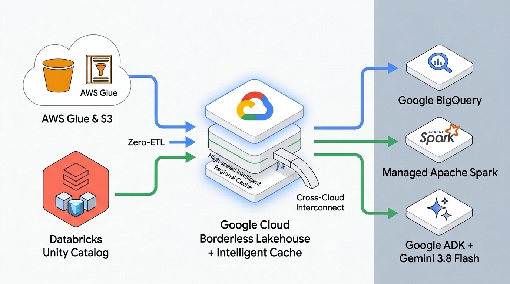
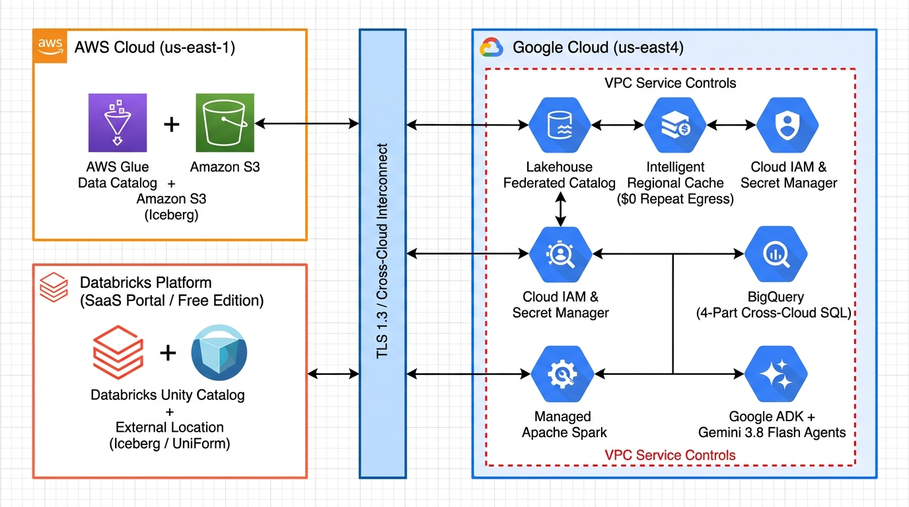
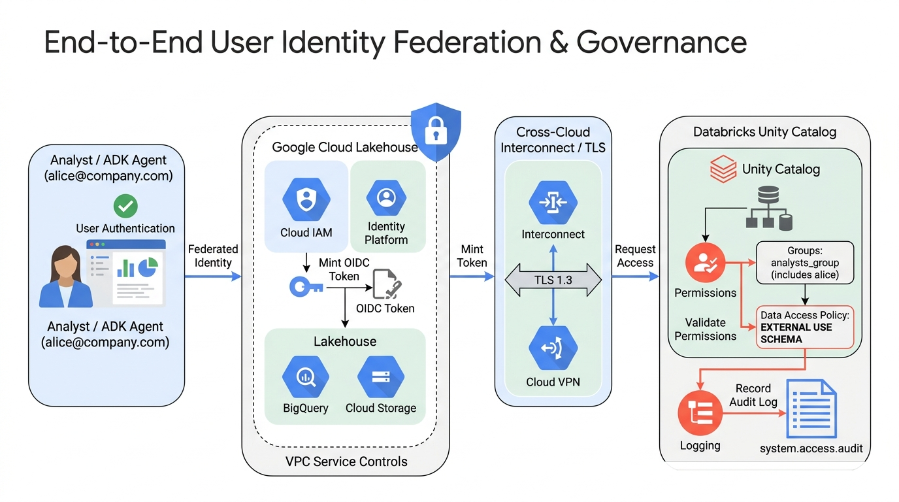
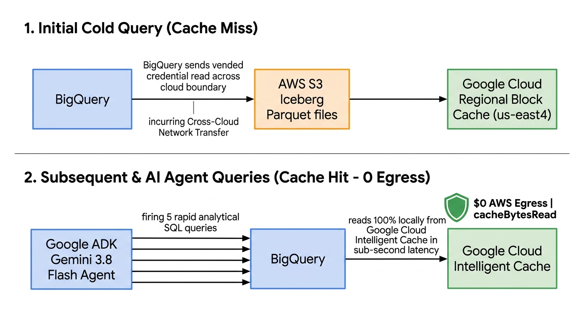

# Google Cloud Borderless Lakehouse + Google ADK (`gemini-3.8-flash`)



[](https://github.com/cmanikandan/gcp-borderless-lakehouse-adk/actions/workflows/ci.yml)
[](LICENSE)
[](https://adk.dev/integrations/bigquery/)
[](https://ai.google.dev/)

A Principal Architect's reference implementation and companion codebase for **Google Cloud Borderless Lakehouse's two flagship Generally Available (GA) releases**:

1. **Cross-Cloud Federated Catalogs (GA)** (`--catalog-type="federated"`): Zero-ETL metadata synchronization and direct Apache Iceberg query execution from **BigQuery**, **Managed Service for Apache Spark**, and **Apache Spark** across **Databricks Unity Catalog**, **AWS Glue Data Catalog**, **Snowflake Horizon Catalog**, and **Workday Data Lake**—with optional **Cross-Cloud Interconnect**, **VPC Service Controls**, and **End-User Identity Federation**.
2. **Intelligent Cross-Cloud Caching (GA)** (`--cross-cloud-cache="enabled"`): Opt-in, block-level regional caching inside Google Cloud that slashes repeat cross-cloud storage egress fees and accelerates multi-turn BI and **Agentic AI** workloads.

On top of this data foundation, this repository layers an autonomous **Supply Chain & FinOps Copilot** built with **Google Agent Development Kit (`google-adk` 2.x)** and **`gemini-3.8-flash`**.

> **Companion Medium Blog Post**: Read the full publication-ready post in [`blog/medium_blog_post.md`](blog/medium_blog_post.md).

---

## Enterprise Use Case: *OmniRetail Horizon*

Global retailer **OmniRetail Horizon** needs real-time **Margin-at-Risk** intelligence during supply chain disruptions without building brittle cross-platform ETL pipelines:

| Domain Dataset | Platform & Governance | Table Format | Query Path in BigQuery |
| :--- | :--- | :--- | :--- |
| **Live Customer Orders** | **Google Cloud BigQuery** (`us-east4`) | Native BigQuery | `` `omni-retail-lakehouse-prod.commerce_core.orders` `` |
| **Supplier Risk & SKU Margins** | **Standalone Databricks Portal** (*Free / Community Edition* or Enterprise Unity Catalog) | Delta + Iceberg UniForm | `` `omni-retail-lakehouse-prod.dbx_unity_merch.supply_chain.*` `` |
| **Carrier Shipment Telemetry** | **AWS Cloud** (*AWS Glue Data Catalog + Amazon S3*, `us-east-1`) | Apache Iceberg on S3 | `` `omni-retail-lakehouse-prod.aws_glue_logistics.fulfillment.shipment_events` `` |

---

## Reference Architecture (Draw.io + Google Cloud Icons)



* **Editable Draw.io Source**: [`docs/diagrams/borderless_lakehouse_architecture.drawio`](docs/diagrams/borderless_lakehouse_architecture.drawio)
* **Crisp Vector SVG**: [`docs/diagrams/borderless_lakehouse_architecture.svg`](docs/diagrams/borderless_lakehouse_architecture.svg)

---

## Repository Structure

```text
gcp-borderless-lakehouse-adk/
├── AGENTS.md                                      # AI agent & contributor architectural guardrails
├── README.md                                      # Step-by-step setup, testing, and FinOps guide
├── blog/
│   └── medium_blog_post.md                        # Publication-ready Medium article
├── docs/
│   ├── diagrams/                                  # Editable .drawio XML & vector .svg architecture
│   └── images/                                    # High-res architecture, cache & OIDC flow visuals
├── infra/
│   ├── aws-glue/                                  # 3-step secretless OIDC setup for AWS Glue + S3
│   ├── databricks-unity/                          # Standalone Databricks Portal SQL & federation CLI
│   └── networking/                                # Optional Private Cross-Cloud Interconnect + Service Directory
├── sql/
│   ├── 01_seed_bigquery_orders.sql                # Seed native BigQuery orders table in us-east4
│   ├── 02_cross_cloud_supply_chain_join.sql       # 4-part cross-platform join (BigQuery + Databricks + AWS Glue)
│   └── 03_verify_databricks_user_audit.sql        # Audit OIDC end-user identity in Databricks system.access.audit
├── spark/
│   ├── cross_cloud_margin_risk_job.py             # PySpark Iceberg REST Catalog + vended-credentials job
│   └── submit_managed_spark_batch.sh              # Submit serverless Managed Spark batch in Google Cloud
├── src/lakehouse_agent/
│   ├── config.py                                  # Typed environment configuration
│   ├── cache_telemetry.py                         # Parses statistics.query.objectStorageStats & FinOps ROI
│   └── agent.py                                   # Google ADK 2.x + gemini-3.8-flash multi-agent copilot
├── scripts/
│   └── demo_agent_cache_finops.py                 # Cold vs. Warm cache telemetry & agentic egress benchmark
└── tests/                                         # Pytest suite for ADK guardrails & telemetry parsing
```

---

## Step-by-Step Implementation & Testing Guide

### Prerequisites

* **Google Cloud SDK (`gcloud`)** authenticated against a project with **BigQuery**, **BigLake**, and **Secret Manager** enabled in `us-east4` (choose the Google Cloud region geographically closest to your remote buckets—e.g., `us-east4` Northern Virginia for `us-east-1` S3).
* **Standalone Databricks Account** accessed via the **Databricks Portal** (*Databricks Free Edition*—the modern successor to Community Edition—or Enterprise Workspace) with **Unity Catalog** enabled.
* **AWS Account + AWS CLI** with an Amazon S3 Iceberg table registered in **AWS Glue Data Catalog** (`us-east-1`).
* **Python 3.11+** and [`uv`](https://docs.astral.sh/uv/) for running the Google ADK `gemini-3.8-flash` agent layer.

---

### Step 1: Federate AWS Glue Data Catalog with Secretless OIDC + Intelligent Caching

Google Cloud Lakehouse eliminates long-lived AWS IAM access keys by binding a dedicated Google-managed BigLake service account to an AWS IAM Role via OpenID Connect (`accounts.google.com`).

> **Architect Gotcha**: `--glue-warehouse` must be your **12-digit AWS Account ID** (or `123456789012:s3tablescatalog/<bucket>` for Amazon S3 Tables)—**not** an `s3://` URI.

```bash
export PROJECT_ID="omni-retail-lakehouse-prod"
export GCP_REGION="us-east4"
export AWS_ACCOUNT_ID="123456789012"
export AWS_REGION="us-east-1"
export S3_ICEBERG_BUCKET="omniretail-logistics-iceberg-us-east-1"

bash infra/aws-glue/setup_glue_federation.sh
```

What [`infra/aws-glue/setup_glue_federation.sh`](infra/aws-glue/setup_glue_federation.sh) automates:
1. Creates `lakehouse_glue_federation_role` with read-only `glue:Get*` and `s3:GetObject`/`s3:ListBucket` permissions.
2. Runs `gcloud biglake iceberg catalogs create aws_glue_logistics --catalog-type="federated" --federated-catalog-type="glue" --cross-cloud-cache="enabled"`.
3. Extracts `biglake_service_account_id` from `gcloud biglake iceberg catalogs describe` and locks the AWS IAM trust policy to that exact unique subject ID (`accounts.google.com:sub`).
4. Activates continuous background metadata sync (`--refresh-interval="300s"`).

---

### Step 2: Federate Standalone Databricks Unity Catalog (Databricks Portal / Free Edition)

Open your standalone **Databricks Portal** (Free / Community Edition or Enterprise) and run [`infra/databricks-unity/databricks_uc_setup.sql`](infra/databricks-unity/databricks_uc_setup.sql) in the **SQL Editor** to create `omniretail_merch.supply_chain.supplier_risk_scores` and `sku_margins` with Delta **UniForm (`iceberg`)** enabled.

> **Critical Databricks Free / Community Edition Checklist**:
> 1. **Enable External Data Access**: In your Databricks Portal, navigate to **Catalog -> Gear Icon (Metastore Settings)** and check **External data access**.
> 2. **Use a Unity Catalog External Location**: Google Cloud Lakehouse **does not support Databricks internal `default storage`**. Back your schema (`MANAGED LOCATION '<EXTERNAL_LOCATION_URI>/supply_chain/'`) with a registered **Unity Catalog External Location** (*Catalog -> External Data -> External Locations*).
> 3. **Grant `EXTERNAL USE SCHEMA`**: Without `GRANT EXTERNAL USE SCHEMA ON SCHEMA ...`, Unity Catalog will sync metadata with 0 queryable tables because it refuses to vend short-lived storage credentials.

Next, create a Databricks Service Principal in your portal (*Settings -> Identity and access -> Service principals*), generate an OAuth secret, and run [`infra/databricks-unity/setup_unity_federation.sh`](infra/databricks-unity/setup_unity_federation.sh):

```bash
export PROJECT_ID="omni-retail-lakehouse-prod"
export GCP_REGION="us-east4"
export DBX_WORKSPACE_HOST="dbc-a1b2c3d4-e5f6.cloud.databricks.com" # No https://
export DBX_UC_CATALOG="omniretail_merch"
export DBX_SP_CLIENT_ID="<YOUR_DATABRICKS_SP_UUID>"
export DBX_SP_CLIENT_SECRET="<YOUR_DATABRICKS_SP_OAUTH_SECRET>"

# Default AUTH_MODE="secret" uses Regional Secret Manager (fastest for Databricks Free/Community Portal).
# Set AUTH_MODE="oidc" and IDENTITY_MODE="user-identity-federation" for enterprise OIDC propagation!
bash infra/databricks-unity/setup_unity_federation.sh
```



*When running on a multi-user Databricks workspace with `IDENTITY_MODE="user-identity-federation"`, Google Cloud exchanges the analyst's identity for a scoped OIDC token (`issuer = https://www.gstatic.com/biglake/federation/organizations/<ORG_ID>`, `audience = databricks-<METASTORE_ID>`), enforcing Unity Catalog row/column policies per user and logging `oidcTokenAuthorization` in `system.access.audit` (see [`sql/03_verify_databricks_user_audit.sql`](sql/03_verify_databricks_user_audit.sql)).*

---

### Step 3: Seed Native Orders & Run a 3-Platform Zero-ETL Join in BigQuery

Seed native orders in BigQuery (`us-east4`) and execute the cross-platform analytical join using **4-part table identifiers** (`` `project.federated_catalog.namespace.table` ``):

```bash
bq query --location=us-east4 --use_legacy_sql=false < sql/01_seed_bigquery_orders.sql
bq query --location=us-east4 --use_legacy_sql=false < sql/02_cross_cloud_supply_chain_join.sql
```

In a single standard SQL statement ([`sql/02_cross_cloud_supply_chain_join.sql`](sql/02_cross_cloud_supply_chain_join.sql)), BigQuery joins native Google Cloud orders with standalone Databricks Unity Catalog supplier risk/margin tables and AWS Glue S3 carrier shipment events—zero pipelines, zero staging buckets.

---

### Step 4: Query the Same Federated Catalogs from Managed Service for Apache Spark

Your federated catalogs also expose a standard **Apache Iceberg REST endpoint** (`https://biglake.googleapis.com/iceberg/v1/restcatalog`) with automatic storage **credential vending** (`header.X-Iceberg-Access-Delegation=vended-credentials`)—meaning your Spark cluster needs **zero** AWS keys or Databricks tokens!

```bash
bash spark/submit_managed_spark_batch.sh
```

Inspect [`spark/cross_cloud_margin_risk_job.py`](spark/cross_cloud_margin_risk_job.py) to see how PySpark mounts both `dbx_unity_merch` and `aws_glue_logistics` simultaneously and computes delay-adjusted margin exposure.

---

### Step 5: Test & Verify Intelligent Cross-Cloud Caching (`objectStorageStats`)



Cross-cloud caching (`--cross-cloud-cache="enabled"`) is **opt-in** (`disabled` by default). To verify it in action:

1. Run [`sql/02_cross_cloud_supply_chain_join.sql`](sql/02_cross_cloud_supply_chain_join.sql) **twice** with BigQuery query result cache turned off (`--nouse_cache`) so BigQuery actually executes the storage scan both times:

```bash
# Run #1 — Cold Scan (populates regional block cache in us-east4)
bq query --location=us-east4 --use_legacy_sql=false --nouse_cache < sql/02_cross_cloud_supply_chain_join.sql

# Run #2 — Warm Scan (reads cached Parquet column blocks locally at $0 remote egress!)
bq query --location=us-east4 --use_legacy_sql=false --nouse_cache < sql/02_cross_cloud_supply_chain_join.sql
```

2. Inspect `statistics.query.objectStorageStats` on the second job using either `bq show --format=prettyjson -j <JOB_ID>` or our FinOps analyzer CLI:

```bash
uv sync --extra dev
uv run python scripts/demo_agent_cache_finops.py --live-job-id <WARM_BQ_JOB_ID> --location us-east4
```

You can also run the built-in offline FinOps benchmark anytime without cloud credentials:

```bash
uv run python scripts/demo_agent_cache_finops.py
```

---

### Step 6: Launch the Google ADK (`gemini-3.8-flash`) Agentic Copilot

AI agents don't run one SQL query—they iterate through **5–8 exploratory queries per user question**. Without caching, an agentic copilot multiplies cross-cloud egress fees by 6x–8x. With **Intelligent Cross-Cloud Caching**, query #1 warms the regional block cache and queries #2–#8 execute at local Google Cloud speed and **\$0 remote egress**.

```bash
cp .env.example .env
# Set GOOGLE_API_KEY (or GOOGLE_GENAI_USE_VERTEXAI=TRUE) and PROJECT_ID in .env

# Run automated unit tests (ADK 2.x guardrails + telemetry parser)
uv run pytest -v

# Launch the interactive Google ADK Web UI
uv run adk web src
```

Try asking `lakehouse_principal_copilot` in the ADK UI:
* *"Which product categories have the highest gross margin exposure from delayed shipments or high geopolitical supplier risk over the past 7 days? Also audit the BigQuery job's cross-cloud cache hit ratio."*
* *"Simulate our monthly S3 egress savings if 40 analysts run 6-step agent investigations every day over 48 GB of federated Iceberg tables."*

---

## Principal Architect Troubleshooting Checklist

* **Catalog sync succeeds, but 0 tables appear from Databricks**: Verify **External data access** is enabled on your Unity Catalog metastore, your schema uses an **External Location** (not Databricks `default storage`), and your service principal has `EXTERNAL USE SCHEMA`.
* **`cacheBytesRead` stays `0` on repeat `--nouse_cache` runs**: Confirm `--cross-cloud-cache="enabled"` on the federated catalog AND check that organization policy `constraints/gcp.restrictNonCmekServices` is not active on the project (the regional cache uses Google-managed encryption keys and automatically disables itself when non-CMEK services are restricted).
* **AWS Glue catalog creation fails on `--glue-warehouse`**: Pass only the **12-digit AWS Account ID** (e.g., `123456789012`), not an `s3://` path.
* **Private Cross-Cloud Interconnect**: For production workloads requiring zero public internet traversal, run [`infra/networking/setup_cci_service_directory.sh`](infra/networking/setup_cci_service_directory.sh) to bind `--service-directory-name` and `--metadata-service-directory-name` inside a **VPC Service Controls** perimeter.

---

## Key Links & Official References

* [Google Cloud Lakehouse Release Notes (Cross-Cloud Caching GA & Federated Catalogs GA)](https://docs.cloud.google.com/lakehouse/docs/release-notes)
* [About Cross-Cloud Data Access & Intelligent Caching](https://docs.cloud.google.com/lakehouse/docs/about-cross-cloud-data-access#intelligent-caching)
* [Query Remote Data in Google Cloud Lakehouse](https://docs.cloud.google.com/lakehouse/docs/query-remote-data)
* [Set Up Cross-Cloud Connection to Databricks Unity Catalog (including User Identity Federation)](https://docs.cloud.google.com/lakehouse/docs/set-up-cross-cloud-connection-databricks)
* [Set Up Cross-Cloud Connection to AWS Glue Data Catalog](https://docs.cloud.google.com/lakehouse/docs/set-up-cross-cloud-connection-aws-glue)
* [Set Up Cross-Cloud Connection to Snowflake Horizon Catalog](https://docs.cloud.google.com/lakehouse/docs/set-up-cross-cloud-connection-snowflake)
* [Set Up Cross-Cloud Connection to Workday Data Lake](https://docs.cloud.google.com/lakehouse/docs/set-up-cross-cloud-connection-workday)
* [Google Agent Development Kit (ADK) — BigQuery Integration](https://adk.dev/integrations/bigquery/)
