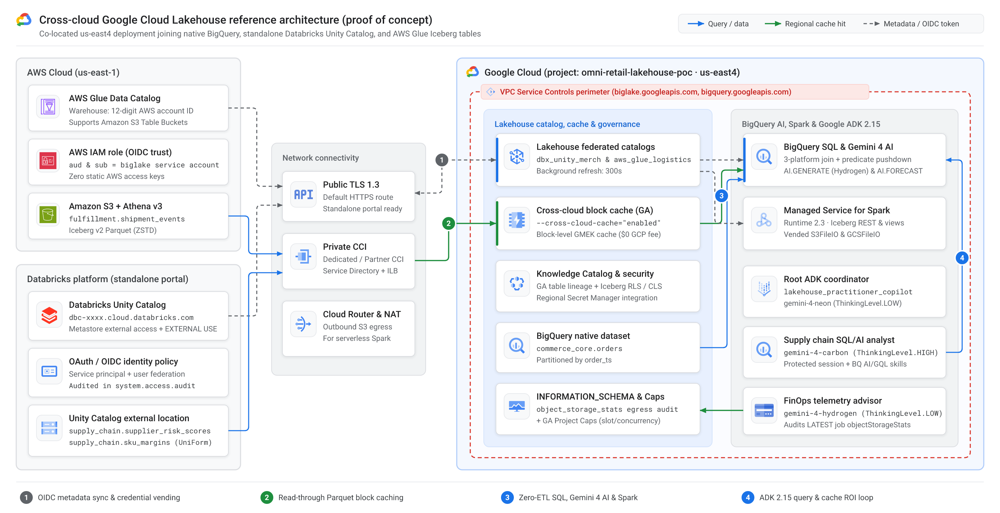
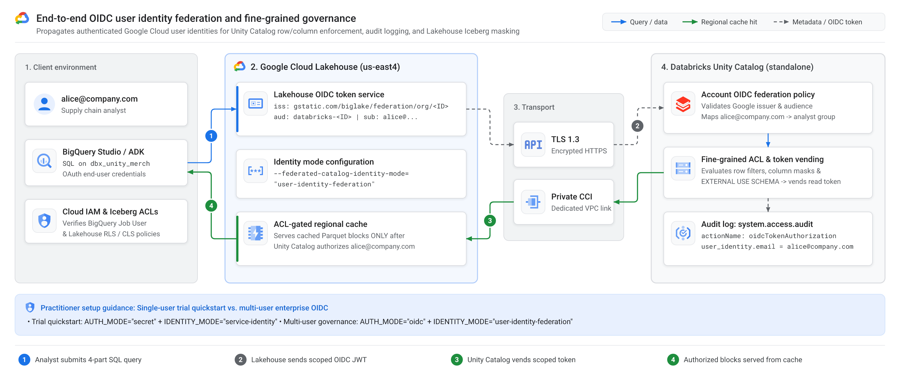
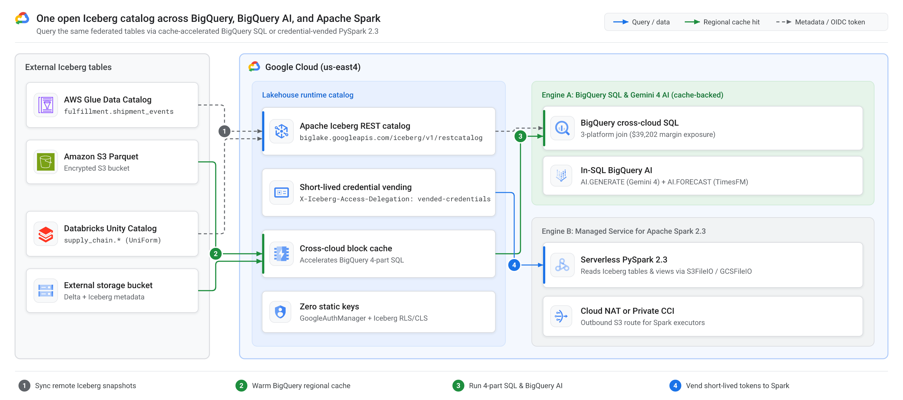

# How to query Databricks Unity Catalog and AWS Glue in place with Google Cloud Lakehouse, cross-cloud caching, and Google ADK


Most enterprise data teams no longer live in a single cloud—checkout orders land in **BigQuery**, merchandising and supplier risk models live in **Databricks Unity Catalog**, and carrier shipment events stream into **Amazon S3** behind **AWS Glue**. Historically, joining those three datasets meant choosing between two painful options: maintain fragile ETL pipelines that duplicate terabytes across clouds, or query remote storage directly and watch cloud egress bills explode—especially when autonomous AI agents run five or six follow-up SQL queries per investigation (`345.6 TB/month`, or roughly **$31,104/month** in uncached egress across 40 daily investigations on a 48 GB table).

With the General Availability (GA) of [cross-cloud federated catalogs and cross-cloud caching in Google Cloud Lakehouse](https://docs.cloud.google.com/lakehouse/docs/release-notes), cloud practitioners can synchronize metadata from **Databricks Unity Catalog**, **AWS Glue Data Catalog**, **Snowflake Horizon Catalog**, and **Workday Data Lake**, query **Apache Iceberg** tables directly in place from **BigQuery** and **Apache Spark**, and cache active Parquet column blocks inside a Google Cloud region at **$0 additional Google Cloud fee**.

First, we break down the core cross-cloud strengths of Google Cloud Lakehouse in plain terms—covering zero-ETL catalog federation, ACL-verified regional block caching, OpenID Connect (OIDC) user identity federation, and the latest November 2026 Google Data Cloud capabilities (**Knowledge Catalog** lineage, **Iceberg row/column security**, **BigQuery AI with Gemini 4**, and **BigQuery Project Caps**). Second, we walk step by step through provisioning AWS Glue, a standalone Databricks Unity Catalog workspace, BigQuery, Managed Service for Apache Spark, and a tiered **Google ADK 2.15** copilot powered by **Gemini 4 Neon**, **Gemini 4 Carbon**, and **Gemini 4 Hydrogen**. Finally, we apply this architecture to a real-world retail supply chain disruption scenario, quantify 30-day multi-cloud cost savings, explore five additional enterprise use cases, and cleanly tear down every proof-of-concept resource.

> **Proof-of-concept disclaimer:** Everything in this article and the [companion GitHub repository (`cmanikandan/gcp-borderless-lakehouse-adk`)](https://github.com/cmanikandan/gcp-borderless-lakehouse-adk) is an educational proof of concept (POC) built from a cloud practitioner's perspective to validate cross-cloud capabilities hands-on. Before deploying production workloads, always consult the official [Google Cloud Lakehouse documentation](https://docs.cloud.google.com/lakehouse/docs/about-cross-cloud-data-access), [Databricks Unity Catalog documentation](https://docs.databricks.com/en/data-governance/unity-catalog/index.html), and [AWS Glue Apache Iceberg documentation](https://docs.aws.amazon.com/glue/latest/dg/aws-glue-programming-etl-format-iceberg.html) for production security hardening, IAM least-privilege policies, networking, and service limits.

---

## Understanding core Google Cloud Lakehouse cross-cloud strengths

Before running a single CLI command, it helps to see *why* traditional multi-cloud architectures struggle and how **Google Cloud Lakehouse** changes the operating model:

| Architectural dimension | Traditional cross-cloud ETL | Uncached query federation | Google Cloud Lakehouse (GA) |
| :--- | :--- | :--- | :--- |
| **Data movement & freshness** | Copies full tables on brittle schedules; hours of lag | Reads remote storage live on every query | Syncs lightweight Iceberg snapshot pointers (`300s`); caches hot Parquet blocks locally |
| **Cross-cloud egress cost** | Pays egress on every batch sync—even for unread rows | Pays repeated egress on every BI refresh or AI loop | **1x cold read** for projected columns; **$0 repeat egress** on warm cache hits (`$0` GCP cache fee) |
| **Credentials & security** | Long-lived cloud keys stored on ETL workers | Shared service-account credentials | Short-lived credential vending, **OIDC user identity federation**, **VPC-SC**, & **Iceberg RLS/CLS** |
| **Compute & AI engines** | Locked into destination warehouse format | Single SQL engine only | **BigQuery SQL**, **BigQuery AI (`AI.GENERATE`, `AI.FORECAST`)**, **Managed Spark 2.3**, & **Trino** |

> **2026 Google Cloud naming quick-reference:** **BigLake** is now **Google Cloud Lakehouse**, **BigLake metastore** is now the **Lakehouse runtime catalog**, and **Dataplex Universal Catalog** is now **Google Cloud Knowledge Catalog**. To preserve backwards compatibility, existing CLI commands (`gcloud biglake iceberg ...`), REST endpoints (`biglake.googleapis.com`), and IAM roles remain unchanged.

Six technical strengths make Google Cloud Lakehouse uniquely effective for real-world cross-cloud workloads:

* **Zero-ETL catalog federation across four ecosystems (GA):** Setting `--catalog-type="federated"` instructs the Lakehouse runtime catalog to synchronize namespaces and Apache Iceberg metadata pointers in the background from **Databricks Unity Catalog** (on AWS, Azure, Google Cloud, or standalone via the Databricks portal), **AWS Glue Data Catalog** (including **Amazon S3 Table Buckets**), **Snowflake Horizon Catalog**, and **Workday Data Lake**. No data is copied during catalog sync, and no remote Databricks or Snowflake compute clusters are spun up when BigQuery reads the tables.
* **ACL-verified cross-cloud block caching at $0 extra Google Cloud fee (GA):** Disabled by default so you stay in full control of data residency, opting into cross-cloud caching stores active Parquet column blocks in Google-managed regional cache (`us-east4` in our POC). Crucially, caching **never** sacrifices freshness or security: every BigQuery query still performs a lightweight remote snapshot and access-control check first, fetching only newly appended delta blocks while serving unchanged blocks at local BigQuery speed.
* **Zero static keys, private networking, and fine-grained Iceberg security:** Compute engines never hold static AWS keys or Databricks tokens; the Lakehouse runtime catalog vends short-lived, table-scoped credentials per query. Traffic routes over TLS 1.3 or privately over **Cross-Cloud Interconnect** inside **VPC Service Controls** perimeters. For **Databricks Unity Catalog**, **OIDC user identity federation** propagates the caller's Google identity (`alice@company.com`) end to end for row/column enforcement and `system.access.audit` logging—complemented on Google Cloud by **Knowledge Catalog** table-level lineage (GA) and **Lakehouse row-level security and column-level dynamic data masking** on Apache Iceberg tables.
* **Open multi-engine interoperability on Apache Iceberg:** Because Lakehouse exposes a standard Apache Iceberg REST Catalog (`https://biglake.googleapis.com/iceberg/v1/restcatalog`) supporting native Iceberg tables, Delta Lake tables with **Iceberg UniForm**, REST metrics reporting, and **Apache Iceberg views** (Preview), your SQL analysts in **BigQuery** and data scientists in **Managed Service for Apache Spark 2.3** query the exact same single source of truth.
* **In-warehouse Gemini 4 AI and zero-shot forecasting without moving data:** Federated 4-part tables (`project.catalog.namespace.table`) plug directly into BigQuery's generative and predictive SQL functions—including **`AI.GENERATE`**, **`AI.IF`**, and **`AI.CLASSIFY`** (with GA support for **Gemini 4 Carbon**, **Gemini 4 Neon**, and **Gemini 4 Hydrogen**, plus GA optimized mode for high-row-count classification) as well as zero-shot **`AI.FORECAST`** powered by **TimesFM**.
* **Two-layer FinOps protection for autonomous AI agents:** Multi-agent workflows built with **Google ADK 2.15** naturally run iterative SQL drill-downs. Pairing **Lakehouse cross-cloud caching** (which caps *remote cloud storage egress*) with **BigQuery Project Caps** (GA scheduling policies that cap *slot usage and concurrency* per project in shared Enterprise reservations) keeps both network and compute budgets completely predictable.

---

## Step-by-step implementation and code walkthrough

To see these capabilities working together end to end, we build **OmniRetail Horizon**—a cross-cloud supply chain resilience workspace spanning three separate platforms with zero ETL pipelines:

| Business domain | Hosting platform | Open format | How BigQuery queries it |
| :--- | :--- | :--- | :--- |
| **Live customer checkout orders** | **Google Cloud BigQuery** (`us-east4`) | Native BigQuery table | `` `omni-retail-lakehouse-poc.commerce_core.orders` `` *(3-part)* |
| **Supplier risk & SKU unit margins** | **Standalone Databricks portal** (`Unity Catalog`) | Delta Lake + **Iceberg UniForm** | `` `omni-retail-lakehouse-poc.dbx_unity_merch.supply_chain.*` `` *(4-part)* |
| **Carrier shipment delay telemetry** | **AWS Cloud** (`AWS Glue` + `Amazon S3`, `us-east-1`) | **Apache Iceberg v2** Parquet | `` `omni-retail-lakehouse-poc.aws_glue_logistics.fulfillment.shipment_events` `` *(4-part)* |



You do not need pre-existing cloud infrastructure to try this out: clone the [companion GitHub repository](https://github.com/cmanikandan/gcp-borderless-lakehouse-adk) to run the 30-second offline topology and FinOps simulator (`make install && make test && make inspect-agent && make demo-finops`), or follow the five steps below to provision all three clouds from scratch.

<details>
<summary><b>Prerequisites and environment variables (click to expand)</b></summary>

* **Google Cloud CLI (`gcloud` and `bq`)** authenticated to a Google Cloud project with billing enabled.
* **AWS CLI (`aws`)** authenticated to an AWS account with permissions for Amazon S3, AWS Glue, Amazon Athena, and AWS IAM.
* **Standalone Databricks workspace** accessed via [login.databricks.com](https://login.databricks.com). *(Hands-on tier note: Databricks Free Edition uses a shared multi-tenant metastore where the Metastore Admin **External data access** toggle is locked; use a free 14-day Databricks trial workspace for full Unity Catalog federation, or pass `--glue-only` to test BigQuery + AWS Glue standalone first.)*
* **Python 3.11+** and [`uv`](https://docs.astral.sh/uv/).

```bash
git clone https://github.com/cmanikandan/gcp-borderless-lakehouse-adk.git
cd gcp-borderless-lakehouse-adk

export PROJECT_ID="your-gcp-project-id"
export GCP_REGION="us-east4"      # Co-located near AWS us-east-1 (~1–2 ms RTT)
export AWS_REGION="us-east-1"
```

</details>

### 1. Federating AWS Glue and Amazon S3 with secretless OpenID Connect

First, [`00_bootstrap_aws_s3_glue_iceberg.sh`](https://github.com/cmanikandan/gcp-borderless-lakehouse-adk/blob/main/infra/aws-glue/00_bootstrap_aws_s3_glue_iceberg.sh) provisions a private encrypted Amazon S3 bucket in `us-east-1`, creates the `fulfillment` database in AWS Glue, and uses serverless **Amazon Athena Engine v3** to create and populate an Apache Iceberg v2 table (`fulfillment.shipment_events`) with zero EC2 or EMR clusters.

Next, [`setup_glue_federation.sh`](https://github.com/cmanikandan/gcp-borderless-lakehouse-adk/blob/main/infra/aws-glue/setup_glue_federation.sh) creates the federated catalog in Google Cloud (`us-east4`) with cross-cloud caching enabled, retrieves the unique Google-managed service account (`biglake-service-account-id`) generated for that catalog, and locks the AWS IAM role's OIDC trust policy (`accounts.google.com:aud` and `:sub`) to that exact identity:

```bash
# 1. Provision private S3 bucket + Glue DB + Apache Iceberg v2 table via Athena v3
bash infra/aws-glue/00_bootstrap_aws_s3_glue_iceberg.sh

# 2. Create the federated Glue catalog with regional cross-cloud caching enabled
# Practitioner tip: --glue-warehouse takes your 12-digit AWS account ID (or
# "${AWS_ACCOUNT_ID}:s3tablescatalog/<bucket>" for Amazon S3 Table Buckets)—never an s3:// URI!
gcloud biglake iceberg catalogs create aws_glue_logistics \
  --project="${PROJECT_ID}" \
  --catalog-type="federated" \
  --federated-catalog-type="glue" \
  --glue-warehouse="${AWS_ACCOUNT_ID}" \
  --glue-aws-region="us-east-1" \
  --glue-aws-role-arn="arn:aws:iam::${AWS_ACCOUNT_ID}:role/lakehouse_glue_federation_role" \
  --cross-cloud-cache="enabled" \
  --primary-location="us-east4"
```

### 2. Connecting standalone Databricks Unity Catalog with Iceberg UniForm

Google Cloud Lakehouse connects directly to your **Databricks Unity Catalog** REST endpoint (`dbc-xxxx.cloud.databricks.com`), regardless of where Databricks is hosted. Follow the click-by-click portal checklist in [`infra/databricks-unity/README.md`](https://github.com/cmanikandan/gcp-borderless-lakehouse-adk/blob/main/infra/databricks-unity/README.md) to satisfy three Unity Catalog requirements:

1. Toggle **External data access** ON under **Catalog > Metastore Settings**.
2. Register an **External Location** ([`00_prepare_uc_external_storage.sh`](https://github.com/cmanikandan/gcp-borderless-lakehouse-adk/blob/main/infra/databricks-unity/00_prepare_uc_external_storage.sh))—Lakehouse reads external locations rather than Databricks internal `default storage`.
3. Grant **`EXTERNAL USE SCHEMA`** to your service principal or federated analyst group so Unity Catalog vends short-lived storage credentials.

Run [`databricks_uc_setup.sql`](https://github.com/cmanikandan/gcp-borderless-lakehouse-adk/blob/main/infra/databricks-unity/databricks_uc_setup.sql) in the Databricks SQL Editor to create `supplier_risk_scores` and `sku_margins` with **Delta UniForm (`iceberg`)** enabled—automatically generating Iceberg metadata alongside Delta logs—and then federate the catalog with [`setup_unity_federation.sh`](https://github.com/cmanikandan/gcp-borderless-lakehouse-adk/blob/main/infra/databricks-unity/setup_unity_federation.sh):

```bash
# Supports AUTH_MODE="secret" (Regional Secret Manager quickstart) or two-phase secretless
# AUTH_MODE="oidc" + --federated-catalog-identity-mode="user-identity-federation"
gcloud biglake iceberg catalogs create dbx_unity_merch \
  --project="${PROJECT_ID}" \
  --catalog-type="federated" \
  --federated-catalog-type="unity" \
  --unity-instance-name="dbc-a1b2c3d4-e5f6.cloud.databricks.com" \
  --unity-catalog-name="omniretail_merch" \
  --unity-service-principal-application-id="${DBX_SP_CLIENT_ID}" \
  --federated-catalog-identity-mode="user-identity-federation" \
  --refresh-interval="300s" \
  --cross-cloud-cache="enabled" \
  --primary-location="us-east4"
```



### 3. Querying and enriching across clouds with BigQuery SQL, BigQuery AI, and Spark

Once native orders are seeded (`bash infra/gcp-bigquery/setup_bigquery_native.sh`), **BigQuery** joins native Google Cloud tables (3-part names) with federated Databricks Unity Catalog and AWS Glue tables (4-part names: `` `project.catalog.namespace.table` ``) in a single standard SQL statement ([`02_cross_cloud_supply_chain_join.sql`](https://github.com/cmanikandan/gcp-borderless-lakehouse-adk/blob/main/sql/02_cross_cloud_supply_chain_join.sql))—and with November 2026's GA **Gemini 4** support in BigQuery AI ([`05_cross_cloud_bigquery_ai_insights.sql`](https://github.com/cmanikandan/gcp-borderless-lakehouse-adk/blob/main/sql/05_cross_cloud_bigquery_ai_insights.sql)), you can even generate structured mitigation plans via **`AI.GENERATE`** (`endpoint => 'gemini-4-hydrogen'`) and 7-day carrier delay projections via **`AI.FORECAST`** directly in SQL:

```sql
WITH cross_cloud_exposure AS (
  SELECT
    o.customer_region,
    m.category,
    m.product_name,
    r.supplier_name,
    r.geopolitical_risk_score,
    s.carrier,
    s.delay_hours,
    ROUND(SUM(o.quantity * (o.unit_sale_price_usd - m.unit_cost_usd)), 2) AS gross_margin_exposure_usd
  FROM `omni-retail-lakehouse-poc.commerce_core.orders` AS o
  INNER JOIN `omni-retail-lakehouse-poc.dbx_unity_merch.supply_chain.sku_margins` AS m
    ON o.sku_id = m.sku_id
  INNER JOIN `omni-retail-lakehouse-poc.dbx_unity_merch.supply_chain.supplier_risk_scores` AS r
    ON m.supplier_id = r.supplier_id
  INNER JOIN `omni-retail-lakehouse-poc.aws_glue_logistics.fulfillment.shipment_events` AS s
    ON o.order_id = s.order_id
  WHERE o.order_ts >= TIMESTAMP_SUB(CURRENT_TIMESTAMP(), INTERVAL 7 DAY)
    AND (s.delay_hours > 12 OR r.geopolitical_risk_score >= 0.65)
  GROUP BY 1, 2, 3, 4, 5, 6, 7
)
SELECT
  customer_region,
  category,
  supplier_name,
  carrier,
  delay_hours,
  gross_margin_exposure_usd,
  AI.GENERATE(
    CONCAT(
      'Recommend an expedite action for ', category, ' from ', supplier_name,
      ' (carrier=', carrier, ', delay_hours=', CAST(delay_hours AS STRING), ').'
    ),
    endpoint => 'gemini-4-hydrogen',
    output_schema => 'expedite_priority STRING, recommended_carrier_action STRING'
  ) AS mitigation_plan
FROM cross_cloud_exposure
ORDER BY gross_margin_exposure_usd DESC;
```



Need distributed Python feature engineering over those exact same federated tables? Point **Google Cloud Managed Service for Apache Spark** (runtime `2.3`) at the Lakehouse Iceberg REST Catalog ([`cross_cloud_margin_risk_job.py`](https://github.com/cmanikandan/gcp-borderless-lakehouse-adk/blob/main/spark/cross_cloud_margin_risk_job.py)), where `GoogleAuthManager` and `X-Iceberg-Access-Delegation=vended-credentials` vend short-lived S3 and GCS tokens automatically:

```python
spark = (
    SparkSession.builder.appName("borderless-lakehouse-margin-risk")
    .config("spark.sql.catalog.aws_glue_logistics", "org.apache.iceberg.spark.SparkCatalog")
    .config("spark.sql.catalog.aws_glue_logistics.type", "rest")
    .config("spark.sql.catalog.aws_glue_logistics.uri", "https://biglake.googleapis.com/iceberg/v1/restcatalog")
    .config("spark.sql.catalog.aws_glue_logistics.warehouse", f"bl://projects/{project_id}/catalogs/aws_glue_logistics")
    .config("spark.sql.catalog.aws_glue_logistics.header.X-Iceberg-Access-Delegation", "vended-credentials")
    .config("spark.sql.catalog.aws_glue_logistics.rest.auth.type", "org.apache.iceberg.gcp.auth.GoogleAuthManager")
    .config("spark.sql.catalog.aws_glue_logistics.io-impl", "org.apache.iceberg.aws.s3.S3FileIO")
    .getOrCreate()
)
```

### 4. Enabling and auditing cross-cloud caching in Google Cloud Lakehouse


Google Cloud Lakehouse offers **two GA opt-in surfaces** for cross-cloud caching (both disabled by default, with **$0 additional Google Cloud fee**):

| Opt-in surface | Best suited for | GA command / property |
| :--- | :--- | :--- |
| **Lakehouse federated catalog** | Zero-ETL catalog sync across Unity Catalog, AWS Glue, Snowflake Horizon, and Workday | `gcloud biglake iceberg catalogs update <CATALOG> --cross-cloud-cache="enabled"` |
| **BigQuery cross-cloud connection** | Standalone Lakehouse Iceberg, Delta, or Parquet tables on S3 or Azure ([script](https://github.com/cmanikandan/gcp-borderless-lakehouse-adk/blob/main/infra/gcp-bigquery/setup_bq_cross_cloud_connection_cache.sh)) | `bq mk --connection --connection_type="AWS" --properties='{"accessRole":...,"crossCloudCacheOptions":{"enabled":true}}'` |

To prove storage-level block caching independently of BigQuery's SQL result cache, [`run_cross_cloud_join.sh`](https://github.com/cmanikandan/gcp-borderless-lakehouse-adk/blob/main/scripts/run_cross_cloud_join.sh) runs the join twice with `--nouse_cache` and inspects `statistics.query.objectStorageStats` (plus fleet-wide `INFORMATION_SCHEMA.JOBS_BY_PROJECT` in [`04_finops_org_cache_audit.sql`](https://github.com/cmanikandan/gcp-borderless-lakehouse-adk/blob/main/sql/04_finops_org_cache_audit.sql)):

```json
[
  {
    "cloudProvider": "AWS",
    "cacheBytesRead": "46200000000",
    "objectStorageBytesRead": "1800000000"
  }
]
```

On the warm run, **96.25% of scanned bytes (`46.2 GB`)** are served locally from the Google Cloud regional cache in `us-east4`, while only `1.8 GB` of newly committed Iceberg snapshot blocks cross the cloud boundary.

### 5. Orchestrating tiered Gemini 4 agents with Google ADK 2.15


In November 2026, Google completed the four-model **Gemini 4** family (**Gemini 4 Carbon**, **Gemini 4 Argon**, **Gemini 4 Neon**, and **Gemini 4 Hydrogen**) alongside **Google ADK 2.15**—which ships pre-packaged BigQuery AI/ML and BigQuery Graph skills (`get_bigquery_skill`), session-isolated `WriteMode.PROTECTED`, and streaming agent observability (`BigQueryAgentAnalyticsPlugin`).

Rather than forcing one model onto every task, [`src/lakehouse_agent/config.py`](https://github.com/cmanikandan/gcp-borderless-lakehouse-adk/blob/main/src/lakehouse_agent/config.py) and [`src/lakehouse_agent/agent.py`](https://github.com/cmanikandan/gcp-borderless-lakehouse-adk/blob/main/src/lakehouse_agent/agent.py) assign each specialist agent to its ideal Gemini 4 tier (`MODEL_PROFILE="tiered"`, with CLI overrides `--model-profile argon-tiered|neon|carbon|argon|hydrogen|flash`):

| ADK 2.15 agent role | Default model (`tiered`) | `ThinkingLevel` | Why this Gemini 4 model fits |
| :--- | :--- | :--- | :--- |
| **Coordinator (`lakehouse_practitioner_copilot`)** | **`gemini-4-neon`** | `LOW` | Frontier intelligence with fast end-to-end turn completion (`$3/$15` per 1M tokens) for intent decomposition and crisp synthesis. |
| **Cross-cloud SQL & AI analyst (`cross_cloud_supply_chain_analyst`)** | **`gemini-4-carbon`** | `HIGH` | Deepest multi-step reasoning across 4-part cross-cloud SQL joins, `AI.FORECAST`, `AI.GENERATE`, and anomaly/driver analysis. |
| **Cache & capacity FinOps advisor (`finops_cache_telemetry_advisor`)** | **`gemini-4-hydrogen`** | `LOW` | High-throughput Gemini 4 Flash-tier model (`$1.50/$7.50` per 1M tokens) purpose-built for fast `objectStorageStats` JSON inspection. |

Our ADK 2.15 implementation also wires five practical engineering guardrails:

1. **4-part federated catalog discovery (`discover_federated_catalog_tables`):** Standard `BigQueryToolset` metadata tools (`list_dataset_ids`) only see 3-part BigQuery datasets; our custom tool queries the Lakehouse Iceberg REST endpoint to list 4-part Unity Catalog and AWS Glue schemas and snapshot IDs. *(Note: For simple 3-part read-only SQL from external MCP clients, you can also connect directly to Google's managed **BigQuery MCP server** at `https://bigquery.googleapis.com/mcp` using `execute_sql_readonly`.)*
2. **Session-isolated `WriteMode.PROTECTED` + built-in BigQuery skills:** `WriteMode.PROTECTED` verifies via dry-run that permanent BigQuery and federated Iceberg tables can never be modified, while permitting anonymous session temp tables so ADK's built-in `forecast`, `detect_anomalies`, and `analyze_contribution` tools work seamlessly alongside `SkillToolset` (`bigquery-ai-ml` and `bigquery-graph`).
3. **Decode & endpoint cost guardrails (`max_output_tokens=8192` + `global` endpoint):** Caps Gemini 4's 1M-token decode window per turn and routes model calls through `GOOGLE_CLOUD_LOCATION=global` (avoiding the 10% regional endpoint surcharge) while keeping BigQuery co-located in `us-east4`.
4. **Dynamic `llm_model` job labels & `BigQueryAgentAnalyticsPlugin`:** Every SQL job stamps `job_labels={"workload": "borderless-lakehouse-adk", "llm_model": ...}` for `job_id="LATEST"` cache lookup, and setting `ENABLE_BQ_AGENT_ANALYTICS=true` streams ADK agent traces directly into BigQuery via `build_lakehouse_app()`:

```python
from google.adk.agents import Agent
from google.adk.apps import App
from google.adk.integrations.bigquery import (
    BigQueryToolset,
    get_bigquery_skill,
)
from google.adk.integrations.bigquery.config import BigQueryToolConfig, WriteMode
from google.adk.planners import BuiltInPlanner
from google.adk.tools.skill_toolset import SkillToolset
from google.genai import types

from lakehouse_agent.cache_telemetry import (
    inspect_bigquery_job_cache_stats,
    simulate_agentic_burst_finops,
)
from lakehouse_agent.catalog_discovery import discover_federated_catalog_tables
from lakehouse_agent.config import load_settings, sanitize_bq_label

def build_copilot() -> App:
    cfg = load_settings()  # Default tiered: Neon + Carbon + Hydrogen
    bounded_output = types.GenerateContentConfig(max_output_tokens=cfg.max_output_tokens)

    bq_skills = SkillToolset(
        skills=[get_bigquery_skill("bigquery-ai-ml"), get_bigquery_skill("bigquery-graph")]
    )
    bq_toolset = BigQueryToolset(
        bigquery_tool_config=BigQueryToolConfig(
            write_mode=WriteMode.PROTECTED,
            location=cfg.gcp_region,
            compute_project_id=cfg.project_id,
            maximum_bytes_billed=cfg.max_bytes_billed,
            job_labels={
                "workload": "borderless-lakehouse-adk",
                "llm_model": sanitize_bq_label(cfg.resolved_analyst_model),
            },
        ),
        tool_filter=[
            "execute_sql", "forecast", "detect_anomalies", "analyze_contribution",
            "list_dataset_ids", "get_dataset_info", "list_table_ids", "get_table_info", "get_job_info",
        ],
    )

    analyst = Agent(
        name="cross_cloud_supply_chain_analyst",
        model=cfg.resolved_analyst_model,      # gemini-4-carbon
        planner=BuiltInPlanner(thinking_config=types.ThinkingConfig(thinking_level=types.ThinkingLevel.HIGH)),
        generate_content_config=bounded_output,
        instruction="Discover 4-part federated schemas and run cache-friendly cross-cloud SQL & BigQuery AI.",
        tools=[bq_toolset, bq_skills, discover_federated_catalog_tables],
    )
    finops_advisor = Agent(
        name="finops_cache_telemetry_advisor",
        model=cfg.resolved_finops_model,       # gemini-4-hydrogen
        planner=BuiltInPlanner(thinking_config=types.ThinkingConfig(thinking_level=types.ThinkingLevel.LOW)),
        generate_content_config=bounded_output,
        instruction="Call `inspect_bigquery_job_cache_stats(job_id='LATEST')` to report cross-cloud cache ROI.",
        tools=[inspect_bigquery_job_cache_stats, simulate_agentic_burst_finops],
    )
    coordinator = Agent(
        name="lakehouse_practitioner_copilot",
        model=cfg.resolved_coordinator_model,  # gemini-4-neon
        planner=BuiltInPlanner(thinking_config=types.ThinkingConfig(thinking_level=types.ThinkingLevel.LOW)),
        generate_content_config=bounded_output,
        instruction="Coordinate cross-cloud supply chain analytics and regional cache FinOps.",
        sub_agents=[analyst, finops_advisor],
    )
    return App(name="borderless_lakehouse_poc", root_agent=coordinator)
```

---

## Real-world application: Solving supply chain disruption at OmniRetail Horizon

### Pinpointing margin exposure across three clouds in seconds

Imagine a port slowdown hits East Coast apparel and electronics shipments on Monday morning. At *OmniRetail Horizon*, no single team owns the full picture: checkout orders sit in **BigQuery** (`commerce_core.orders`), supplier geopolitical risk scores and unit costs sit in **standalone Databricks Unity Catalog** (`omniretail_merch.supply_chain.*`), and live carrier delay hours sit in **AWS Glue on Amazon S3** (`fulfillment.shipment_events`).

When a supply chain planner asks the ADK copilot, *"Which US-NORTHEAST categories face the highest gross margin exposure over the past 7 days, what expedite action should we take, and did our query hit the regional cache?"*:

1. **Gemini 4 Neon** decomposes the question and routes the analytical work to **Gemini 4 Carbon**.
2. **Gemini 4 Carbon** discovers the 4-part table schemas and runs the 3-platform join with `delay_hours > 12 OR geopolitical_risk_score >= 0.65` predicate pushdown—automatically pruning healthy Midwest order `ORD-8803` (`2h` delay, `0.14` risk on `NordicFreight`) at the storage layer and surfacing **`$39,202.00` in total gross margin exposure** (`$72,250.00` gross revenue at risk):

| `customer_region` | `category` | `supplier_name` | `geopolitical_risk_score` | `carrier` | `delay_hours` | `affected_orders` | `gross_margin_exposure_usd` |
| :--- | :--- | :--- | ---: | :--- | ---: | ---: | ---: |
| `US-NORTHEAST` | `Apparel` | `Pacific Rim Textiles` | `0.69` | `PacificAirCargo` | `19` | `1` | `24412.00` |
| `US-NORTHEAST` | `Electronics` | `Apex MicroSystems` | `0.78` | `OceanicExpress` | `28` | `1` | `7740.00` |
| `US-WEST` | `Packaging` | `Great Lakes Packaging` | `0.11` | `GreatLakesRail` | `36` | `1` | `7050.00` |

3. **Gemini 4 Hydrogen** inspects `job_id="LATEST"` via `statistics.query.objectStorageStats` and confirms that **96.25%** of the remote bytes were served directly from the `us-east4` regional cache.

### Quantifying 30-day multi-cloud egress savings on agentic workloads

Because AI agents explore anomalies iteratively over recent partitions, enabling cross-cloud caching fundamentally changes the unit economics of cross-cloud analytics (`make demo-finops`):

| Deployment pattern (40 daily 6-query agent investigations × 48 GB) | Monthly remote egress | Estimated monthly egress cost | Savings vs. uncached |
| :--- | ---: | ---: | ---: |
| **Uncached cross-cloud federation** (public internet @ $0.09/GB) | `345.6 TB` | `$31,104` | — |
| **Google Cloud Lakehouse caching** (public internet, 92% warm cache hit) | `27.6 TB` | `$2,488` | **92.0% saved** |
| **Google Cloud Lakehouse caching + Cross-Cloud Interconnect** (@ $0.02/GB) | `27.6 TB` | `$553` | **98.2% saved** |

<details>
<summary><b>Troubleshooting checklist for hands-on testing (click to expand)</b></summary>

* **Databricks catalog sync succeeds, but `0` tables appear:** Confirm **External data access** is toggled ON in Unity Catalog Metastore Settings, your schema uses an **External Location** (not Databricks `default storage`), `DESCRIBE EXTENDED` shows an Iceberg `Metadata Location`, and your principal has `EXTERNAL USE SCHEMA`.
* **`cacheBytesRead` stays `0` on repeat `--nouse_cache` runs:** Verify `--cross-cloud-cache="enabled"` on the federated catalog (or `crossCloudCacheOptions.enabled=true` on the BigQuery connection) and confirm organization policy `constraints/gcp.restrictNonCmekServices` is not blocking Google-managed cache encryption (`uv run python scripts/preflight_doctor.py --check-cloud`).
* **Managed Spark batch times out reaching Amazon S3:** Serverless Spark executors use internal IPs by default; run `ENSURE_CLOUD_NAT=true bash spark/submit_managed_spark_batch.sh` to attach Cloud Router and Cloud NAT (or route privately over Cross-Cloud Interconnect).

</details>

### Cleaning up your proof-of-concept resources

Because this POC spans three cloud environments, tear down your test resources once you finish experimenting to avoid ongoing storage or NAT charges. Run [`infra/teardown_all.sh`](https://github.com/cmanikandan/gcp-borderless-lakehouse-adk/blob/main/infra/teardown_all.sh) to remove the Google Cloud federated catalogs, regional secret, BigQuery connection and dataset, Cloud NAT gateway (if created), Cloud Storage buckets, AWS Glue database/table, OIDC IAM role, and Amazon S3 bucket in one command:

```bash
export PROJECT_ID="your-gcp-project-id"
export GCP_REGION="us-east4"
export AWS_REGION="us-east-1"

bash infra/teardown_all.sh
```

Then run these three cleanup statements in your **Databricks SQL Editor** (and delete your test service principal under **Settings > Identity and access > Service principals**):

```sql
DROP CATALOG IF EXISTS omniretail_merch CASCADE;
DROP EXTERNAL LOCATION IF EXISTS lakehouse_poc_ext_loc;
DROP STORAGE CREDENTIAL IF EXISTS lakehouse_poc_cred;
```

---

## Conclusion and next steps

With **cross-cloud federated catalogs (GA)** and **cross-cloud caching (GA)**, **Google Cloud Lakehouse** turns distributed data silos across **Databricks Unity Catalog**, **AWS Glue Data Catalog**, **Snowflake Horizon Catalog**, and **Workday Data Lake** into a single, governed, open **Apache Iceberg** foundation—without copying data or paying repeated egress penalties. Pairing that foundation with **BigQuery AI**, **Knowledge Catalog**, **BigQuery Project Caps**, and tiered **Google ADK 2.15** agents (**Gemini 4 Neon**, **Gemini 4 Carbon**, and **Gemini 4 Hydrogen**) lets engineering teams move straight from raw multi-cloud tables to trusted, cost-bounded autonomous insights.

### Additional cross-cloud use cases unlocked by this architecture

Beyond retail supply chain risk, the exact same federation, regional caching, credential-vending, and multi-model ADK patterns apply directly across industries:

* **Post-merger financial diligence and close reconciliation (`Snowflake Horizon Catalog` + `Databricks Unity Catalog` + `BigQuery`):** Join acquired billing ledgers in **Snowflake Horizon Catalog**, ML churn/credit scores in **Databricks Unity Catalog**, and core ERP actuals in **BigQuery** using **BigQuery Measures (GA)** to prevent fan-out double-counting—while regional caching absorbs repetitive close-week variance queries.
* **Workforce capacity and operational margin planning (`Workday Data Lake` + `AWS Glue` + `BigQuery`):** Combine governed HR and shift-staffing datasets in **Workday Data Lake** with fulfillment labor/IoT telemetry in **AWS Glue** and finance budgets in **BigQuery**, keeping sensitive workforce records governed in place with **Lakehouse Iceberg row/column masking**.
* **Autonomous cybersecurity threat hunting and graph investigation (`Amazon S3 Table Buckets` + `BigQuery Graph` + `Gemini 4 Carbon`):** Retain petabytes of CloudTrail, VPC Flow, and EDR logs as Apache Iceberg tables in **AWS Glue / Amazon S3 Table Buckets** inside a **VPC Service Controls** perimeter—using **BigQuery Graph (GQL)** and **Gemini 4 Carbon** to traverse lateral-movement paths while the regional cache serves iterative pivot queries at **$0 repeat egress**.
* **Cross-cloud Customer 360 feature engineering and demand forecasting (`Managed Service for Apache Spark 2.3` + `BigQuery AI`):** Process clickstream Iceberg tables and **Apache Iceberg views** from **AWS Glue** alongside subscription cohorts from **Databricks** in **PySpark 2.3** via short-lived vended credentials, while running zero-shot **`AI.FORECAST`** and optimized-mode **`AI.CLASSIFY`** in **BigQuery**.
* **Regulated clinical and life sciences research collaboration (`OIDC user identity federation` + `Knowledge Catalog`):** Query multi-institution genomics Delta UniForm tables in **Databricks Unity Catalog** alongside clinical outcomes in **BigQuery**, enforcing per-researcher row filters, dynamic data masking, `system.access.audit` user attribution, and end-to-end **Knowledge Catalog** lineage.

### Recommended next steps

1. **Run the 30-second local quickstart:** Clone [`cmanikandan/gcp-borderless-lakehouse-adk`](https://github.com/cmanikandan/gcp-borderless-lakehouse-adk), execute `make install && make test && make inspect-agent && make demo-finops`, and compare `--model-profile tiered`, `argon-tiered`, `neon`, `carbon`, and `hydrogen`.
2. **Deploy the cross-cloud POC:** Provision AWS Glue, standalone Databricks Unity Catalog, and BigQuery (or pass `--glue-only` to test AWS Glue + BigQuery first), run [`05_cross_cloud_bigquery_ai_insights.sql`](https://github.com/cmanikandan/gcp-borderless-lakehouse-adk/blob/main/sql/05_cross_cloud_bigquery_ai_insights.sql), verify `objectStorageStats`, and run `bash infra/teardown_all.sh` when finished.
3. **Plan production governance and FinOps:** Review the official documentation below to pair **Private Cross-Cloud Interconnect**, **VPC Service Controls**, **OIDC user identity federation**, **Lakehouse Iceberg RLS/CLS**, and **BigQuery Project Caps** before moving to production.
4. **Join the conversation:** Which external catalog (**Databricks Unity Catalog**, **AWS Glue**, **Snowflake Horizon**, or **Workday Data Lake**) or **Gemini 4** capability are you exploring with Google Cloud Lakehouse? Drop your questions, architecture patterns, or benchmarks in the comments below!

### Helpful documentation and Google Developer Program community resources

**Official Google Cloud, AI & partner documentation**
* [Companion GitHub POC repository (`cmanikandan/gcp-borderless-lakehouse-adk`)](https://github.com/cmanikandan/gcp-borderless-lakehouse-adk)
* [Google Cloud Lakehouse release notes (cross-cloud caching GA, federated catalogs GA, Iceberg RLS/CLS & Iceberg views)](https://docs.cloud.google.com/lakehouse/docs/release-notes)
* [About cross-cloud data access and intelligent caching](https://docs.cloud.google.com/lakehouse/docs/about-cross-cloud-data-access#intelligent-caching) and [Query remote data](https://docs.cloud.google.com/lakehouse/docs/query-remote-data)
* [Set up cross-cloud connections: Databricks Unity Catalog](https://docs.cloud.google.com/lakehouse/docs/set-up-cross-cloud-connection-databricks) · [AWS Glue Data Catalog](https://docs.cloud.google.com/lakehouse/docs/set-up-cross-cloud-connection-aws-glue) · [Snowflake Horizon Catalog](https://docs.cloud.google.com/lakehouse/docs/set-up-cross-cloud-connection-snowflake) · [Workday Data Lake](https://docs.cloud.google.com/lakehouse/docs/set-up-cross-cloud-connection-workday)
* [BigQuery generative AI overview (`AI.GENERATE`, `AI.FORECAST`, `AI.IF`, `AI.CLASSIFY`)](https://docs.cloud.google.com/bigquery/docs/generative-ai-overview) and [BigQuery release notes (Gemini 4 models & Project Caps GA)](https://docs.cloud.google.com/bigquery/docs/release-notes)
* [Google ADK BigQuery integration](https://adk.dev/integrations/bigquery/), [BigQuery Agent Analytics plugin](https://docs.cloud.google.com/bigquery/docs/bigquery-agent-analytics), and [Managed BigQuery MCP server](https://docs.cloud.google.com/bigquery/docs/use-bigquery-mcp)
* [What's new in Gemini 4 Neon, Carbon, Hydrogen, and Argon](https://aistudio.google.com/docs/whats-new-gemini-4-neon)

**Google Developer Program forums & community formatting guides**
* [Tips and tricks to make the most of the Google Developer Program forums](https://discuss.google.dev/t/tips-and-tricks-to-make-the-most-of-the-google-developer-program-forums/154)
* [Navigating the Google Developer Program forums](https://discuss.google.dev/t/navigating-the-google-developer-program-forums/153)
* [Understanding trust levels on the Google Developer Program forums](https://discuss.google.dev/t/understanding-trust-levels-on-the-google-developer-program-forums/127)
* [Google Developer Program community guidelines and FAQ](https://discuss.google.dev/faq)
