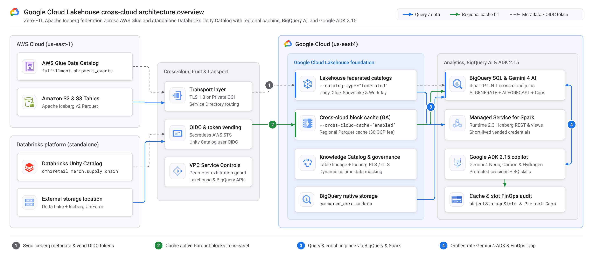
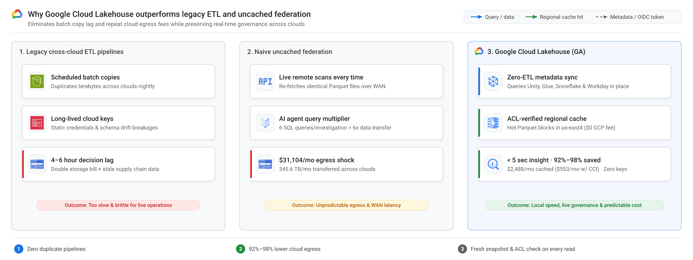
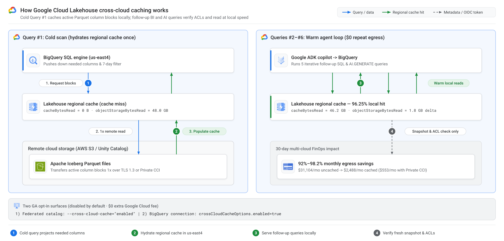
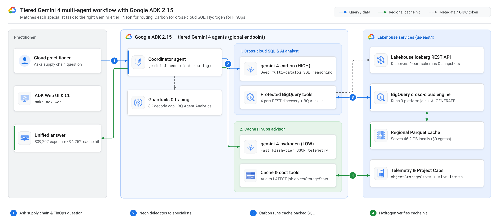

# Google Cloud Lakehouse and BigQuery for cross-cloud analytics: How to query Databricks and AWS Glue in place with cross-cloud caching and Gemini



When an East Coast port bottleneck stalls freight on Monday morning, retail operations leaders have minutes—not hours—to spot which delayed shipments threaten their highest-margin customer orders and reroute inventory before customer commitments break. Yet in most enterprises, that single answer is trapped across three platforms: live orders in **BigQuery**, supplier margins in **Databricks Unity Catalog**, and carrier telemetry on **Amazon S3** behind **AWS Glue**—forcing an ugly choice between **4–6 hour batch pipeline delays** or **~$31,104/month** in repeat cloud egress fees when AI agents query remote storage directly.

With the General Availability of [cross-cloud federated catalogs and cross-cloud caching in Google Cloud Lakehouse](https://docs.cloud.google.com/lakehouse/docs/release-notes) (formerly BigLake), you can join cross-cloud **Apache Iceberg** tables in seconds from **BigQuery**, protect margins in real time, and cut repeat cloud egress by **92%–98%** at **$0 additional Google Cloud cache fee**.

First, we compare **Google Cloud Lakehouse** visually against legacy copy pipelines and naive federation. Next, we walk through a runnable supply chain proof of concept joining **BigQuery**, standalone **Databricks Unity Catalog**, and **AWS Glue** with **BigQuery AI**, **Gemini 4**, and **Google Agent Development Kit**. Finally, we review the quantified business outcomes achieved, why this architecture wins, and five other enterprise workflows where it applies.

> **Proof-of-concept note:** This post and the [companion GitHub repository (`cmanikandan/gcp-borderless-lakehouse-adk`)](https://github.com/cmanikandan/gcp-borderless-lakehouse-adk) are an educational cloud practitioner proof of concept. Consult the official [Google Cloud Lakehouse](https://docs.cloud.google.com/lakehouse/docs/about-cross-cloud-data-access), [Databricks](https://docs.databricks.com/en/data-governance/unity-catalog/index.html), and [AWS Glue](https://docs.aws.amazon.com/glue/latest/dg/aws-glue-programming-etl-format-iceberg.html) documentation before production use.

---

## Why Google Cloud Lakehouse outperforms batch pipelines and naive federation



* **Zero-copy catalog synchronization:** Automatically syncs Apache Iceberg metadata pointers from **Databricks Unity Catalog**, **AWS Glue**, **Snowflake Horizon**, and **Workday Data Lake**—zero data copies or remote cluster spin-up.
* **Permission-verified regional caching at $0 Google Cloud fee:** Caches hot Parquet columns inside your Google Cloud region while checking remote snapshots and access policies on every read so data is never stale.
* **Zero static keys and unified governance:** Vends short-lived storage tokens, propagates caller identities into Unity Catalog audit logs, and pairs with **Google Cloud Knowledge Catalog** lineage and **Apache Iceberg** row/column masking.
* **One open catalog for BigQuery, Apache Spark, and Gemini:** Powers **BigQuery**, in-warehouse **BigQuery AI** (`AI.GENERATE`, `AI.FORECAST`), **Google Cloud Managed Service for Apache Spark**, and **Google Agent Development Kit** agents from the same snapshots.

---

## Building the cross-cloud supply chain solution

In our *OmniRetail Horizon* proof of concept, **Google Cloud Lakehouse** and **BigQuery** join three platforms in place without data movement (`make install && make demo-finops` runs a 30-second offline simulation; [`infra/`](https://github.com/cmanikandan/gcp-borderless-lakehouse-adk/tree/main/infra) provisions all three environments from scratch):

| Business dataset | Platform | Query path in BigQuery |
| :--- | :--- | :--- |
| **Live checkout orders** | **Google Cloud BigQuery** (`us-east4`) | `` `omni-retail-lakehouse-poc.commerce_core.orders` `` |
| **Supplier risk & margins** | **Standalone Databricks** (`Unity Catalog` UniForm) | `` `omni-retail-lakehouse-poc.dbx_unity_merch.supply_chain.*` `` |
| **Carrier delay events** | **AWS Cloud** (`AWS Glue` + `Amazon S3`, `us-east-1`) | `` `omni-retail-lakehouse-poc.aws_glue_logistics.fulfillment.shipment_events` `` |


### 1. Federate AWS Glue and standalone Databricks Unity Catalog into Google Cloud Lakehouse

[`setup_glue_federation.sh`](https://github.com/cmanikandan/gcp-borderless-lakehouse-adk/blob/main/infra/aws-glue/setup_glue_federation.sh) and [`setup_unity_federation.sh`](https://github.com/cmanikandan/gcp-borderless-lakehouse-adk/blob/main/infra/databricks-unity/setup_unity_federation.sh) register both external catalogs in `us-east4` with secretless OpenID Connect trust and regional caching enabled:

```bash
# 1. Federate AWS Glue (OpenID Connect trust, zero static keys)
gcloud biglake iceberg catalogs create aws_glue_logistics \
  --project="${PROJECT_ID}" --catalog-type="federated" --federated-catalog-type="glue" \
  --glue-warehouse="${AWS_ACCOUNT_ID}" --glue-aws-region="us-east-1" \
  --glue-aws-role-arn="arn:aws:iam::${AWS_ACCOUNT_ID}:role/lakehouse_glue_federation_role" \
  --cross-cloud-cache="enabled" --primary-location="us-east4"

# 2. Federate standalone Databricks Unity Catalog with end-user identity propagation
gcloud biglake iceberg catalogs create dbx_unity_merch \
  --project="${PROJECT_ID}" --catalog-type="federated" --federated-catalog-type="unity" \
  --unity-instance-name="dbc-a1b2c3d4-e5f6.cloud.databricks.com" \
  --unity-catalog-name="omniretail_merch" \
  --unity-service-principal-application-id="${DBX_SP_CLIENT_ID}" \
  --federated-catalog-identity-mode="user-identity-federation" \
  --cross-cloud-cache="enabled" --primary-location="us-east4"
```


### 2. Join and act in place with BigQuery, BigQuery AI, and Apache Spark

Using **4-part table identifiers** (`` `project.catalog.namespace.table` ``), **BigQuery** joins all three platforms and calls **`AI.GENERATE`** (`gemini-4-hydrogen`) to produce a carrier expedite plan directly in SQL ([`05_cross_cloud_bigquery_ai_insights.sql`](https://github.com/cmanikandan/gcp-borderless-lakehouse-adk/blob/main/sql/05_cross_cloud_bigquery_ai_insights.sql)):

```sql
SELECT
  o.customer_region, m.category, r.supplier_name, s.carrier, s.delay_hours,
  ROUND(SUM(o.quantity * (o.unit_sale_price_usd - m.unit_cost_usd)), 2) AS gross_margin_exposure_usd,
  AI.GENERATE(
    CONCAT('Recommend an expedite action for ', m.category, ' on ', s.carrier,
           ' delayed ', CAST(s.delay_hours AS STRING), 'h.'),
    endpoint => 'gemini-4-hydrogen',
    output_schema => 'expedite_priority STRING, recommended_action STRING'
  ) AS action_plan
FROM `omni-retail-lakehouse-poc.commerce_core.orders` AS o
JOIN `omni-retail-lakehouse-poc.dbx_unity_merch.supply_chain.sku_margins` AS m ON o.sku_id = m.sku_id
JOIN `omni-retail-lakehouse-poc.dbx_unity_merch.supply_chain.supplier_risk_scores` AS r ON m.supplier_id = r.supplier_id
JOIN `omni-retail-lakehouse-poc.aws_glue_logistics.fulfillment.shipment_events` AS s ON o.order_id = s.order_id
WHERE o.order_ts >= TIMESTAMP_SUB(CURRENT_TIMESTAMP(), INTERVAL 7 DAY)
  AND (s.delay_hours > 12 OR r.geopolitical_risk_score >= 0.65)
GROUP BY 1, 2, 3, 4, 5
ORDER BY gross_margin_exposure_usd DESC;
```

Data science teams can also read those exact same catalogs from **Google Cloud Managed Service for Apache Spark** via short-lived vended credentials ([`cross_cloud_margin_risk_job.py`](https://github.com/cmanikandan/gcp-borderless-lakehouse-adk/blob/main/spark/cross_cloud_margin_risk_job.py)):


### 3. Eliminate repeat egress with Google Cloud Lakehouse caching



Running [`run_cross_cloud_join.sh`](https://github.com/cmanikandan/gcp-borderless-lakehouse-adk/blob/main/scripts/run_cross_cloud_join.sh) with `--nouse_cache` verifies storage-level caching via BigQuery's `statistics.query.objectStorageStats`—serving **96.25% (`46.2 GB`)** of warm scans locally in `us-east4` and fetching only `1.8 GB` of newly committed delta blocks from Amazon S3.

### 4. Automate root-cause analysis with Gemini 4 and Google Agent Development Kit



In [`agent.py`](https://github.com/cmanikandan/gcp-borderless-lakehouse-adk/blob/main/src/lakehouse_agent/agent.py), **Google Agent Development Kit** assigns each specialist role to the right **Gemini 4** tier—**`gemini-4-neon`** for fast routing, **`gemini-4-carbon`** for 4-part cross-cloud SQL & `AI.FORECAST`, and **`gemini-4-hydrogen`** for Flash-tier cache telemetry checks:

```python
analyst = Agent(
    name="cross_cloud_supply_chain_analyst",
    model="gemini-4-carbon",
    tools=[bq_toolset, bq_skills, discover_federated_catalog_tables],
)
finops = Agent(
    name="finops_cache_telemetry_advisor",
    model="gemini-4-hydrogen",
    tools=[inspect_bigquery_job_cache_stats, simulate_agentic_burst_finops],
)
root_agent = Agent(
    name="lakehouse_practitioner_copilot",
    model="gemini-4-neon",
    sub_agents=[analyst, finops],
)
```

---

## Business outcomes achieved and why this solution wins

On *OmniRetail Horizon*, the copilot isolates **$39,202 in exposed gross margin** across **$72,250 of delayed orders** in under 5 seconds (`$24,412` in Northeast Apparel, `$7,740` in Northeast Electronics, and `$7,050` in West Packaging, while automatically pruning healthy Midwest shipments):

| Business metric | Legacy batch pipelines / uncached federation | Google Cloud Lakehouse + Gemini | Business value delivered |
| :--- | :--- | :--- | :--- |
| **Decision speed** | `4–6 hours` (batch sync lag) | **`< 5 seconds`** (live 3-cloud join) | Expedite high-margin orders before delivery commitments break |
| **30-day cloud egress** | `$31,104/mo` (`345.6 TB` transferred) | **`$2,488/mo`** (`$553/mo` w/ Cross-Cloud Interconnect) | **92%–98.2% egress saved** (`$0` Google Cloud cache fee) |
| **Operational overhead** | Fragile sync jobs + static cloud keys | **`0` copy pipelines · `0` static keys** | Engineers build AI workflows instead of fixing broken syncs |

### Why this architecture wins

* **Faster and leaner than batch copy pipelines:** Zero duplicate storage bills, zero broken ingestion schedules, and live visibility into external tables.
* **Smarter than naive federation:** Regional Parquet caching absorbs repetitive business intelligence and AI query bursts at local speed while verifying permissions on every read—and pairs with **BigQuery Project Caps** to bound slot usage.
* **Open by design:** Data stays in **Apache Iceberg** across AWS, Databricks, Snowflake, Workday, **BigQuery**, and **Apache Spark**.

*(When finished testing the proof of concept, run `bash infra/teardown_all.sh` to delete all cloud resources cleanly.)*

---

## Where else this works and next steps

* **Post-merger financial close (`Snowflake Horizon` + `Databricks` + `BigQuery`):** Reconcile acquired billing ledgers and core finance actuals on day one without a 6-month data migration.
* **Workforce and fulfillment planning (`Workday Data Lake` + `AWS Glue` + `BigQuery`):** Match live warehouse shipment volume against shift staffing while keeping human-resources records masked in place.
* **Autonomous cyber threat hunting (`Amazon S3` + `BigQuery` + `Gemini 4`):** Investigate petabytes of cloud security logs with **Gemini 4 Carbon** at **$0 repeat egress** on follow-up pivot queries.
* **Customer 360 and demand forecasting (`Apache Spark` + `BigQuery AI`):** Combine PySpark clickstream cohorts with zero-shot **`AI.FORECAST`** demand planning in **BigQuery**.
* **Regulated clinical research (`Databricks Unity Catalog` + `BigQuery`):** Analyze multi-institution cohorts with per-researcher row masking and end-to-end user audit trails.

### Get started in minutes

1. **Try the 30-second local simulator:** Clone [`cmanikandan/gcp-borderless-lakehouse-adk`](https://github.com/cmanikandan/gcp-borderless-lakehouse-adk) and run `make install && make test && make demo-finops`.
2. **Deploy the cross-cloud proof of concept:** Follow [`README.md`](https://github.com/cmanikandan/gcp-borderless-lakehouse-adk#readme) (pass `--glue-only` to test AWS Glue + **BigQuery** first), and run `bash infra/teardown_all.sh` when finished.
3. **Join the conversation:** Which external catalog—**Databricks**, **AWS Glue**, **Snowflake Horizon**, or **Workday Data Lake**—would save your team the most time to query in place with **Google Cloud Lakehouse** and **BigQuery**? Share in the comments!

### References and community resources

* **Official documentation:** [Google Cloud Lakehouse release notes](https://docs.cloud.google.com/lakehouse/docs/release-notes) · [Cross-cloud caching](https://docs.cloud.google.com/lakehouse/docs/about-cross-cloud-data-access#intelligent-caching) · [Databricks setup](https://docs.cloud.google.com/lakehouse/docs/set-up-cross-cloud-connection-databricks) · [AWS Glue setup](https://docs.cloud.google.com/lakehouse/docs/set-up-cross-cloud-connection-aws-glue) · [Snowflake Horizon](https://docs.cloud.google.com/lakehouse/docs/set-up-cross-cloud-connection-snowflake) · [Workday Data Lake](https://docs.cloud.google.com/lakehouse/docs/set-up-cross-cloud-connection-workday) · [BigQuery AI](https://docs.cloud.google.com/bigquery/docs/generative-ai-overview) · [Google Agent Development Kit for BigQuery](https://adk.dev/integrations/bigquery/) · [Gemini 4 guide](https://aistudio.google.com/docs/whats-new-gemini-4-neon)
* **Google Developer Program forums:** [Tips and tricks for the forums](https://discuss.google.dev/t/tips-and-tricks-to-make-the-most-of-the-google-developer-program-forums/154) · [Navigating the forums](https://discuss.google.dev/t/navigating-the-google-developer-program-forums/153) · [Community guidelines and FAQ](https://discuss.google.dev/faq)
