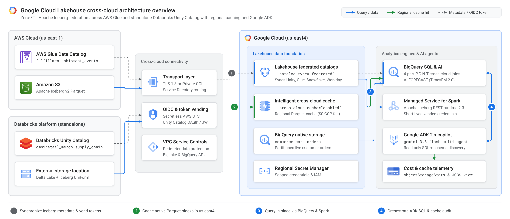
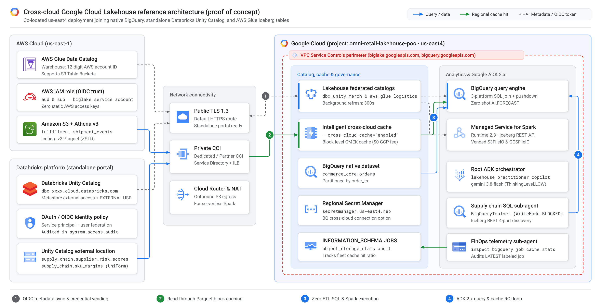
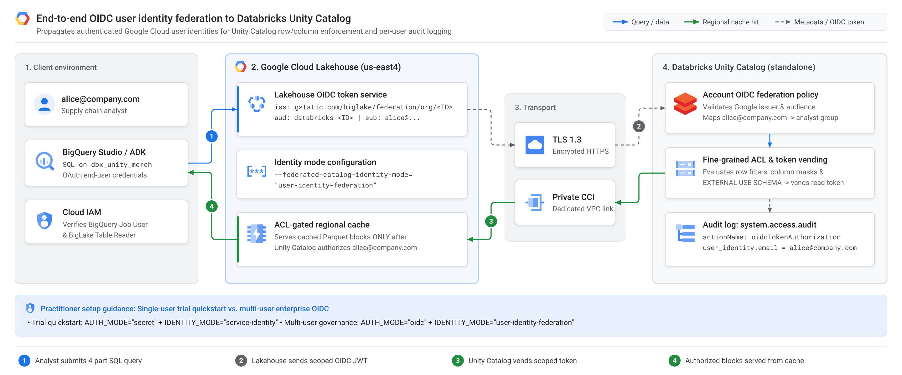
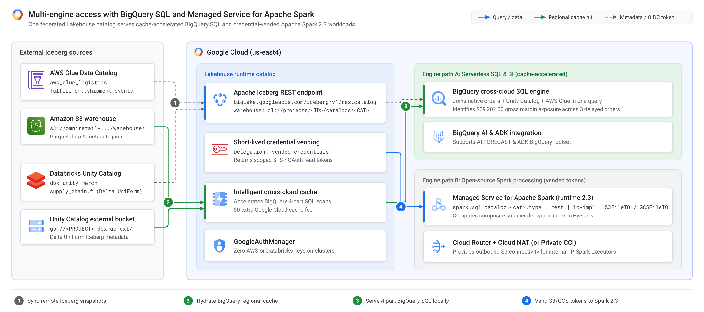
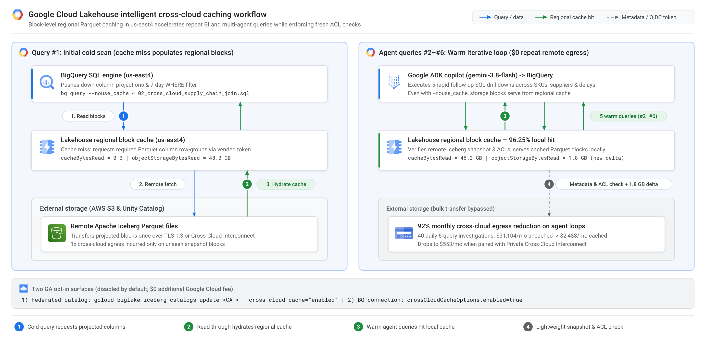
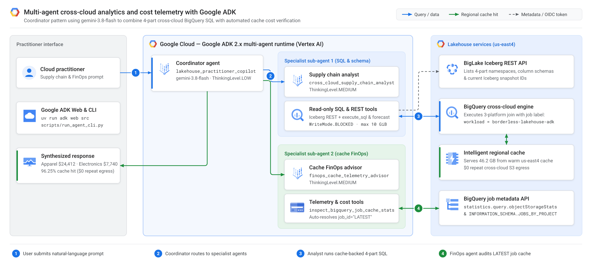

# How to query Databricks Unity Catalog and AWS Glue in place with Google Cloud Lakehouse, cross-cloud caching, and Google ADK



When an autonomous AI agent investigates a production supply chain anomaly, it rarely runs a single SQL query—it loops through five or six follow-up queries in seconds to isolate root causes across regions, suppliers, and carriers. Across 40 daily investigations over a 48 GB cross-cloud table on Amazon S3, uncached federation transfers **345.6 TB per month**—generating roughly **$31,104/month** in cloud storage egress fees before a single dashboard refreshes.

With the General Availability (GA) of [cross-cloud federated catalogs and cross-cloud caching in Google Cloud Lakehouse](https://docs.cloud.google.com/lakehouse/docs/release-notes), cloud practitioners can query remote **Apache Iceberg** tables in **Databricks Unity Catalog**, **AWS Glue Data Catalog**, **Snowflake Horizon Catalog**, and **Workday Data Lake** directly from **BigQuery** and **Apache Spark** without building brittle ETL pipelines—while caching active Parquet blocks inside your Google Cloud region at **$0 additional Google Cloud fee**.

First, we unpack the core architecture of Google Cloud Lakehouse, including background metadata synchronization, short-lived credential vending, OpenID Connect (OIDC) user identity federation, and regional block caching. Second, we walk step by step through provisioning AWS Glue, a standalone Databricks Unity Catalog workspace, BigQuery, Managed Service for Apache Spark, and a multi-agent copilot built with **Google Agent Development Kit (Google ADK)** and **Gemini 3.8 Flash**. Finally, we evaluate a real-world retail supply chain scenario, measure 30-day multi-agent egress savings, and clean up every proof-of-concept resource.

> **Proof-of-concept disclaimer:** Everything in this article and the [companion GitHub repository (`cmanikandan/gcp-borderless-lakehouse-adk`)](https://github.com/cmanikandan/gcp-borderless-lakehouse-adk) is an educational proof of concept (POC) built from a cloud practitioner's perspective to validate cross-cloud capabilities hands-on. Before deploying production workloads, always consult the official [Google Cloud Lakehouse documentation](https://docs.cloud.google.com/lakehouse/docs/about-cross-cloud-data-access), [Databricks Unity Catalog documentation](https://docs.databricks.com/en/data-governance/unity-catalog/index.html), and [AWS Glue Apache Iceberg documentation](https://docs.aws.amazon.com/glue/latest/dg/aws-glue-programming-etl-format-iceberg.html) for production security hardening, IAM least-privilege policies, networking, and service limits.

---

## Understanding core Google Cloud Lakehouse concepts

Enterprise datasets rarely live in a single cloud. Historically, analytics teams faced an expensive trade-off: maintain fragile copy pipelines that duplicate terabytes across clouds, or query remote object storage directly and absorb high latency and unpredictable network egress charges.

**Google Cloud Lakehouse** (built on **BigLake** and **BigQuery**) resolves that trade-off by combining open table standards with cloud-spanning governance and regional block caching.

* **Open-format interoperability on Apache Iceberg:** Google Cloud Lakehouse exposes a unified Apache Iceberg REST Catalog (`https://biglake.googleapis.com/iceberg/v1/restcatalog`) over native Apache Iceberg tables as well as Delta Lake tables configured with Iceberg UniForm. **BigQuery**, **Google Cloud Managed Service for Apache Spark**, and open-source **Apache Spark** read the exact same table snapshots in place with zero duplicate copies.
* **Zero-ETL cross-cloud federated catalogs (GA):** Configuring `--catalog-type="federated"` synchronizes catalog namespaces and Iceberg snapshot pointers in the background from **Databricks Unity Catalog** (on AWS, Azure, or Google Cloud, or via the standalone Databricks portal), **AWS Glue Data Catalog** (including Amazon S3 Table Buckets), **Snowflake Horizon Catalog**, and **Workday Data Lake**.
* **Intelligent cross-cloud caching (GA):** Disabled by default and available at **$0 additional Google Cloud fee**, opting into cross-cloud caching stores active remote Parquet column blocks in Google-managed regional cache inside your Google Cloud region. Every query still checks remote snapshot metadata and access control lists (ACLs) so stale or unauthorized blocks are never served, while warm BigQuery reads execute at local speed with **$0 repeat cross-cloud egress**.
* **Secretless credential vending, private routing, and user identity federation:** Compute clusters never store static AWS keys or long-lived tokens; Lakehouse vends short-lived, table-scoped credentials on demand. Traffic routes over TLS 1.3 or privately over **Cross-Cloud Interconnect** inside **VPC Service Controls** perimeters (`biglake.googleapis.com` and `bigquery.googleapis.com`), and **Databricks Unity Catalog** supports end-to-end **OIDC user identity federation** for row filters, column masks, and per-user audit logging in `system.access.audit`.
* **Agent-ready analytics foundation:** Because federated tables behave like native tables in BigQuery—supporting predicate pushdown and zero-shot time-series forecasting (`AI.FORECAST` with TimesFM 2.0)—multi-agent applications built with **Google ADK** and **Gemini 3.8 Flash** can run iterative SQL investigations without multiplying cross-cloud egress costs.

---

## Step-by-step implementation and code walkthrough

You do not need pre-existing tables in AWS, Databricks, or Google Cloud to reproduce this guide. Clone the [companion GitHub repository](https://github.com/cmanikandan/gcp-borderless-lakehouse-adk) to run the local 30-second simulator (`make install && make test && make demo-finops`) or provision all three environments end to end.



<details>
<summary><b>Prerequisites and environment variables (click to expand)</b></summary>

* **Google Cloud CLI (`gcloud` and `bq`)** authenticated to a Google Cloud project with billing enabled.
* **AWS CLI (`aws`)** authenticated to an AWS account with permissions for Amazon S3, AWS Glue, Amazon Athena, and AWS IAM.
* **Standalone Databricks workspace** accessed via [login.databricks.com](https://login.databricks.com). *(Hands-on tier note: Databricks Free Edition uses a shared multi-tenant metastore where the Metastore Admin **External data access** toggle is locked; use a free 14-day Databricks trial workspace for full Unity Catalog federation, or pass `--glue-only` to test BigQuery + AWS Glue standalone first.)*
* **Python 3.11+** and [`uv`](https://docs.astral.sh/uv/).

```bash
git clone https://github.com/cmanikandan/gcp-borderless-lakehouse-adk.git
cd gcp-borderless-lakehouse-adk

export PROJECT_ID="your-gcp-project-id"
export GCP_REGION="us-east4"      # Co-located near AWS us-east-1
export AWS_REGION="us-east-1"
```

</details>

### 1. Federating AWS Glue and Amazon S3 with OpenID Connect

First, run [`00_bootstrap_aws_s3_glue_iceberg.sh`](https://github.com/cmanikandan/gcp-borderless-lakehouse-adk/blob/main/infra/aws-glue/00_bootstrap_aws_s3_glue_iceberg.sh) to provision a private encrypted Amazon S3 bucket in `us-east-1`, create the `fulfillment` database in AWS Glue, and use serverless **Amazon Athena Engine v3** to seed an Apache Iceberg v2 table (`fulfillment.shipment_events`).

Next, [`setup_glue_federation.sh`](https://github.com/cmanikandan/gcp-borderless-lakehouse-adk/blob/main/infra/aws-glue/setup_glue_federation.sh) creates the federated catalog in Google Cloud (`us-east4`) with cross-cloud caching enabled and binds Google's auto-provisioned BigLake service account to an AWS IAM role via OpenID Connect (OIDC)—eliminating static AWS access keys:

```bash
# 1. Seed S3 bucket + Glue database + Apache Iceberg v2 table via Athena v3
bash infra/aws-glue/00_bootstrap_aws_s3_glue_iceberg.sh

# 2. Create the federated Glue catalog with cross-cloud caching enabled
# Note: --glue-warehouse takes your 12-digit AWS account ID (or
# "${AWS_ACCOUNT_ID}:s3tablescatalog/<bucket>" for S3 Table Buckets), never an s3:// URI.
gcloud biglake iceberg catalogs create aws_glue_logistics \
  --project="${PROJECT_ID}" \
  --catalog-type="federated" \
  --federated-catalog-type="glue" \
  --glue-warehouse="${AWS_ACCOUNT_ID}" \
  --glue-aws-region="us-east-1" \
  --glue-aws-role-arn="arn:aws:iam::${AWS_ACCOUNT_ID}:role/lakehouse_glue_federation_role" \
  --cross-cloud-cache="enabled" \
  --primary-location="us-east4"

# 3. Lock the AWS IAM OIDC trust policy (aud + sub) to Google's BigLake identity
GLUE_SA_SUB="$(gcloud biglake iceberg catalogs describe aws_glue_logistics \
  --project="${PROJECT_ID}" --format=json | jq -r '.["biglake-service-account-id"]')"
# setup_glue_federation.sh patches accounts.google.com:aud and :sub automatically,
# then sets --refresh-interval="300s" and verifies synchronized Iceberg namespaces.
```

### 2. Connecting standalone Databricks Unity Catalog

Google Cloud Lakehouse connects to **Databricks Unity Catalog** directly over its REST endpoint (`dbc-xxxx.cloud.databricks.com`), independent of where Databricks is hosted. Follow the portal checklist in [`infra/databricks-unity/README.md`](https://github.com/cmanikandan/gcp-borderless-lakehouse-adk/blob/main/infra/databricks-unity/README.md) and keep three Unity Catalog requirements in mind:

* Enable **External data access** in **Catalog > Metastore Settings**.
* Store federated schemas in a registered **Unity Catalog External Location** (Lakehouse does not read from Databricks internal `default storage`; [`00_prepare_uc_external_storage.sh`](https://github.com/cmanikandan/gcp-borderless-lakehouse-adk/blob/main/infra/databricks-unity/00_prepare_uc_external_storage.sh) provisions the bucket automatically).
* Grant **`EXTERNAL USE SCHEMA`** to your Databricks service principal or federated user group so Unity Catalog vends short-lived storage credentials.

Run [`databricks_uc_setup.sql`](https://github.com/cmanikandan/gcp-borderless-lakehouse-adk/blob/main/infra/databricks-unity/databricks_uc_setup.sql) in the Databricks SQL Editor to create `supplier_risk_scores` and `sku_margins` with **Delta UniForm (`iceberg`)** enabled:

```sql
CREATE SCHEMA IF NOT EXISTS omniretail_merch.supply_chain
MANAGED LOCATION '<YOUR_UNITY_CATALOG_EXTERNAL_LOCATION_URI>/supply_chain/';

CREATE OR REPLACE TABLE omniretail_merch.supply_chain.supplier_risk_scores (
  supplier_id STRING NOT NULL,
  supplier_name STRING NOT NULL,
  geopolitical_risk_score DOUBLE,
  lead_time_days INT
) TBLPROPERTIES (
  'delta.columnMapping.mode' = 'name',
  'delta.enableIcebergCompatV2' = 'true',
  'delta.universalFormat.enabledFormats' = 'iceberg'
);

GRANT USE CATALOG ON CATALOG omniretail_merch TO `<SERVICE_PRINCIPAL_APP_ID>`;
GRANT USE SCHEMA, SELECT, EXTERNAL USE SCHEMA
  ON SCHEMA omniretail_merch.supply_chain TO `<SERVICE_PRINCIPAL_APP_ID>`;
```

Then run [`setup_unity_federation.sh`](https://github.com/cmanikandan/gcp-borderless-lakehouse-adk/blob/main/infra/databricks-unity/setup_unity_federation.sh), which supports both a regional Secret Manager quickstart (`AUTH_MODE="secret"`) for single-user trials and two-phase secretless OIDC with `--federated-catalog-identity-mode="user-identity-federation"` for multi-user workspaces:

```bash
gcloud biglake iceberg catalogs create dbx_unity_merch \
  --project="${PROJECT_ID}" \
  --catalog-type="federated" \
  --federated-catalog-type="unity" \
  --unity-instance-name="dbc-a1b2c3d4-e5f6.cloud.databricks.com" \
  --unity-catalog-name="omniretail_merch" \
  --secret-name="projects/${PROJECT_ID}/locations/us-east4/secrets/dbx-unity-sp-oauth" \
  --refresh-interval="300s" \
  --cross-cloud-cache="enabled" \
  --primary-location="us-east4"
```



### 3. Joining tables across BigQuery and Managed Service for Apache Spark

Seed the native BigQuery orders table (`bash infra/gcp-bigquery/setup_bigquery_native.sh`), then join **BigQuery + standalone Databricks Unity Catalog + AWS Glue** in a single SQL query ([`02_cross_cloud_supply_chain_join.sql`](https://github.com/cmanikandan/gcp-borderless-lakehouse-adk/blob/main/sql/02_cross_cloud_supply_chain_join.sql)) using **4-part table identifiers** (`` `project.catalog.namespace.table` ``):

```sql
SELECT
  o.customer_region,
  m.category,
  r.supplier_name,
  r.geopolitical_risk_score,
  s.carrier,
  s.delay_hours,
  COUNT(DISTINCT o.order_id) AS affected_orders,
  ROUND(SUM(o.quantity * (o.unit_sale_price_usd - m.unit_cost_usd)), 2) AS gross_margin_exposure_usd
FROM `omni-retail-lakehouse-poc.commerce_core.orders` AS o
INNER JOIN `omni-retail-lakehouse-poc.dbx_unity_merch.supply_chain.sku_margins` AS m
  ON o.sku_id = m.sku_id
INNER JOIN `omni-retail-lakehouse-poc.dbx_unity_merch.supply_chain.supplier_risk_scores` AS r
  ON m.supplier_id = r.supplier_id
INNER JOIN `omni-retail-lakehouse-poc.aws_glue_logistics.fulfillment.shipment_events` AS s
  ON o.order_id = s.order_id
WHERE o.order_ts >= TIMESTAMP_SUB(CURRENT_TIMESTAMP(), INTERVAL 7 DAY)
  AND (s.delay_hours > 12 OR r.geopolitical_risk_score >= 0.65)
GROUP BY 1, 2, 3, 4, 5, 6
ORDER BY gross_margin_exposure_usd DESC;
```



Because Google Cloud Lakehouse exposes a standard Apache Iceberg REST endpoint, you can also run **PySpark** feature engineering over the exact same federated catalogs in **Google Cloud Managed Service for Apache Spark** (runtime `2.3`). In [`cross_cloud_margin_risk_job.py`](https://github.com/cmanikandan/gcp-borderless-lakehouse-adk/blob/main/spark/cross_cloud_margin_risk_job.py), `GoogleAuthManager` and `X-Iceberg-Access-Delegation=vended-credentials` request short-lived S3 and GCS read tokens per query—zero cloud keys are stored on Spark executors:

```python
spark = (
    SparkSession.builder.appName("borderless-lakehouse-margin-risk")
    .config("spark.sql.catalog.aws_glue_logistics", "org.apache.iceberg.spark.SparkCatalog")
    .config("spark.sql.catalog.aws_glue_logistics.type", "rest")
    .config("spark.sql.catalog.aws_glue_logistics.uri", "https://biglake.googleapis.com/iceberg/v1/restcatalog")
    .config("spark.sql.catalog.aws_glue_logistics.warehouse", f"bl://projects/{project_id}/catalogs/aws_glue_logistics")
    .config("spark.sql.catalog.aws_glue_logistics.header.X-Iceberg-Access-Delegation", "vended-credentials")
    .config("spark.sql.catalog.aws_glue_logistics.rest.auth.type", "org.apache.iceberg.gcp.auth.GoogleAuthManager")
    .config("spark.sql.catalog.aws_glue_logistics.io-impl", "org.apache.iceberg.aws.s3.S3FileIO")
    .getOrCreate()
)
```

*(Engine scope note: Cross-cloud caching accelerates **BigQuery** reads; Apache Spark executors read Parquet files directly from remote object storage via vended credentials.)*

### 4. Enabling and verifying cross-cloud caching in Google Cloud Lakehouse



Google Cloud Lakehouse provides **two GA opt-in surfaces** for cross-cloud caching (both disabled by default, with **$0 additional Google Cloud fee**):

| Opt-in surface | Best suited for | GA configuration command / property |
| :--- | :--- | :--- |
| **Lakehouse federated catalog** | Zero-ETL catalog sync across Unity Catalog, AWS Glue, Snowflake Horizon, and Workday | `gcloud biglake iceberg catalogs update <CATALOG> --cross-cloud-cache="enabled"` |
| **BigQuery cross-cloud connection** | Standalone BigLake Iceberg, Delta, or Parquet tables on S3 or Azure ([script](https://github.com/cmanikandan/gcp-borderless-lakehouse-adk/blob/main/infra/gcp-bigquery/setup_bq_cross_cloud_connection_cache.sh)) | `bq mk --connection --connection_type="AWS" --properties='{"accessRole":...,"crossCloudCacheOptions":{"enabled":true}}'` |

To verify storage-level block caching independently of BigQuery's SQL result cache, [`run_cross_cloud_join.sh`](https://github.com/cmanikandan/gcp-borderless-lakehouse-adk/blob/main/scripts/run_cross_cloud_join.sh) executes the cross-cloud join twice with `--nouse_cache` and inspects `statistics.query.objectStorageStats` (on a 48 GB partition benchmark, warm runs report `cacheBytesRead` vs. `objectStorageBytesRead` directly):

```json
[
  {
    "cloudProvider": "AWS",
    "cacheBytesRead": "46200000000",
    "objectStorageBytesRead": "1800000000"
  }
]
```

Here, **96.25% of scanned bytes** are served locally from regional cache in `us-east4`, while only `1.8 GB` of newly appended Iceberg snapshot blocks are fetched from Amazon S3. You can also audit fleet-wide cache efficiency across every user and agent workload using `INFORMATION_SCHEMA.JOBS_BY_PROJECT` ([`04_finops_org_cache_audit.sql`](https://github.com/cmanikandan/gcp-borderless-lakehouse-adk/blob/main/sql/04_finops_org_cache_audit.sql)):

```sql
SELECT
  s.cloud_provider,
  ROUND(SUM(s.cache_bytes_read) / POW(1024, 3), 2) AS local_cache_gib,
  ROUND(SUM(s.object_storage_bytes_read) / POW(1024, 3), 2) AS remote_egress_gib,
  ROUND(SAFE_DIVIDE(SUM(s.cache_bytes_read),
    SUM(s.cache_bytes_read + s.object_storage_bytes_read)) * 100, 2) AS cache_hit_pct
FROM `region-us-east4`.INFORMATION_SCHEMA.JOBS_BY_PROJECT AS j,
  UNNEST(j.object_storage_stats) AS s
WHERE j.creation_time >= TIMESTAMP_SUB(CURRENT_TIMESTAMP(), INTERVAL 7 DAY)
GROUP BY 1;
```

### 5. Building a multi-agent copilot with Google ADK and Gemini 3.8 Flash



In [`src/lakehouse_agent/agent.py`](https://github.com/cmanikandan/gcp-borderless-lakehouse-adk/blob/main/src/lakehouse_agent/agent.py), we implement the Coordinator multi-agent pattern using **Google ADK 2.x** (`google-adk`) and **`gemini-3.8-flash`** with three practical guardrails:

1. **4-part federated schema discovery (`discover_federated_catalog_tables`):** Standard `list_dataset_ids` only enumerates 3-part BigQuery datasets, so our custom tool queries the BigLake Iceberg REST API to discover 4-part Unity Catalog and AWS Glue schemas and current snapshot IDs.
2. **Read-only SQL + zero-shot `AI.FORECAST` filter:** We configure `WriteMode.BLOCKED`, enforce a 10 GiB per-query scan cap, and restrict `BigQueryToolset` to read-only metadata tools, `execute_sql`, and zero-shot `forecast` (TimesFM 2.0).
3. **Automated `job_id="LATEST"` cache auditing:** Every agent SQL job carries `job_labels={"workload": "borderless-lakehouse-adk"}` so our FinOps specialist sub-agent automatically verifies `objectStorageStats` after each investigation:

```python
from google.adk.agents import Agent
from google.adk.integrations.bigquery import BigQueryCredentialsConfig, BigQueryToolset
from google.adk.integrations.bigquery.config import BigQueryToolConfig, WriteMode
from google.adk.planners import BuiltInPlanner
from google.genai import types
from google.oauth2.credentials import Credentials

from lakehouse_agent.cache_telemetry import (
    inspect_bigquery_job_cache_stats,
    simulate_agentic_burst_finops,
)
from lakehouse_agent.catalog_discovery import discover_federated_catalog_tables

ALLOWED_BQ_TOOLS = [
    "execute_sql", "forecast", "list_dataset_ids",
    "get_dataset_info", "list_table_ids", "get_table_info", "get_job_info",
]

def build_copilot(project_id: str, user_oauth_token: str | None = None) -> Agent:
    bq_toolset = BigQueryToolset(
        credentials_config=(
            BigQueryCredentialsConfig(credentials=Credentials(token=user_oauth_token))
            if user_oauth_token else None
        ),
        bigquery_tool_config=BigQueryToolConfig(
            write_mode=WriteMode.BLOCKED,
            location="us-east4",
            compute_project_id=project_id,
            maximum_bytes_billed=10 * 1024**3,
            job_labels={"workload": "borderless-lakehouse-adk"},
        ),
        tool_filter=ALLOWED_BQ_TOOLS,
    )

    analyst = Agent(
        name="cross_cloud_supply_chain_analyst",
        model="gemini-3.8-flash",
        planner=BuiltInPlanner(
            thinking_config=types.ThinkingConfig(thinking_level=types.ThinkingLevel.MEDIUM)
        ),
        instruction=(
            "Discover 4-part schemas via `discover_federated_catalog_tables` and join "
            "BigQuery (`commerce_core.orders`), standalone Databricks (`dbx_unity_merch`), "
            "and AWS Glue (`aws_glue_logistics`) with explicit column projection."
        ),
        tools=[bq_toolset, discover_federated_catalog_tables],
    )

    finops_advisor = Agent(
        name="finops_cache_telemetry_advisor",
        model="gemini-3.8-flash",
        instruction="Call `inspect_bigquery_job_cache_stats(job_id='LATEST')` to report cache ROI.",
        tools=[inspect_bigquery_job_cache_stats, simulate_agentic_burst_finops],
    )

    return Agent(
        name="lakehouse_practitioner_copilot",
        model="gemini-3.8-flash",
        planner=BuiltInPlanner(
            thinking_config=types.ThinkingConfig(thinking_level=types.ThinkingLevel.LOW)
        ),
        instruction="Coordinate cross-platform SQL analytics and cross-cloud cache telemetry.",
        sub_agents=[analyst, finops_advisor],
    )
```

---

## Real-world application and multi-cloud cost impact

### Evaluating supply chain margin exposure at OmniRetail Horizon

Consider *OmniRetail Horizon*, a global retail team responding to port congestion and supplier lead-time spikes across three separate data platforms:

* **Google Cloud (`us-east4`):** Live customer orders in native BigQuery (`commerce_core.orders`).
* **Standalone Databricks Unity Catalog:** Supplier geopolitical risk scores and SKU unit cost margins (`omniretail_merch.supply_chain.*`).
* **AWS Cloud (`us-east-1`):** Real-time carrier delay events on Amazon S3 registered in AWS Glue (`fulfillment.shipment_events`).

When a supply chain practitioner asks the ADK copilot, *"Which US-NORTHEAST categories have the highest gross margin exposure, and did our query hit the regional cache?"*, BigQuery pushes down the `delay_hours > 12` and `geopolitical_risk_score >= 0.65` predicates—automatically pruning healthy Midwest order `ORD-8803` (`2h` delay, `0.14` risk on `NordicFreight`) and returning **$39,202.00** in total gross margin exposure across three delayed shipments:

| `customer_region` | `category` | `supplier_name` | `geopolitical_risk_score` | `carrier` | `delay_hours` | `affected_orders` | `gross_margin_exposure_usd` |
| :--- | :--- | :--- | ---: | :--- | ---: | ---: | ---: |
| `US-NORTHEAST` | `Apparel` | `Pacific Rim Textiles` | `0.69` | `PacificAirCargo` | `19` | `1` | `24412.00` |
| `US-NORTHEAST` | `Electronics` | `Apex MicroSystems` | `0.78` | `OceanicExpress` | `28` | `1` | `7740.00` |
| `US-WEST` | `Packaging` | `Great Lakes Packaging` | `0.11` | `GreatLakesRail` | `36` | `1` | `7050.00` |

### Measuring 30-day cloud egress savings on multi-agent loops

Because AI agents iterate rapidly over recent partitions, enabling cross-cloud caching changes the economics of multi-cloud agentic analytics (`uv run python scripts/demo_agent_cache_finops.py`):

| Deployment pattern (40 daily 6-query agent investigations × 48 GB) | Monthly remote egress | Estimated monthly egress cost | Savings vs. uncached |
| :--- | ---: | ---: | ---: |
| **Uncached cross-cloud federation** (public internet @ $0.09/GB) | `345.6 TB` | `$31,104` | — |
| **Google Cloud Lakehouse caching** (public internet, 92% warm cache hit) | `27.6 TB` | `$2,488` | **92.0% saved** |
| **Google Cloud Lakehouse caching + Cross-Cloud Interconnect** (@ $0.02/GB) | `27.6 TB` | `$553` | **98.2% saved** |

<details>
<summary><b>Troubleshooting checklist for hands-on testing (click to expand)</b></summary>

* **Databricks catalog sync succeeds, but `0` tables appear:** Confirm **External data access** is toggled ON in Unity Catalog Metastore Settings, your schema uses an **External Location** (not Databricks `default storage`), `DESCRIBE EXTENDED` shows an Iceberg `Metadata Location`, and your principal has `EXTERNAL USE SCHEMA`.
* **`cacheBytesRead` stays `0` on repeat `--nouse_cache` runs:** Verify `--cross-cloud-cache="enabled"` on the federated catalog (or `crossCloudCacheOptions.enabled=true` on the BigQuery connection) and confirm organization policy `constraints/gcp.restrictNonCmekServices` is not blocking Google-managed cache encryption.
* **Managed Spark batch times out reaching Amazon S3:** Serverless Spark executors use internal IPs by default; run `ENSURE_CLOUD_NAT=true bash spark/submit_managed_spark_batch.sh` to attach Cloud Router and Cloud NAT (or route privately over Cross-Cloud Interconnect).

</details>

### Cleaning up your proof-of-concept resources

Because this POC spans three cloud environments, remove your test resources once you finish experimenting so you avoid ongoing storage or NAT charges. Run [`infra/teardown_all.sh`](https://github.com/cmanikandan/gcp-borderless-lakehouse-adk/blob/main/infra/teardown_all.sh) to delete the Google Cloud federated catalogs, regional secret, BigQuery connection and dataset, Cloud NAT gateway (if created), Cloud Storage buckets, AWS Glue database/table, OIDC IAM role, and Amazon S3 bucket in one command:

```bash
export PROJECT_ID="your-gcp-project-id"
export GCP_REGION="us-east4"
export AWS_REGION="us-east-1"

bash infra/teardown_all.sh
```

Then run these three cleanup statements in your **Databricks SQL Editor** (and remove your test service principal under **Settings > Identity and access > Service principals**):

```sql
DROP CATALOG IF EXISTS omniretail_merch CASCADE;
DROP EXTERNAL LOCATION IF EXISTS lakehouse_poc_ext_loc;
DROP STORAGE CREDENTIAL IF EXISTS lakehouse_poc_cred;
```

---

## Conclusion and next steps

With **cross-cloud federated catalogs (GA)** and **cross-cloud caching (GA)**, **Google Cloud Lakehouse** lets you unify **BigQuery**, **Managed Service for Apache Spark**, **Databricks Unity Catalog**, and **AWS Glue Data Catalog** on open Apache Iceberg standards—delivering zero-ETL agility, unified OIDC governance, and predictable cross-cloud costs for **Gemini 3.8 Flash** multi-agent workloads.

Ready to try it out?

1. **Run the POC hands-on:** Clone [`cmanikandan/gcp-borderless-lakehouse-adk`](https://github.com/cmanikandan/gcp-borderless-lakehouse-adk), start with `make install && make test && make demo-finops`, and walk through the full cross-cloud setup.
2. **Review production guidance:** Check the official Google Cloud, Databricks, and AWS documentation linked below before planning production deployments.
3. **Join the conversation:** How are you handling cross-cloud Iceberg governance or multi-agent query costs today? Drop your questions, benchmarks, or feedback in the comments below!

### Helpful documentation and Google Developer Program community resources

**Official technical documentation**
* [Companion GitHub POC repository (`cmanikandan/gcp-borderless-lakehouse-adk`)](https://github.com/cmanikandan/gcp-borderless-lakehouse-adk)
* [Google Cloud Lakehouse release notes (cross-cloud caching GA & federated catalogs GA)](https://docs.cloud.google.com/lakehouse/docs/release-notes)
* [About cross-cloud data access and intelligent caching](https://docs.cloud.google.com/lakehouse/docs/about-cross-cloud-data-access#intelligent-caching)
* [Query remote data in BigQuery and Apache Spark](https://docs.cloud.google.com/lakehouse/docs/query-remote-data)
* [Set up a cross-cloud connection to Databricks Unity Catalog](https://docs.cloud.google.com/lakehouse/docs/set-up-cross-cloud-connection-databricks)
* [Set up a cross-cloud connection to AWS Glue Data Catalog](https://docs.cloud.google.com/lakehouse/docs/set-up-cross-cloud-connection-aws-glue)
* [Set up cross-cloud connections to Snowflake Horizon Catalog](https://docs.cloud.google.com/lakehouse/docs/set-up-cross-cloud-connection-snowflake) and [Workday Data Lake](https://docs.cloud.google.com/lakehouse/docs/set-up-cross-cloud-connection-workday)
* [Google Agent Development Kit (ADK) BigQuery integration](https://adk.dev/integrations/bigquery/)
* [Databricks Unity Catalog documentation](https://docs.databricks.com/en/data-governance/unity-catalog/index.html) and [AWS Glue Apache Iceberg documentation](https://docs.aws.amazon.com/glue/latest/dg/aws-glue-programming-etl-format-iceberg.html)

**Google Developer Program forums & community formatting guides**
* [Tips and tricks to make the most of the Google Developer Program forums](https://discuss.google.dev/t/tips-and-tricks-to-make-the-most-of-the-google-developer-program-forums/154) *(guide to advanced forum Markdown, syntax-highlighted code blocks, collapsible `Hide Details` sections, and search operators)*
* [Navigating the Google Developer Program forums](https://discuss.google.dev/t/navigating-the-google-developer-program-forums/153)
* [Understanding trust levels on the Google Developer Program forums](https://discuss.google.dev/t/understanding-trust-levels-on-the-google-developer-program-forums/127)
* [Google Developer Program community guidelines and FAQ](https://discuss.google.dev/faq)
