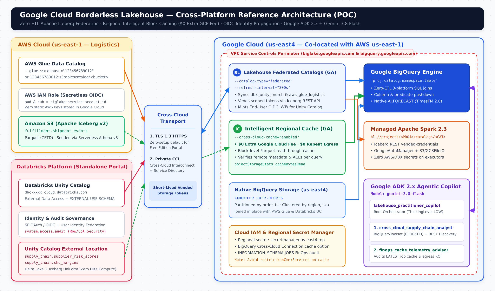
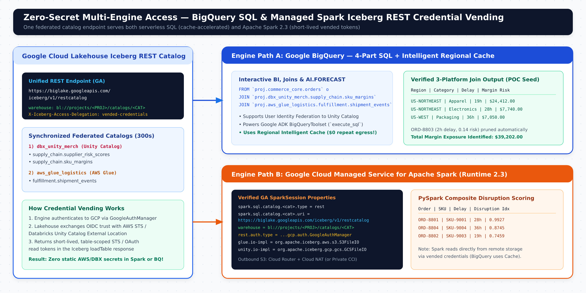
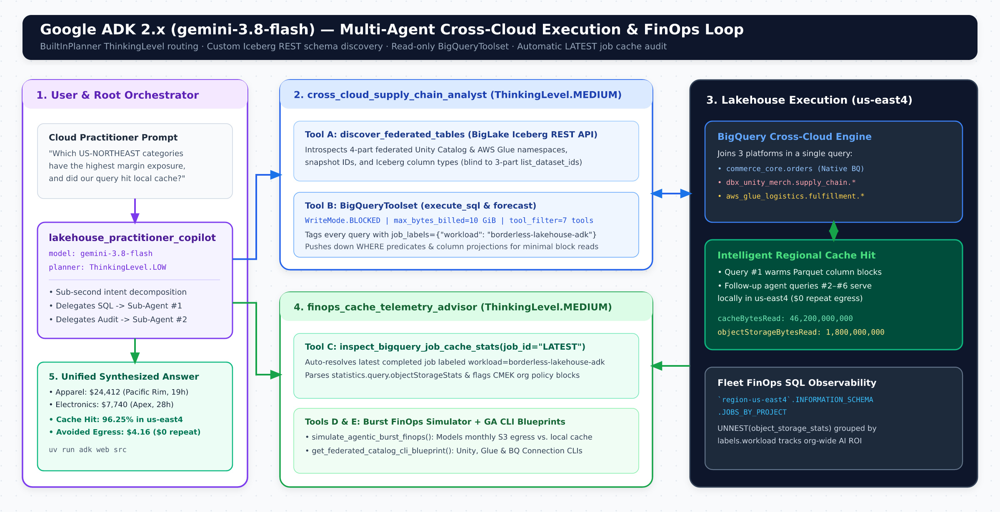

# Zero-ETL Meets Zero-Egress Shock: A Hands-On Google Cloud Lakehouse POC with Databricks, AWS Glue, and Gemini 3.8 Flash

*A cloud practitioner’s end-to-end Proof of Concept testing Google Cloud Lakehouse’s newly GA Cross-Cloud Federated Catalogs, Intelligent Regional Caching, Managed Spark credential vending, and multi-agent analytics with Google ADK 2.x.*


> **Proof-of-Concept (POC) Disclaimer**: Everything in this article and the [companion GitHub repository](https://github.com/cmanikandan/gcp-borderless-lakehouse-adk) is an educational **Proof of Concept (POC)** built from a cloud practitioner’s perspective to explore and validate cross-cloud capabilities hands-on. Before deploying production workloads, always consult the official [**Google Cloud Lakehouse**](https://docs.cloud.google.com/lakehouse/docs/about-cross-cloud-data-access), [**Databricks Unity Catalog**](https://docs.databricks.com/en/data-governance/unity-catalog/index.html), and [**AWS Glue & S3**](https://docs.aws.amazon.com/glue/latest/dg/aws-glue-programming-etl-format-iceberg.html) documentation for production security hardening, IAM boundaries, networking, and service limits.

---

## Why Google Cloud Lakehouse Changes the Multi-Cloud Equation

In almost every enterprise, critical datasets already live across multiple platforms—and migrating petabytes into a single cloud before running analytics or AI rarely makes financial or operational sense. Yet querying across clouds has traditionally forced an uncomfortable trade-off: maintain fragile hourly ETL copy pipelines, or accept high cross-cloud latency and unpredictable storage egress bills.

**Google Cloud Lakehouse** (powered by BigLake and BigQuery) changes that trade-off by pairing an open table foundation with cloud-spanning governance and regional block caching. Five architectural capabilities stand out immediately:

1. **Open-Format Interoperability Without Lock-In**: **Apache Iceberg** (including Delta Lake tables with Iceberg UniForm enabled) is a first-class citizen via a unified Iceberg REST Catalog. **BigQuery**, **Google Cloud Managed Service for Apache Spark**, and open-source **Apache Spark** read the exact same table snapshots in place—with zero duplicate copies.
2. **Zero-ETL Cross-Cloud Federated Catalogs (Now GA)**: Instead of copying files, Lakehouse connects directly to **Databricks Unity Catalog**, **AWS Glue Data Catalog** (including Amazon S3 Table Buckets), **Snowflake Horizon Catalog**, and **Workday Data Lake**—continuously synchronizing Iceberg metadata in the background.
3. **Intelligent Cross-Cloud Caching (Now GA, \$0 Extra GCP Fee)**: Disabled by default, opting into caching on a federated catalog or BigQuery cross-cloud connection stores active remote Parquet column blocks inside your Google Cloud region. Every query still verifies remote metadata and ACLs so you never read stale snapshots, while warm BigQuery scans run at local speed with **\$0 repeat remote egress**.
4. **Secretless Credential Vending, Private Networking & End-User Identity**: Worker clusters never hold static AWS keys or long-lived tokens—Lakehouse vends short-lived, table-scoped credentials automatically. Traffic can route over TLS 1.3 or privately over **Cross-Cloud Interconnect** inside **VPC Service Controls** perimeters, and **User Identity Federation** propagates end-user OIDC identities straight into **Databricks Unity Catalog** row/column policies and `system.access.audit` logs.
5. **An Agent-Ready Data Foundation**: Federated tables behave like native tables in BigQuery—supporting zero-shot time-series forecasting (`AI.FORECAST` with TimesFM 2.0) and **Google Agent Development Kit (`google-adk` 2.x)** agents powered by **`gemini-3.8-flash`**, while Intelligent Caching absorbs the iterative SQL bursts that AI agents generate.

Both [**Cross-Cloud Federated Catalogs** and **Intelligent Cross-Cloud Caching** are now Generally Available (GA)](https://docs.cloud.google.com/lakehouse/docs/release-notes). Let’s build and test a complete zero-to-one POC across three independent platforms.

---

## The POC Use Case: *OmniRetail Horizon* Margin-at-Risk

Imagine a global retailer facing sudden port congestion and supplier lead-time spikes. Supply-chain analysts need real-time **Gross Margin Exposure** across three separate platforms—without building a single ETL pipeline:

* **Google Cloud (`us-east4`)**: Live customer orders in native BigQuery (`commerce_core.orders`).
* **Standalone Databricks Platform**: Supplier geopolitical risk scores and SKU cost margins governed in **Databricks Unity Catalog** (`omniretail_merch.supply_chain.*`), accessed directly through the standalone **Databricks Portal** (*Databricks Free / Community Edition* or workspace).
* **AWS Cloud (`us-east-1`)**: Carrier shipment delay telemetry stored as Apache Iceberg v2 on Amazon S3 and registered in **AWS Glue Data Catalog** (`fulfillment.shipment_events`).



> **Companion GitHub Repo (From-Scratch Setup + Offline Simulator Included)**: Clone [**github.com/cmanikandan/gcp-borderless-lakehouse-adk**](https://github.com/cmanikandan/gcp-borderless-lakehouse-adk) for every bootstrap script, SQL query, PySpark batch job, preflight doctor CLI, Google ADK 2.x multi-agent copilot, and one-command teardown script. Run `make install && make test && make demo-finops` to explore the FinOps telemetry locally in 30 seconds before touching any cloud account.

---

## Step-by-Step POC Implementation & Verification

Don’t worry if you haven’t set up AWS Glue, Databricks Unity Catalog, or BigQuery yet—the repository includes idempotent bootstrap scripts for all three platforms.

### Step 1: Bootstrap & Federate AWS Glue + S3 Iceberg (Secretless OIDC)

First, [`00_bootstrap_aws_s3_glue_iceberg.sh`](https://github.com/cmanikandan/gcp-borderless-lakehouse-adk/blob/main/infra/aws-glue/00_bootstrap_aws_s3_glue_iceberg.sh) creates an encrypted S3 bucket in `us-east-1`, registers the `fulfillment` Glue database, and uses serverless **Amazon Athena Engine v3** (zero EC2/EMR clusters) to create and `MERGE` seed telemetry into `fulfillment.shipment_events`.

Next, [`setup_glue_federation.sh`](https://github.com/cmanikandan/gcp-borderless-lakehouse-adk/blob/main/infra/aws-glue/setup_glue_federation.sh) federates AWS Glue into Google Cloud Lakehouse using **OpenID Connect (OIDC)**—no static AWS access keys required:

```bash
export PROJECT_ID="your-gcp-project-id"
export GCP_REGION="us-east4"      # Co-located near AWS us-east-1
export AWS_REGION="us-east-1"

# 1. Provision S3 bucket + Glue DB + seeded Apache Iceberg v2 table via Athena v3
bash infra/aws-glue/00_bootstrap_aws_s3_glue_iceberg.sh

# 2. Create the federated Glue catalog with Intelligent Cross-Cloud Caching enabled
# Practitioner tip: --glue-warehouse takes your 12-digit AWS Account ID (or
# "${AWS_ACCOUNT_ID}:s3tablescatalog/<bucket>" for S3 Table Buckets)—never an s3:// URI!
gcloud biglake iceberg catalogs create aws_glue_logistics \
  --project="${PROJECT_ID}" \
  --catalog-type="federated" \
  --federated-catalog-type="glue" \
  --glue-warehouse="${AWS_ACCOUNT_ID}" \
  --glue-aws-region="us-east-1" \
  --glue-aws-role-arn="arn:aws:iam::${AWS_ACCOUNT_ID}:role/lakehouse_glue_federation_role" \
  --cross-cloud-cache="enabled" \
  --primary-location="us-east4"

# 3. Extract Google's auto-provisioned OIDC Subject ID and lock AWS IAM trust (aud + sub)
GLUE_SA_SUB="$(gcloud biglake iceberg catalogs describe aws_glue_logistics \
  --project="${PROJECT_ID}" --format=json | jq -r '.["biglake-service-account-id"]')"
# (setup_glue_federation.sh patches accounts.google.com:aud & :sub automatically,
#  then sets --refresh-interval="300s" and lists synchronized Iceberg tables.)
```

---

### Step 2: Configure & Federate Standalone Databricks Portal (Unity Catalog)

In the repository, [`infra/databricks-unity/README.md`](https://github.com/cmanikandan/gcp-borderless-lakehouse-adk/blob/main/infra/databricks-unity/README.md) and [`00_prepare_uc_external_storage.sh`](https://github.com/cmanikandan/gcp-borderless-lakehouse-adk/blob/main/infra/databricks-unity/00_prepare_uc_external_storage.sh) walk click-by-click through setting up a fresh **Standalone Databricks Portal** (*Free / Community Edition* or workspace). Three rules save hours of debugging:

1. Toggle **External data access** ON under **Catalog -> Metastore Settings**.
2. Register a **Unity Catalog External Location**—Google Cloud Lakehouse does not read from Databricks internal `default storage`.
3. Grant **`EXTERNAL USE SCHEMA`** so Unity Catalog vends short-lived storage credentials to Lakehouse.

Run [`databricks_uc_setup.sql`](https://github.com/cmanikandan/gcp-borderless-lakehouse-adk/blob/main/infra/databricks-unity/databricks_uc_setup.sql) in the Databricks SQL Editor to create `supplier_risk_scores` and `sku_margins` with **Delta UniForm (`iceberg`)** enabled:

```sql
CREATE SCHEMA IF NOT EXISTS omniretail_merch.supply_chain
MANAGED LOCATION '<YOUR_UNITY_CATALOG_EXTERNAL_LOCATION_URI>/supply_chain/';

CREATE OR REPLACE TABLE omniretail_merch.supply_chain.supplier_risk_scores (
  supplier_id STRING NOT NULL,
  supplier_name STRING NOT NULL,
  geopolitical_risk_score DOUBLE,
  lead_time_days INT
) TBLPROPERTIES (
  'delta.columnMapping.mode' = 'name',
  'delta.enableIcebergCompatV2' = 'true',
  'delta.universalFormat.enabledFormats' = 'iceberg'
);

GRANT USE CATALOG ON CATALOG omniretail_merch TO `<SERVICE_PRINCIPAL_APP_ID>`;
GRANT USE SCHEMA, SELECT, EXTERNAL USE SCHEMA
  ON SCHEMA omniretail_merch.supply_chain TO `<SERVICE_PRINCIPAL_APP_ID>`;
```

Next, [`setup_unity_federation.sh`](https://github.com/cmanikandan/gcp-borderless-lakehouse-adk/blob/main/infra/databricks-unity/setup_unity_federation.sh) connects Unity Catalog to Google Cloud Lakehouse—handling the regional Secret Manager endpoint (`https://secretmanager.us-east4.rep.googleapis.com/`) for single-user Portal quickstarts, as well as secretless 2-phase OIDC + `--federated-catalog-identity-mode="user-identity-federation"` for multi-user workspaces:

```bash
gcloud biglake iceberg catalogs create dbx_unity_merch \
  --project="${PROJECT_ID}" \
  --catalog-type="federated" \
  --federated-catalog-type="unity" \
  --unity-instance-name="dbc-a1b2c3d4-e5f6.cloud.databricks.com" \
  --unity-catalog-name="omniretail_merch" \
  --secret-name="projects/${PROJECT_ID}/locations/us-east4/secrets/dbx-unity-sp-oauth" \
  --refresh-interval="300s" \
  --cross-cloud-cache="enabled" \
  --primary-location="us-east4"
```


---

### Step 3: Query Across All 3 Platforms in BigQuery SQL & Managed Spark 2.3

Seed the native BigQuery table (`bash infra/gcp-bigquery/setup_bigquery_native.sh`), then join **BigQuery + Standalone Databricks + AWS Glue** in a single query ([`02_cross_cloud_supply_chain_join.sql`](https://github.com/cmanikandan/gcp-borderless-lakehouse-adk/blob/main/sql/02_cross_cloud_supply_chain_join.sql)) using **4-part identifiers** (`` `project.catalog.namespace.table` ``):

```sql
SELECT
  o.customer_region,
  m.category,
  r.supplier_name,
  r.geopolitical_risk_score,
  s.delay_hours,
  COUNT(DISTINCT o.order_id) AS affected_orders,
  ROUND(SUM(o.quantity * (o.unit_sale_price_usd - m.unit_cost_usd)), 2) AS gross_margin_exposure_usd
FROM `omni-retail-lakehouse-prod.commerce_core.orders` AS o
INNER JOIN `omni-retail-lakehouse-prod.dbx_unity_merch.supply_chain.sku_margins` AS m
  ON o.sku_id = m.sku_id
INNER JOIN `omni-retail-lakehouse-prod.dbx_unity_merch.supply_chain.supplier_risk_scores` AS r
  ON m.supplier_id = r.supplier_id
INNER JOIN `omni-retail-lakehouse-prod.aws_glue_logistics.fulfillment.shipment_events` AS s
  ON o.order_id = s.order_id
WHERE o.order_ts >= TIMESTAMP_SUB(CURRENT_TIMESTAMP(), INTERVAL 7 DAY)
  AND (s.delay_hours > 12 OR r.geopolitical_risk_score >= 0.65)
GROUP BY 1, 2, 3, 4, 5
ORDER BY gross_margin_exposure_usd DESC;
```

Out of the 4 seeded POC orders, BigQuery pushes down the `delay_hours` and `geopolitical_risk_score` predicates—automatically pruning healthy European order `ORD-8803` (`2h` delay, `0.14` risk) and surfacing **\$39,202.00** in total gross margin exposure:

| `customer_region` | `category` | `supplier_name` | `geopolitical_risk_score` | `delay_hours` | `affected_orders` | `gross_margin_exposure_usd` |
| :--- | :--- | :--- | ---: | ---: | ---: | ---: |
| `US-NORTHEAST` | `Apparel` | `Pacific Rim Textiles` | `0.69` | `19` | `1` | `24412.00` |
| `US-NORTHEAST` | `Electronics` | `Apex MicroSystems` | `0.78` | `28` | `1` | `7740.00` |
| `US-WEST` | `Packaging` | `Great Lakes Packaging` | `0.11` | `36` | `1` | `7050.00` |



Want to run feature engineering or composite disruption scoring in **PySpark** over the exact same catalogs? [`cross_cloud_margin_risk_job.py`](https://github.com/cmanikandan/gcp-borderless-lakehouse-adk/blob/main/spark/cross_cloud_margin_risk_job.py) mounts Lakehouse’s unified Iceberg REST endpoint (`https://biglake.googleapis.com/iceberg/v1/restcatalog`) with `bl://projects/<PROJECT>/catalogs/<CATALOG>`, `GoogleAuthManager`, and `X-Iceberg-Access-Delegation=vended-credentials`—running on **Managed Service for Apache Spark 2.3** with zero AWS or Databricks secrets on the executors:

```python
spark = (
    SparkSession.builder.appName("borderless-lakehouse-margin-risk")
    .config("spark.sql.catalog.aws_glue_logistics", "org.apache.iceberg.spark.SparkCatalog")
    .config("spark.sql.catalog.aws_glue_logistics.type", "rest")
    .config("spark.sql.catalog.aws_glue_logistics.uri", "https://biglake.googleapis.com/iceberg/v1/restcatalog")
    .config("spark.sql.catalog.aws_glue_logistics.warehouse", f"bl://projects/{project_id}/catalogs/aws_glue_logistics")
    .config("spark.sql.catalog.aws_glue_logistics.header.X-Iceberg-Access-Delegation", "vended-credentials")
    .config("spark.sql.catalog.aws_glue_logistics.rest.auth.type", "org.apache.iceberg.gcp.auth.GoogleAuthManager")
    .config("spark.sql.catalog.aws_glue_logistics.io-impl", "org.apache.iceberg.aws.s3.S3FileIO")
    .getOrCreate()
)
```

*(Note on engine scope: Intelligent Cross-Cloud Caching accelerates **BigQuery** cross-cloud reads; Spark executors stream Parquet directly from remote storage via vended credentials.)*

---

### Step 4: Opt In & Verify Intelligent Cross-Cloud Caching


Cross-cloud caching is disabled by default and carries **\$0 additional Google Cloud fee**. Depending on how your tables are registered, GA gives you **two opt-in surfaces**:

| Opt-In Surface | Best For | Verified GA CLI Flag / Property |
| :--- | :--- | :--- |
| **1. Lakehouse Federated Catalog** | Zero-ETL federation across Unity Catalog, AWS Glue, Snowflake Horizon & Workday | `gcloud biglake iceberg catalogs update <CAT> --cross-cloud-cache="enabled"` |
| **2. BigQuery Cross-Cloud Connection** | Individual BigLake Iceberg/Delta/Parquet tables on S3 or Azure ([script](https://github.com/cmanikandan/gcp-borderless-lakehouse-adk/blob/main/infra/gcp-bigquery/setup_bq_cross_cloud_connection_cache.sh)) | `bq mk --connection --connection_type="AWS" --properties='{"accessRole":...,"crossCloudCacheOptions":{"enabled":true}}'` |

To prove Intelligent Caching is serving Parquet blocks locally (rather than hitting BigQuery’s SQL result cache), [`run_cross_cloud_join.sh`](https://github.com/cmanikandan/gcp-borderless-lakehouse-adk/blob/main/scripts/run_cross_cloud_join.sh) executes the join twice with `--nouse_cache`. Inspect `statistics.query.objectStorageStats` on Run #2 (on our 4-row seed table you’ll see KB-scale values; on a 48 GB production partition benchmark, warm runs look like this):

```json
[
  {
    "cloudProvider": "AWS",
    "cacheBytesRead": "46200000000",
    "objectStorageBytesRead": "1800000000"
  }
]
```

**96.25% of bytes serve directly from regional cache in `us-east4` at \$0 repeat egress.** Even better, you can audit cache hit ratios across every user and AI workload in your project using `INFORMATION_SCHEMA.JOBS_BY_PROJECT` ([`04_finops_org_cache_audit.sql`](https://github.com/cmanikandan/gcp-borderless-lakehouse-adk/blob/main/sql/04_finops_org_cache_audit.sql)):

```sql
SELECT
  s.cloud_provider,
  ROUND(SUM(s.cache_bytes_read) / POW(1024, 3), 2) AS local_cache_gib,
  ROUND(SUM(s.object_storage_bytes_read) / POW(1024, 3), 2) AS remote_egress_gib,
  ROUND(SAFE_DIVIDE(SUM(s.cache_bytes_read),
    SUM(s.cache_bytes_read + s.object_storage_bytes_read)) * 100, 2) AS cache_hit_pct
FROM `region-us-east4`.INFORMATION_SCHEMA.JOBS_BY_PROJECT AS j,
  UNNEST(j.object_storage_stats) AS s
WHERE j.creation_time >= TIMESTAMP_SUB(CURRENT_TIMESTAMP(), INTERVAL 7 DAY)
GROUP BY 1;
```

*(Practitioner tip: If `cacheBytesRead` stays `0`, verify `--cross-cloud-cache="enabled"` and confirm org policy `constraints/gcp.restrictNonCmekServices` isn’t blocking Google-managed cache encryption.)*

---

## Adding the Agentic Layer: Google ADK 2.x + `gemini-3.8-flash`

Dashboards run predictable queries. **AI agents investigate data in loops.** When a manager asks *“Why is US-NORTHEAST margin slipping, and which suppliers are driving the delay?”*, an autonomous agent routinely fires **6 follow-up SQL queries** in seconds:

* **Uncached Federation**: 40 investigations/day × 6 SQL calls × 48 GB = **345.6 TB/month** of remote egress (**~\$31,104/month** at \$0.09/GB).
* **With Lakehouse Intelligent Caching**: Query #1 warms the regional block cache; agent queries #2–#6 hit local Google Cloud cache, slashing remote egress by **~92% (~\$2,488/month**, or **~\$553/month** over Cross-Cloud Interconnect).



In [`src/lakehouse_agent/agent.py`](https://github.com/cmanikandan/gcp-borderless-lakehouse-adk/blob/main/src/lakehouse_agent/agent.py), we pair **Google ADK 2.x** and **`gemini-3.8-flash`** with three engineering touches that make federated agents work reliably in practice:

1. **4-Part Federated Schema Discovery (`discover_federated_tables`)**: Built-in `list_dataset_ids` only sees 3-part BigQuery datasets, so our custom tool queries the BigLake Iceberg REST API to introspect 4-part Unity Catalog and AWS Glue schemas and snapshot IDs.
2. **Read-Only + TimesFM 2.0 Tool Filter**: We enforce `WriteMode.BLOCKED`, a 10 GiB per-query billing cap, and an explicit `tool_filter` keeping `execute_sql` and zero-shot `forecast` (`AI.FORECAST`) while excluding tools that attempt `CREATE TEMP MODEL`.
3. **Automatic `job_id="LATEST"` Cache Auditing**: Every agent query carries `job_labels={"workload": "borderless-lakehouse-adk"}`, allowing our FinOps sub-agent to audit `objectStorageStats` automatically right after `execute_sql` finishes:

```python
from google.adk.agents import Agent
from google.adk.integrations.bigquery import BigQueryCredentialsConfig, BigQueryToolset
from google.adk.integrations.bigquery.config import BigQueryToolConfig, WriteMode
from google.adk.planners import BuiltInPlanner
from google.genai import types
from google.oauth2.credentials import Credentials

from lakehouse_agent.cache_telemetry import (
    inspect_bigquery_job_cache_stats,
    simulate_agentic_burst_finops,
)
from lakehouse_agent.catalog_discovery import discover_federated_catalog_tables

ALLOWED_BQ_TOOLS = [
    "execute_sql", "forecast", "list_dataset_ids",
    "get_dataset_info", "list_table_ids", "get_table_info", "get_job_info",
]

def build_copilot(project_id: str, user_oauth_token: str | None = None) -> Agent:
    bq_toolset = BigQueryToolset(
        credentials_config=(
            BigQueryCredentialsConfig(credentials=Credentials(token=user_oauth_token))
            if user_oauth_token else None
        ),
        bigquery_tool_config=BigQueryToolConfig(
            write_mode=WriteMode.BLOCKED,
            location="us-east4",
            compute_project_id=project_id,
            maximum_bytes_billed=10 * 1024**3,
            job_labels={"workload": "borderless-lakehouse-adk"},
        ),
        tool_filter=ALLOWED_BQ_TOOLS,
    )

    analyst = Agent(
        name="cross_cloud_supply_chain_analyst",
        model="gemini-3.8-flash",
        planner=BuiltInPlanner(
            thinking_config=types.ThinkingConfig(thinking_level=types.ThinkingLevel.MEDIUM)
        ),
        instruction=(
            "Discover 4-part schemas via `discover_federated_catalog_tables` and join "
            "BigQuery (`commerce_core.orders`), standalone Databricks (`dbx_unity_merch`), "
            "and AWS Glue (`aws_glue_logistics`) with explicit column projection."
        ),
        tools=[bq_toolset, discover_federated_catalog_tables],
    )

    finops_advisor = Agent(
        name="finops_cache_telemetry_advisor",
        model="gemini-3.8-flash",
        instruction="Call `inspect_bigquery_job_cache_stats(job_id='LATEST')` to report cache ROI.",
        tools=[inspect_bigquery_job_cache_stats, simulate_agentic_burst_finops],
    )

    return Agent(
        name="lakehouse_practitioner_copilot",
        model="gemini-3.8-flash",
        planner=BuiltInPlanner(
            thinking_config=types.ThinkingConfig(thinking_level=types.ThinkingLevel.LOW)
        ),
        instruction="Coordinate cross-platform SQL analytics and Intelligent Cache FinOps telemetry.",
        sub_agents=[analyst, finops_advisor],
    )
```

Launch the ADK Web UI (`make adk-web`) or run headlessly via [`scripts/run_agent_cli.py`](https://github.com/cmanikandan/gcp-borderless-lakehouse-adk/blob/main/scripts/run_agent_cli.py) to watch both sub-agents collaborate in real time:

```text
$ uv run python scripts/run_agent_cli.py --prompt \
  "Which US-NORTHEAST categories have the highest margin exposure, and did our query hit cache?"

[lakehouse_practitioner_copilot -> tool_call] transfer_to_agent(agent_name="cross_cloud_supply_chain_analyst")
[cross_cloud_supply_chain_analyst -> tool_call] discover_federated_tables(catalog_id="dbx_unity_merch")
[cross_cloud_supply_chain_analyst -> tool_call] execute_sql(query="SELECT o.customer_region, m.category ...")
[finops_cache_telemetry_advisor -> tool_call] inspect_bigquery_job_cache_stats(job_id="LATEST")

[lakehouse_practitioner_copilot]
1. Apparel ($24,412.00 exposure) — Supplier: Pacific Rim Textiles (risk 0.69, 19h delay on MAERSK-AIR)
2. Electronics ($7,740.00 exposure) — Supplier: Apex MicroSystems (risk 0.78, 28h delay on FEDEX-FREIGHT)
Cache Telemetry (us-east4): 96.25% served from Google Cloud Intelligent Cache ($0 repeat remote egress).
```

---

## Clean Up / Uninstall the POC

Because this POC spans three cloud environments, tear down your test resources once you finish experimenting so you don’t incur ongoing storage charges.

Run [`infra/teardown_all.sh`](https://github.com/cmanikandan/gcp-borderless-lakehouse-adk/blob/main/infra/teardown_all.sh) to delete the Google Cloud federated catalogs, regional secret, BigQuery connection and dataset, GCS buckets, AWS Glue table/database, OIDC IAM role, and S3 bucket in one shot:

```bash
export PROJECT_ID="your-gcp-project-id"
export GCP_REGION="us-east4"
export AWS_REGION="us-east-1"

bash infra/teardown_all.sh
```

Then run these three lines in your **Databricks Portal SQL Editor** (and delete your test Service Principal under *Settings -> Identity and access*):

```sql
DROP CATALOG IF EXISTS omniretail_merch CASCADE;
DROP EXTERNAL LOCATION IF EXISTS lakehouse_poc_ext_loc;
DROP STORAGE CREDENTIAL IF EXISTS lakehouse_poc_cred;
```

---

## Wrapping Up

With **Cross-Cloud Federated Catalogs (GA)** and **Intelligent Cross-Cloud Caching (GA)**, **Google Cloud Lakehouse** lets you unite **BigQuery**, **Managed Apache Spark**, **Standalone Databricks Unity Catalog**, and **AWS Glue** on open Apache Iceberg standards—combining zero-ETL agility with local-lakehouse speed and predictable FinOps for **Gemini 3.8 Flash** agents.

Clone the POC repository to try it hands-on, and consult the official documentation below as you plan production rollouts.

---

## Key Links & Official References

* **Companion GitHub POC Repository**: [cmanikandan/gcp-borderless-lakehouse-adk](https://github.com/cmanikandan/gcp-borderless-lakehouse-adk)
* **Google Cloud Lakehouse Release Notes**: [Cross-Cloud Caching (GA) & Federated Catalogs (GA)](https://docs.cloud.google.com/lakehouse/docs/release-notes)
* **Google Cloud Cross-Cloud Overview**: [About Cross-Cloud Data Access & Intelligent Caching](https://docs.cloud.google.com/lakehouse/docs/about-cross-cloud-data-access#intelligent-caching)
* **Querying Federated Iceberg Tables**: [Query Remote Data in BigQuery & Apache Spark](https://docs.cloud.google.com/lakehouse/docs/query-remote-data)
* **Databricks Federation Guide**: [Set Up Cross-Cloud Connection to Databricks Unity Catalog](https://docs.cloud.google.com/lakehouse/docs/set-up-cross-cloud-connection-databricks)
* **AWS Glue Federation Guide**: [Set Up Cross-Cloud Connection to AWS Glue Data Catalog](https://docs.cloud.google.com/lakehouse/docs/set-up-cross-cloud-connection-aws-glue)
* **Snowflake & Workday Federation**: [Snowflake Horizon Catalog](https://docs.cloud.google.com/lakehouse/docs/set-up-cross-cloud-connection-snowflake) | [Workday Data Lake](https://docs.cloud.google.com/lakehouse/docs/set-up-cross-cloud-connection-workday)
* **Databricks & AWS Official Docs**: [Databricks Unity Catalog Docs](https://docs.databricks.com/en/data-governance/unity-catalog/index.html) | [AWS Glue Iceberg Docs](https://docs.aws.amazon.com/glue/latest/dg/aws-glue-programming-etl-format-iceberg.html)
* **Google Agent Development Kit (ADK)**: [BigQuery Toolset Integration (`google.adk.integrations.bigquery`)](https://adk.dev/integrations/bigquery/)
