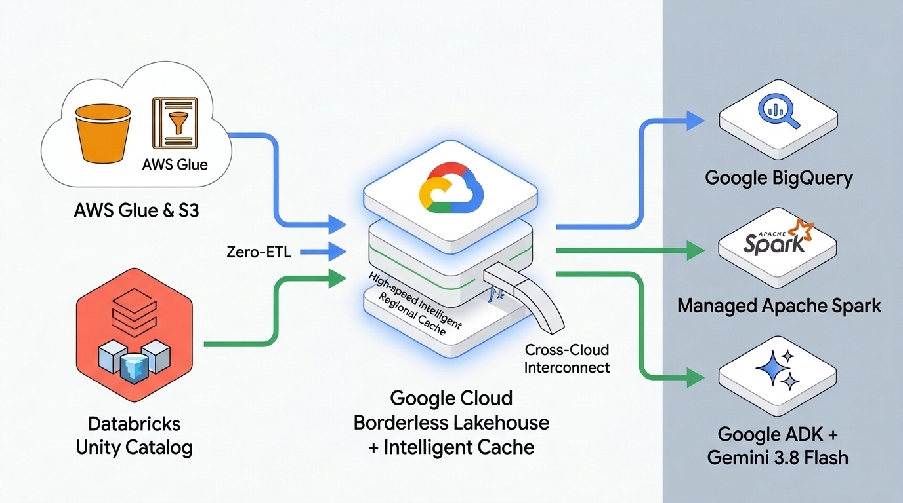
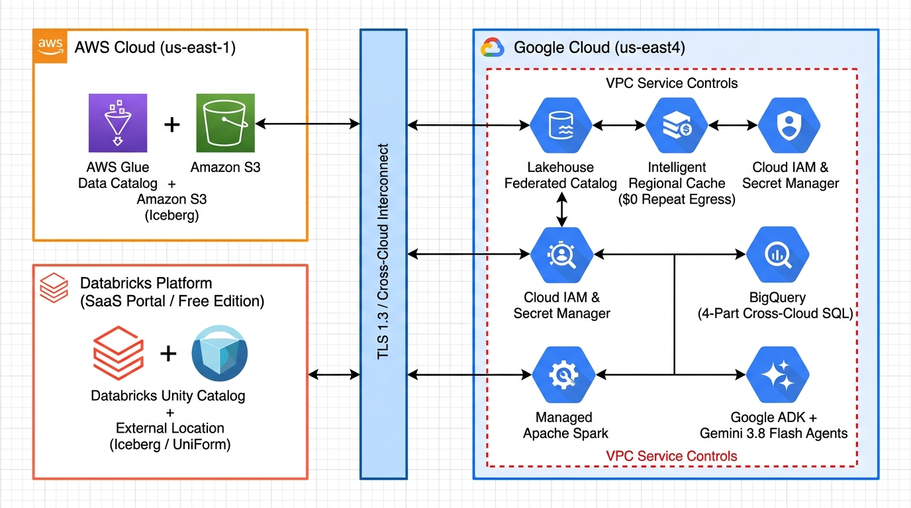
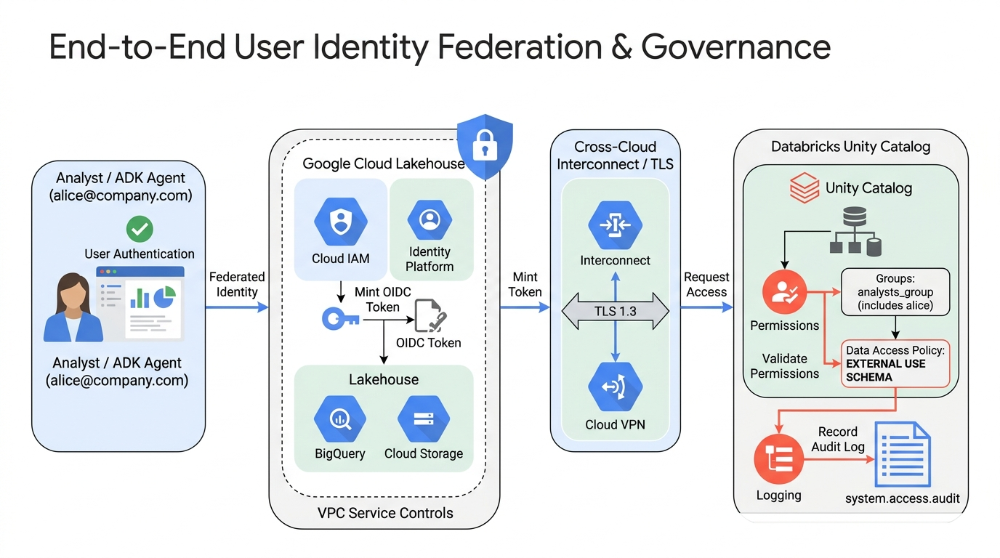
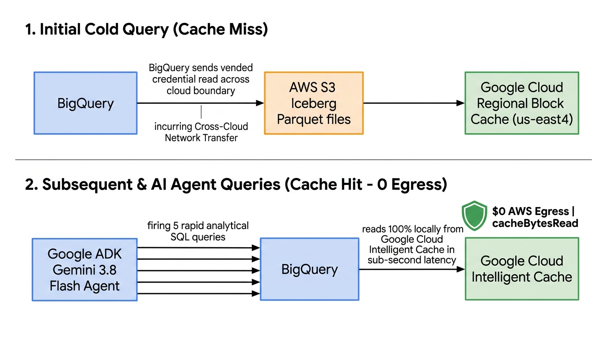

# Zero-ETL Meets Zero-Egress Shock: Building an Agentic Borderless Lakehouse on Google Cloud with Databricks, AWS Glue, and Gemini 3.8 Flash

*A Principal Architect’s hands-on blueprint for Google Cloud Lakehouse’s newly GA Cross-Cloud Federated Catalogs and Intelligent Caching—powered by Google ADK.*



Every enterprise data estate I review shares the same reality: **your data already lives in more than one platform, and migrating all of it into one bucket isn’t happening this quarter.**

Orders sit in **Google Cloud BigQuery**. Merchandising and supplier risk models live in a standalone **Databricks Unity Catalog** workspace. Real-time carrier telemetry lands in **Amazon S3** governed by **AWS Glue Data Catalog**.

Historically, unifying those three domains forced an ugly trade-off:
1. **Build brittle cross-cloud ETL pipelines**—paying to copy, orchestrate, and reconcile duplicate tables every hour.
2. **Federate naively over the wire**—watching latency spike and cloud egress bills explode the moment BI dashboards or chatty AI agents scan the same remote Parquet files ten times in a row.

With two **Generally Available (GA)** milestones in [**Google Cloud Lakehouse**](https://docs.cloud.google.com/lakehouse/docs/release-notes), that trade-off is officially dead:

* **Cross-Cloud Federated Catalogs (GA)**: Synchronize Apache Iceberg metadata directly from **Databricks Unity Catalog**, **AWS Glue Data Catalog**, **Snowflake Horizon Catalog**, and **Workday Data Lake**—and query tables in place from **BigQuery**, **Managed Service for Apache Spark**, and open-source **Apache Spark**. You get optional private routing over **Cross-Cloud Interconnect**, **VPC Service Controls** perimeters, and end-to-end **User Identity Federation** for Unity Catalog.
* **Intelligent Cross-Cloud Caching (GA)**: Opt in (`--cross-cloud-cache="enabled"`, disabled by default) to cache remote Parquet/Iceberg data blocks locally inside your Google Cloud region—slashing repeat cross-cloud egress costs and accelerating subsequent queries.

Let’s walk through a real architecture, implement and test every layer step-by-step, and put an autonomous **Google ADK + `gemini-3.8-flash`** copilot on top.

> **Companion GitHub Repository**: Full scripts, SQL, PySpark, Draw.io diagrams, and the Google ADK multi-agent codebase are available at [**github.com/cmanikandan/gcp-borderless-lakehouse-adk**](https://github.com/cmanikandan/gcp-borderless-lakehouse-adk).

---

## The Use Case: *OmniRetail Horizon* Margin-at-Risk

Imagine a global retailer facing sudden port congestion and supplier lead-time spikes. Leadership needs real-time **Gross Margin Exposure** across three independent platforms—without moving a single table:

1. **Google Cloud (`us-east4`)**: Live customer orders in native BigQuery (`commerce_core.orders`).
2. **Standalone Databricks Platform**: Supplier geopolitical risk scores and SKU cost margins governed in **Databricks Unity Catalog** (`omniretail_merch.supply_chain.*`), accessed directly via the **Databricks Portal (Free / Community Edition or Enterprise)**.
3. **AWS Cloud (`us-east-1`)**: Live carrier shipment delay events in Apache Iceberg on Amazon S3, cataloged in **AWS Glue** (`fulfillment.shipment_events`).

---

## Reference Architecture



Four architectural pillars make this production-grade:

1. **Zero-ETL Iceberg Metadata Sync**: Lakehouse Federated Catalogs continuously poll remote Iceberg snapshots (`--refresh-interval="300s"`) and expose a unified catalog to both **BigQuery** (via 4-part SQL names) and **Spark** (via Iceberg REST credential vending).
2. **Regional Block-Level Intelligent Caching**: Disabled by default (`--cross-cloud-cache="disabled"`). Once enabled, cold scans pull only projected Parquet column blocks into encrypted regional Google Cloud cache; warm queries read locally at **\$0 remote egress**.
3. **Flexible Network & Perimeter Security**: Start over TLS 1.3 public endpoints (ideal when testing against the standalone **Databricks Free/Community Portal**), or bind **Service Directory** endpoints over **Cross-Cloud Interconnect** inside a **VPC Service Controls** perimeter for production.
4. **End-User Identity Federation**: For Databricks Unity Catalog, `--federated-catalog-identity-mode="user-identity-federation"` propagates the querying analyst’s OIDC identity straight into Databricks row/column policies and `system.access.audit`.

---

## Step-by-Step Implementation & Testing Guide

### Step 1: Federate AWS Glue Data Catalog (Secretless OIDC + Local Cache)

Never paste static AWS access keys into another cloud. Lakehouse assigns each federated catalog a dedicated Google-managed service account whose OIDC subject ID you trust directly in AWS IAM.

> **Architect Pro-Tip**: `--glue-warehouse` must be your **12-digit AWS Account ID** (or `123456789012:s3tablescatalog/bucket` for S3 Tables)—*not* an `s3://` path.

```bash
# 1. Create the federated catalog in Google Cloud (closest region to us-east-1 -> us-east4)
gcloud biglake iceberg catalogs create aws_glue_logistics \
  --project="omni-retail-lakehouse-prod" \
  --catalog-type="federated" \
  --federated-catalog-type="glue" \
  --glue-warehouse="123456789012" \
  --glue-aws-region="us-east-1" \
  --glue-aws-role-arn="arn:aws:iam::123456789012:role/lakehouse_glue_federation_role" \
  --cross-cloud-cache="enabled" \
  --primary-location="us-east4"

# 2. Extract the unique Google-managed Subject ID and lock your AWS IAM Role trust policy
GLUE_SA_SUB="$(gcloud biglake iceberg catalogs describe aws_glue_logistics \
  --project="omni-retail-lakehouse-prod" \
  --format="value(biglake_service_account_id)")"

# (Update AWS IAM Trust Policy Principal {"Federated": "accounts.google.com"} with Condition accounts.google.com:sub = $GLUE_SA_SUB)

# 3. Activate continuous 5-minute Iceberg snapshot synchronization
gcloud biglake iceberg catalogs update aws_glue_logistics \
  --project="omni-retail-lakehouse-prod" \
  --refresh-interval="300s" \
  --cross-cloud-cache="enabled"
```

---

### Step 2: Federate Standalone Databricks Unity Catalog (Databricks Portal)

Open your standalone **Databricks Portal** (*Databricks Free Edition*—the modern Unity-Catalog-enabled successor to Community Edition—or Enterprise) and enable **Delta UniForm (`iceberg`)** on your tables:

```sql
-- Run in your Databricks Portal SQL Editor
CREATE SCHEMA IF NOT EXISTS omniretail_merch.supply_chain
MANAGED LOCATION '<YOUR_UNITY_CATALOG_EXTERNAL_LOCATION_URI>/supply_chain/';

CREATE OR REPLACE TABLE omniretail_merch.supply_chain.supplier_risk_scores (
  supplier_id STRING NOT NULL,
  supplier_name STRING NOT NULL,
  geopolitical_risk_score DOUBLE,
  lead_time_days INT
) TBLPROPERTIES (
  'delta.columnMapping.mode' = 'name',
  'delta.enableIcebergCompatV2' = 'true',
  'delta.universalFormat.enabledFormats' = 'iceberg'
);

-- Mandatory for Unity Catalog credential vending!
GRANT USE CATALOG ON CATALOG omniretail_merch TO `<SERVICE_PRINCIPAL_APP_ID>`;
GRANT USE SCHEMA, SELECT, EXTERNAL USE SCHEMA
  ON SCHEMA omniretail_merch.supply_chain TO `<SERVICE_PRINCIPAL_APP_ID>`;
```

> **3-Point Databricks Portal Checklist (Don’t Skip!)**:
> 1. Check **External data access** in Unity Catalog Metastore Settings.
> 2. Use a registered **Unity Catalog External Location**—Google Cloud Lakehouse does not read from Databricks internal `default storage`.
> 3. Grant **`EXTERNAL USE SCHEMA`** so Unity Catalog vends short-lived storage tokens.

Now register the federated Unity Catalog in Google Cloud (using Regional Secret Manager for quick portal testing, or `--unity-service-principal-application-id` + `--federated-catalog-identity-mode="user-identity-federation"` for enterprise OIDC):

```bash
gcloud biglake iceberg catalogs create dbx_unity_merch \
  --project="omni-retail-lakehouse-prod" \
  --catalog-type="federated" \
  --federated-catalog-type="unity" \
  --unity-instance-name="dbc-a1b2c3d4-e5f6.cloud.databricks.com" \
  --unity-catalog-name="omniretail_merch" \
  --secret-name="projects/omni-retail-lakehouse-prod/locations/us-east4/secrets/dbx-unity-sp-oauth" \
  --cross-cloud-cache="enabled" \
  --primary-location="us-east4"
```



---

### Step 3: Run a 3-Platform Zero-ETL Join in BigQuery

Federated catalogs appear instantly in BigQuery using **4-part identifiers** (`` `project.catalog.namespace.table` ``). Here is one standard SQL query joining **BigQuery + standalone Databricks + AWS Glue**:

```sql
SELECT
  o.customer_region,
  m.category,
  r.supplier_name,
  r.geopolitical_risk_score,
  s.delay_hours,
  COUNT(DISTINCT o.order_id) AS affected_orders,
  ROUND(SUM(o.quantity * (o.unit_sale_price_usd - m.unit_cost_usd)), 2) AS gross_margin_exposure_usd
FROM `omni-retail-lakehouse-prod.commerce_core.orders` AS o
INNER JOIN `omni-retail-lakehouse-prod.dbx_unity_merch.supply_chain.sku_margins` AS m
  ON o.sku_id = m.sku_id
INNER JOIN `omni-retail-lakehouse-prod.dbx_unity_merch.supply_chain.supplier_risk_scores` AS r
  ON m.supplier_id = r.supplier_id
INNER JOIN `omni-retail-lakehouse-prod.aws_glue_logistics.fulfillment.shipment_events` AS s
  ON o.order_id = s.order_id
WHERE o.order_ts >= TIMESTAMP_SUB(CURRENT_TIMESTAMP(), INTERVAL 7 DAY)
  AND (s.delay_hours > 12 OR r.geopolitical_risk_score >= 0.65)
GROUP BY 1, 2, 3, 4, 5
ORDER BY gross_margin_exposure_usd DESC;
```

Want to run feature engineering in **Managed Service for Apache Spark** over the exact same tables without distributing cloud credentials to worker nodes? Pass `header.X-Iceberg-Access-Delegation=vended-credentials` against `https://biglake.googleapis.com/iceberg/v1/restcatalog` (full script in [`spark/submit_managed_spark_batch.sh`](../spark/submit_managed_spark_batch.sh)).

---

### Step 4: Prove Intelligent Caching Works (`objectStorageStats`)



To prove Intelligent Caching is working at the storage layer (and not just hitting BigQuery’s SQL result cache), execute your query twice with `--nouse_cache` and inspect `statistics.query.objectStorageStats`:

```bash
# Run #1 (Cold) -> populates regional block cache in us-east4
bq query --location=us-east4 --use_legacy_sql=false --nouse_cache < sql/02_cross_cloud_supply_chain_join.sql

# Run #2 (Warm) -> serves Parquet column blocks locally!
bq query --location=us-east4 --use_legacy_sql=false --nouse_cache < sql/02_cross_cloud_supply_chain_join.sql

# Verify cacheBytesRead vs. objectStorageBytesRead
bq show --format=prettyjson -j <RUN_2_JOB_ID> | jq '.statistics.query.objectStorageStats'
```

```json
[
  {
    "cloudProvider": "AWS",
    "cacheBytesRead": "46200000000",
    "objectStorageBytesRead": "1800000000"
  }
]
```

**96.25% of the scan (`46.2 GB`) read directly from Google Cloud’s regional cache at \$0 remote egress.** *(Note: If `cacheBytesRead` stays `0`, check that `constraints/gcp.restrictNonCmekServices` isn’t active—the cache uses Google-managed encryption keys.)*

---

## The Agentic Multiplier: Google ADK + `gemini-3.8-flash`

Here is why **Intelligent Cross-Cloud Caching** is an architectural game-changer for **Agentic AI**:

Humans run one dashboard query. **AI agents think in loops.** When an executive asks *“Why is Q4 electronics margin slipping in North America, and which alternate supplier cuts delay risk?”*, an autonomous agent fires **6 to 8 sequential SQL queries**—testing hypotheses, drilling into SKUs, and checking shipment lags.

* **Without Cross-Cloud Caching**: 40 agent investigations/day × 6 SQL calls × 48 GB = **345.6 TB/month** of cross-cloud egress (**~\$31,104/month** at \$0.09/GB).
* **With Lakehouse Intelligent Caching**: Query #1 warms the regional Parquet block cache; agent queries #2–#6 hit local Google Cloud cache (~92% hit rate), dropping egress to **~\$2,488/month** (or **~\$553/month** over Cross-Cloud Interconnect)—a **92% FinOps reduction**.

Using **Google Agent Development Kit (`google-adk` 2.x)** and **`gemini-3.8-flash`**, we wire a read-only, cost-capped multi-agent copilot in ~50 lines of Python (`src/lakehouse_agent/agent.py`):

```python
from google.adk.agents import Agent
from google.adk.integrations.bigquery import BigQueryCredentialsConfig, BigQueryToolset
from google.adk.integrations.bigquery.config import BigQueryToolConfig, WriteMode
from google.oauth2.credentials import Credentials

from lakehouse_agent.cache_telemetry import (
    inspect_bigquery_job_cache_stats,
    simulate_agentic_burst_finops,
)

def build_copilot(project_id: str, user_oauth_token: str | None = None) -> Agent:
    bq_toolset = BigQueryToolset(
        credentials_config=(
            BigQueryCredentialsConfig(credentials=Credentials(token=user_oauth_token))
            if user_oauth_token else None
        ),
        bigquery_tool_config=BigQueryToolConfig(
            write_mode=WriteMode.BLOCKED,          # Strict read-only guardrail
            location="us-east4",
            compute_project_id=project_id,
            maximum_bytes_billed=10 * 1024**3,     # 10 GiB per-query FinOps cap
        ),
    )

    analyst = Agent(
        name="cross_cloud_supply_chain_analyst",
        model="gemini-3.8-flash",
        instruction=(
            "Query BigQuery (`commerce_core.orders`), standalone Databricks Unity Catalog "
            "(`dbx_unity_merch.supply_chain.*`), and AWS Glue (`aws_glue_logistics.fulfillment.*`) "
            "using 4-part SQL identifiers. Project only needed columns and return the job_id."
        ),
        tools=[bq_toolset],
    )

    finops_advisor = Agent(
        name="finops_cache_telemetry_advisor",
        model="gemini-3.8-flash",
        instruction="Audit BigQuery `objectStorageStats` cache hit ratios and quantify avoided egress.",
        tools=[inspect_bigquery_job_cache_stats, simulate_agentic_burst_finops],
    )

    return Agent(
        name="lakehouse_principal_copilot",
        model="gemini-3.8-flash",
        instruction="Coordinate cross-platform SQL analytics and Intelligent Cache FinOps telemetry.",
        sub_agents=[analyst, finops_advisor],
    )
```

Notice two subtle enterprise wins in that snippet:
1. **`gemini-3.8-flash` + Warm Regional Cache** gives sub-second reasoning paired with local-speed Parquet scans—making interactive multi-agent investigation feel instantaneous.
2. Passing `user_oauth_token` into `BigQueryCredentialsConfig` lets an authenticated human’s identity flow **all the way from the ADK chat UI -> BigQuery -> Databricks Unity Catalog row/column security**.

Launch it locally in two commands from the repo:

```bash
uv sync --extra dev
uv run adk web src
```

---

## Final Takeaway

A modern lakehouse shouldn't force you to centralize every byte before you can innovate. With **Cross-Cloud Federated Catalogs (GA)** and **Intelligent Cross-Cloud Caching (GA)**, Google Cloud turns **BigQuery**, **Managed Spark**, **Databricks Unity Catalog**, and **AWS Glue** into a single governed, cache-accelerated substrate—ready for high-frequency **Gemini 3.8 Flash** agents from day one.

Clone the repo, connect your standalone Databricks Portal and AWS Glue catalog, and run the Cold-vs-Warm benchmark yourself.

---

## Key Links & Official References

* **Companion GitHub Project**: [cmanikandan/gcp-borderless-lakehouse-adk](https://github.com/cmanikandan/gcp-borderless-lakehouse-adk)
* **Google Cloud Lakehouse Release Notes**: [Cross-Cloud Caching (GA) & Federated Catalogs (GA)](https://docs.cloud.google.com/lakehouse/docs/release-notes)
* **Architecture & Caching Deep Dive**: [About Cross-Cloud Data Access & Intelligent Caching](https://docs.cloud.google.com/lakehouse/docs/about-cross-cloud-data-access#intelligent-caching)
* **Querying Federated Iceberg Tables**: [Query Remote Data in BigQuery & Spark](https://docs.cloud.google.com/lakehouse/docs/query-remote-data)
* **Databricks Unity Catalog Setup & Identity Federation**: [Set Up Cross-Cloud Connection to Databricks Unity Catalog](https://docs.cloud.google.com/lakehouse/docs/set-up-cross-cloud-connection-databricks)
* **AWS Glue Setup**: [Set Up Cross-Cloud Connection to AWS Glue Data Catalog](https://docs.cloud.google.com/lakehouse/docs/set-up-cross-cloud-connection-aws-glue)
* **Snowflake & Workday Federation**: [Snowflake Horizon Catalog](https://docs.cloud.google.com/lakehouse/docs/set-up-cross-cloud-connection-snowflake) | [Workday Data Lake](https://docs.cloud.google.com/lakehouse/docs/set-up-cross-cloud-connection-workday)
* **Google Agent Development Kit (ADK)**: [BigQuery Toolset Integration (`google.adk.integrations.bigquery`)](https://adk.dev/integrations/bigquery/)
