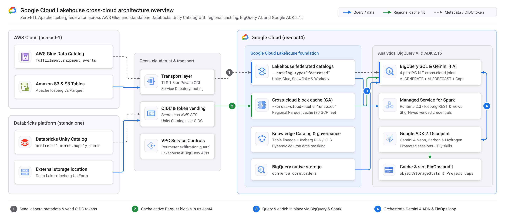
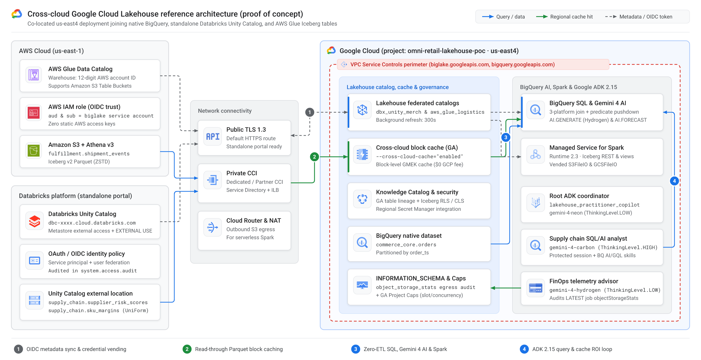
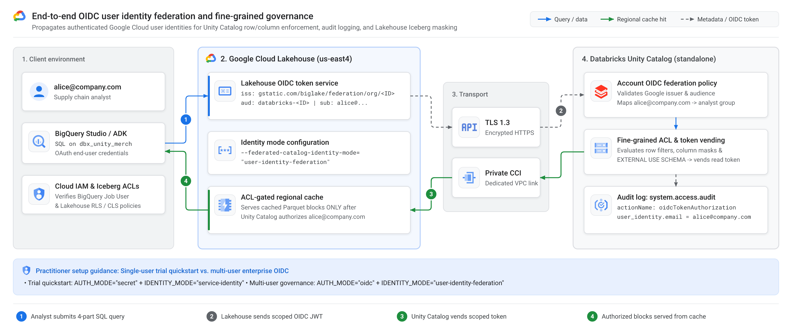
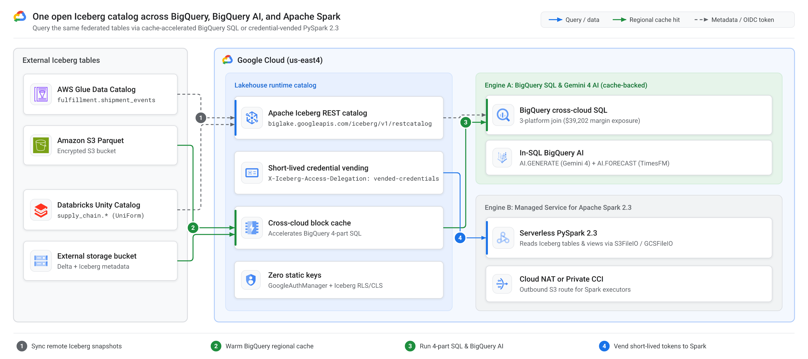
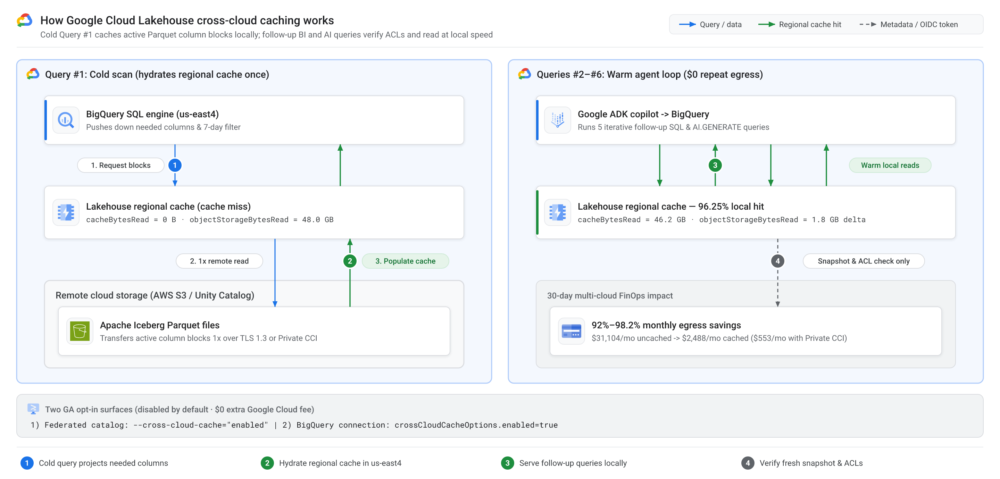
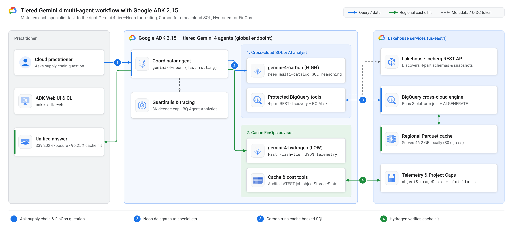

# Querying Databricks Unity Catalog and AWS Glue in Place with Google Cloud Lakehouse, Cross-Cloud Caching, and Google ADK 2.15

*A hands-on cloud practitioner proof of concept uniting zero-ETL Apache Iceberg federation, regional Parquet caching, in-warehouse Gemini 4 BigQuery AI, and tiered multi-agent analytics.*



Enterprise data rarely lives inside a single cloud boundary. Checkout orders stream into **BigQuery**, merchandising and supplier risk models live in **Databricks Unity Catalog**, and carrier shipment telemetry lands as **Apache Iceberg** files on **Amazon S3** registered in **AWS Glue**.

For years, analytics teams faced an expensive trade-off: maintain fragile ETL pipelines that copy terabytes across clouds on delayed schedules, or query remote storage directly and watch network egress bills surge—especially now that autonomous AI agents run five or six iterative follow-up SQL queries per investigation (`345.6 TB/month`, or **~$31,104/month** in uncached egress across 40 daily investigations over a 48 GB table).

With the General Availability (GA) of [**cross-cloud federated catalogs** and **cross-cloud caching** in **Google Cloud Lakehouse**](https://docs.cloud.google.com/lakehouse/docs/release-notes), combined with Google's November 2026 Data Cloud releases (**Knowledge Catalog** GA lineage, **Lakehouse Iceberg RLS/CLS dynamic data masking**, **BigQuery AI with Gemini 4**, **BigQuery Project Caps**, and **Google ADK 2.15**), you no longer have to choose between data freshness and predictable cloud costs.

> **Proof-of-Concept Disclaimer:** Everything in this post and the [companion GitHub repository (`cmanikandan/gcp-borderless-lakehouse-adk`)](https://github.com/cmanikandan/gcp-borderless-lakehouse-adk) is an educational proof of concept (POC) built from a cloud practitioner's perspective. Before deploying to production, always consult the official [Google Cloud Lakehouse documentation](https://docs.cloud.google.com/lakehouse/docs/about-cross-cloud-data-access), [Databricks Unity Catalog documentation](https://docs.databricks.com/en/data-governance/unity-catalog/index.html), and [AWS Glue Apache Iceberg documentation](https://docs.aws.amazon.com/glue/latest/dg/aws-glue-programming-etl-format-iceberg.html) for production security hardening, IAM least-privilege policies, networking, and service limits.

---

## Why Google Cloud Lakehouse Excels Across Clouds

> **2026 Naming Quick-Reference:** **BigLake** is now **Google Cloud Lakehouse**, **BigLake metastore** is now the **Lakehouse runtime catalog**, and **Dataplex Universal Catalog** is now **Google Cloud Knowledge Catalog** (while existing `gcloud biglake` CLI commands, `biglake.googleapis.com` endpoints, and IAM roles remain backwards-compatible).

At a glance, here is how **Google Cloud Lakehouse** compares with traditional cross-cloud approaches:

| Architectural Dimension | Legacy Cross-Cloud ETL | Uncached Query Federation | Google Cloud Lakehouse (GA) |
| :--- | :--- | :--- | :--- |
| **Data Movement & Freshness** | Copies full tables on brittle schedules; hours of lag | Reads remote object storage live on every query | Syncs lightweight Iceberg snapshot pointers (`300s`); caches hot Parquet column blocks locally |
| **Cross-Cloud Egress Cost** | Pays egress on every batch sync—even for unread rows | Pays repeated egress on every BI refresh or AI loop | **1x cold read** for projected columns; **$0 repeat egress** on warm cache hits (`$0` GCP cache fee) |
| **Credentials & Governance** | Static cloud keys stored on ETL workers | Shared service-account credentials | Short-lived credential vending, **OIDC user identity federation**, **VPC-SC**, & **Iceberg RLS/CLS** |
| **Compute & AI Engines** | Locked into destination warehouse format | Single SQL engine only | **BigQuery SQL**, **BigQuery AI (`AI.GENERATE`, `AI.FORECAST`)**, **Managed Spark 2.3**, & **Trino** |

Six core strengths power this architecture:

1. **Zero-ETL Federated Catalogs Across Four Ecosystems (GA):** `--catalog-type="federated"` continuously synchronizes namespaces and Apache Iceberg metadata pointers from **Databricks Unity Catalog** (on AWS, Azure, Google Cloud, or standalone via the Databricks portal), **AWS Glue Data Catalog** (including **Amazon S3 Table Buckets**), **Snowflake Horizon Catalog**, and **Workday Data Lake**—without invoking remote Databricks or Snowflake compute clusters.
2. **ACL-Verified Regional Block Caching at $0 Extra Google Cloud Fee (GA):** Opting into `--cross-cloud-cache="enabled"` (or `crossCloudCacheOptions.enabled=true` on a BigQuery cross-cloud connection) caches active Parquet column blocks in your Google Cloud region (`us-east4`). Every query still checks the remote Iceberg snapshot ID and ACLs first—fetching only newly appended delta blocks while serving unchanged blocks at local speed.
3. **Zero Static Keys, OIDC User Identity Federation, and Iceberg RLS/CLS:** Compute engines never store AWS keys or Databricks tokens; Lakehouse vends short-lived, table-scoped credentials per query. Traffic runs over TLS 1.3 or **Private Cross-Cloud Interconnect** inside **VPC Service Controls**, **OIDC user identity federation** propagates caller identities (`alice@company.com`) to Unity Catalog's `system.access.audit`, **Knowledge Catalog** tracks GA table lineage, and Lakehouse enforces **BigQuery row-level and column-level dynamic data masking** on Apache Iceberg tables.
4. **Multi-Engine Open Standards:** A single Lakehouse runtime catalog (`https://biglake.googleapis.com/iceberg/v1/restcatalog`) serves native Iceberg tables, **Delta Lake UniForm** tables, REST metrics reporting, and **Apache Iceberg views** (Preview) across **BigQuery** and **Managed Service for Apache Spark 2.3**.
5. **In-Warehouse Gemini 4 SQL AI & TimesFM Forecasting:** Federated 4-part tables work natively with **`AI.GENERATE`**, **`AI.IF`**, and **`AI.CLASSIFY`** (supporting **Gemini 4 Hydrogen**, **Gemini 4 Neon**, and **Gemini 4 Carbon**, plus GA optimized mode for large-scale classification) alongside zero-shot **`AI.FORECAST`**.
6. **Two-Layer FinOps for Autonomous Agents:** **Cross-cloud caching** bounds *network egress* across clouds, while **BigQuery Project Caps (GA)** bound *slot and concurrency usage* per project inside shared Enterprise reservations so exploratory AI agents never starve executive dashboards.

---

## Real-World POC Scenario: *OmniRetail Horizon* Supply Chain Resilience

In the [companion GitHub repository (`cmanikandan/gcp-borderless-lakehouse-adk`)](https://github.com/cmanikandan/gcp-borderless-lakehouse-adk), we provision three separate platforms from scratch to investigate East Coast port delays and supplier risk without building a single ETL pipeline:

* **Google Cloud BigQuery (`us-east4`):** Live checkout orders in `` `omni-retail-lakehouse-poc.commerce_core.orders` `` *(3-part native table)*.
* **Standalone Databricks Portal (`Unity Catalog`):** Supplier geopolitical risk scores and SKU unit cost margins in `` `omni-retail-lakehouse-poc.dbx_unity_merch.supply_chain.*` `` *(4-part Delta UniForm tables)*.
* **AWS Cloud (`us-east-1`, `AWS Glue` + `Amazon S3`):** Carrier delay events in `` `omni-retail-lakehouse-poc.aws_glue_logistics.fulfillment.shipment_events` `` *(4-part Apache Iceberg v2 table)*.



*(Want to test locally in 30 seconds before touching cloud credentials? Run `make install && make test && make inspect-agent && make demo-finops`.)*

---

## Step-by-Step Implementation Walkthrough

### 1. Federate AWS Glue and Amazon S3 via Secretless OIDC

[`00_bootstrap_aws_s3_glue_iceberg.sh`](https://github.com/cmanikandan/gcp-borderless-lakehouse-adk/blob/main/infra/aws-glue/00_bootstrap_aws_s3_glue_iceberg.sh) creates an encrypted S3 bucket in `us-east-1` and seeds an Apache Iceberg v2 table via serverless **Amazon Athena Engine v3**. [`setup_glue_federation.sh`](https://github.com/cmanikandan/gcp-borderless-lakehouse-adk/blob/main/infra/aws-glue/setup_glue_federation.sh) then registers the federated catalog in `us-east4` and locks the AWS IAM role's OIDC trust policy (`aud` and `sub`) to Google's auto-provisioned `biglake-service-account-id`:

```bash
bash infra/aws-glue/00_bootstrap_aws_s3_glue_iceberg.sh

# --glue-warehouse takes your 12-digit AWS account ID (or "${AWS_ACCOUNT_ID}:s3tablescatalog/<bucket>")
gcloud biglake iceberg catalogs create aws_glue_logistics \
  --project="${PROJECT_ID}" \
  --catalog-type="federated" \
  --federated-catalog-type="glue" \
  --glue-warehouse="${AWS_ACCOUNT_ID}" \
  --glue-aws-region="us-east-1" \
  --glue-aws-role-arn="arn:aws:iam::${AWS_ACCOUNT_ID}:role/lakehouse_glue_federation_role" \
  --cross-cloud-cache="enabled" \
  --primary-location="us-east4"
```

### 2. Connect Standalone Databricks Unity Catalog (Delta UniForm + User OIDC)

Follow [`infra/databricks-unity/README.md`](https://github.com/cmanikandan/gcp-borderless-lakehouse-adk/blob/main/infra/databricks-unity/README.md) to enable **External data access** on your Unity Catalog metastore, register an **External Location** ([`00_prepare_uc_external_storage.sh`](https://github.com/cmanikandan/gcp-borderless-lakehouse-adk/blob/main/infra/databricks-unity/00_prepare_uc_external_storage.sh)), grant **`EXTERNAL USE SCHEMA`**, run [`databricks_uc_setup.sql`](https://github.com/cmanikandan/gcp-borderless-lakehouse-adk/blob/main/infra/databricks-unity/databricks_uc_setup.sql) (`'delta.universalFormat.enabledFormats' = 'iceberg'`), and federate via [`setup_unity_federation.sh`](https://github.com/cmanikandan/gcp-borderless-lakehouse-adk/blob/main/infra/databricks-unity/setup_unity_federation.sh):

```bash
gcloud biglake iceberg catalogs create dbx_unity_merch \
  --project="${PROJECT_ID}" \
  --catalog-type="federated" \
  --federated-catalog-type="unity" \
  --unity-instance-name="dbc-a1b2c3d4-e5f6.cloud.databricks.com" \
  --unity-catalog-name="omniretail_merch" \
  --unity-service-principal-application-id="${DBX_SP_CLIENT_ID}" \
  --federated-catalog-identity-mode="user-identity-federation" \
  --refresh-interval="300s" \
  --cross-cloud-cache="enabled" \
  --primary-location="us-east4"
```



### 3. Join & Enrich in Place with BigQuery SQL, Gemini 4 `AI.GENERATE`, and Spark 2.3

In [`05_cross_cloud_bigquery_ai_insights.sql`](https://github.com/cmanikandan/gcp-borderless-lakehouse-adk/blob/main/sql/05_cross_cloud_bigquery_ai_insights.sql), BigQuery joins all three platforms using 4-part identifiers, pushes down predicates (`ORD-8803` is pruned automatically, surfacing **`$39,202.00`** in gross margin exposure), and calls **`AI.GENERATE`** (`endpoint => 'gemini-4-hydrogen'`) with a typed `output_schema` right inside SQL:

```sql
WITH cross_cloud_exposure AS (
  SELECT
    o.customer_region, m.category, m.product_name, r.supplier_name,
    r.geopolitical_risk_score, s.carrier, s.delay_hours,
    ROUND(SUM(o.quantity * (o.unit_sale_price_usd - m.unit_cost_usd)), 2) AS gross_margin_exposure_usd
  FROM `omni-retail-lakehouse-poc.commerce_core.orders` AS o
  INNER JOIN `omni-retail-lakehouse-poc.dbx_unity_merch.supply_chain.sku_margins` AS m ON o.sku_id = m.sku_id
  INNER JOIN `omni-retail-lakehouse-poc.dbx_unity_merch.supply_chain.supplier_risk_scores` AS r ON m.supplier_id = r.supplier_id
  INNER JOIN `omni-retail-lakehouse-poc.aws_glue_logistics.fulfillment.shipment_events` AS s ON o.order_id = s.order_id
  WHERE o.order_ts >= TIMESTAMP_SUB(CURRENT_TIMESTAMP(), INTERVAL 7 DAY)
    AND (s.delay_hours > 12 OR r.geopolitical_risk_score >= 0.65)
  GROUP BY 1, 2, 3, 4, 5, 6, 7
)
SELECT
  customer_region, category, supplier_name, carrier, delay_hours, gross_margin_exposure_usd,
  AI.GENERATE(
    CONCAT('Recommend an expedite action for ', category, ' from ', supplier_name,
           ' (carrier=', carrier, ', delay_hours=', CAST(delay_hours AS STRING), ').'),
    endpoint => 'gemini-4-hydrogen',
    output_schema => 'expedite_priority STRING, recommended_carrier_action STRING'
  ) AS mitigation_plan
FROM cross_cloud_exposure
ORDER BY gross_margin_exposure_usd DESC;
```



Meanwhile, **Managed Service for Apache Spark 2.3** ([`cross_cloud_margin_risk_job.py`](https://github.com/cmanikandan/gcp-borderless-lakehouse-adk/blob/main/spark/cross_cloud_margin_risk_job.py)) queries the exact same catalogs over `https://biglake.googleapis.com/iceberg/v1/restcatalog` via short-lived vended credentials (`X-Iceberg-Access-Delegation=vended-credentials`).

### 4. Verify Regional Cache Hits & 30-Day Agentic FinOps



Running [`scripts/run_cross_cloud_join.sh`](https://github.com/cmanikandan/gcp-borderless-lakehouse-adk/blob/main/scripts/run_cross_cloud_join.sh) with `--nouse_cache` bypasses BigQuery's SQL result cache so `statistics.query.objectStorageStats` proves storage-level block caching directly (**96.25% local cache hit** on warm runs):

| Deployment Pattern (40 daily 6-query agent investigations × 48 GB) | Monthly Remote Egress | Estimated Monthly Egress Cost | Savings vs. Uncached |
| :--- | ---: | ---: | ---: |
| **Uncached Cross-Cloud Federation** (public internet @ $0.09/GB) | `345.6 TB` | `$31,104` | — |
| **Google Cloud Lakehouse Caching** (public internet, 92% warm cache hit) | `27.6 TB` | `$2,488` | **92.0% saved** |
| **Google Cloud Lakehouse Caching + Cross-Cloud Interconnect** (@ $0.02/GB) | `27.6 TB` | `$553` | **98.2% saved** |

### 5. Build a Tiered Gemini 4 Copilot with Google ADK 2.15



In [`src/lakehouse_agent/agent.py`](https://github.com/cmanikandan/gcp-borderless-lakehouse-adk/blob/main/src/lakehouse_agent/agent.py), our **Google ADK 2.15** application pairs the complete November 2026 **Gemini 4** lineup with session-protected BigQuery tools (`WriteMode.PROTECTED`), built-in `bigquery-ai-ml` and `bigquery-graph` skills (`SkillToolset`), 4-part REST catalog discovery, `max_output_tokens=8192` decode caps on `GOOGLE_CLOUD_LOCATION=global`, and optional `BigQueryAgentAnalyticsPlugin` trace streaming:

* **Coordinator (`lakehouse_practitioner_copilot`) → `gemini-4-neon` (`ThinkingLevel.LOW`):** Fast frontier intent decomposition and executive synthesis.
* **Cross-Cloud SQL & AI Analyst (`cross_cloud_supply_chain_analyst`) → `gemini-4-carbon` (`ThinkingLevel.HIGH`):** Deep multi-catalog SQL verification, `AI.FORECAST`, `AI.GENERATE`, and anomaly/driver tools.
* **Cache & Capacity FinOps Advisor (`finops_cache_telemetry_advisor`) → `gemini-4-hydrogen` (`ThinkingLevel.LOW`):** Flash-tier `objectStorageStats` telemetry inspection (`job_id="LATEST"`) and CLI blueprints.

---

## Clean Up Your POC Resources

When finished testing, run [`infra/teardown_all.sh`](https://github.com/cmanikandan/gcp-borderless-lakehouse-adk/blob/main/infra/teardown_all.sh) to remove all Google Cloud and AWS POC resources in one command, then drop the test Unity Catalog objects in your Databricks SQL Editor (`DROP CATALOG IF EXISTS omniretail_merch CASCADE; DROP EXTERNAL LOCATION IF EXISTS lakehouse_poc_ext_loc; DROP STORAGE CREDENTIAL IF EXISTS lakehouse_poc_cred;`).

---

## Conclusion, Additional Use Cases & Next Steps

**Google Cloud Lakehouse** unites **BigQuery**, **Managed Service for Apache Spark**, **Databricks Unity Catalog**, **AWS Glue**, **Snowflake Horizon Catalog**, and **Workday Data Lake** on open Apache Iceberg standards—eliminating fragile copy pipelines while keeping cross-cloud egress and compute predictable.

### Five Additional Enterprise Workloads Unlocked by This Pattern
* **Post-M&A Financial Reconciliation (`Snowflake Horizon` + `Databricks` + `BigQuery Measures`):** Reconcile billing ledgers, ML credit scores, and ERP actuals across clouds without months of post-merger ETL migration.
* **Workforce & Fulfillment Margin Planning (`Workday Data Lake` + `AWS Glue` + `BigQuery`):** Join governed HR staffing tables in Workday with warehouse IoT telemetry on S3 while enforcing **Lakehouse Iceberg RLS/CLS dynamic masking**.
* **Autonomous Cyber Threat Hunting (`Amazon S3 Table Buckets` + `BigQuery Graph` + `Gemini 4 Carbon`):** Traverse lateral-movement paths across petabytes of CloudTrail and EDR Iceberg logs inside a **VPC Service Controls** perimeter at **$0 repeat egress** on warm cache windows.
* **Cross-Cloud Customer 360 & Demand Forecasting (`Managed Spark 2.3` + `BigQuery AI`):** Combine PySpark feature engineering over vended Iceberg views with zero-shot **`AI.FORECAST`** and optimized-mode **`AI.CLASSIFY`**.
* **Regulated Life Sciences Collaboration (`OIDC User Identity Federation` + `Knowledge Catalog`):** Query multi-institution assay tables in Unity Catalog alongside clinical outcomes in BigQuery with per-researcher `system.access.audit` attribution and **Knowledge Catalog** table lineage.

### Key References
* [Companion GitHub Repository (`cmanikandan/gcp-borderless-lakehouse-adk`)](https://github.com/cmanikandan/gcp-borderless-lakehouse-adk)
* [Google Cloud Lakehouse Release Notes](https://docs.cloud.google.com/lakehouse/docs/release-notes) & [About Cross-Cloud Data Access and Intelligent Caching](https://docs.cloud.google.com/lakehouse/docs/about-cross-cloud-data-access#intelligent-caching)
* [Set Up Cross-Cloud Connections: Databricks Unity Catalog](https://docs.cloud.google.com/lakehouse/docs/set-up-cross-cloud-connection-databricks) · [AWS Glue](https://docs.cloud.google.com/lakehouse/docs/set-up-cross-cloud-connection-aws-glue) · [Snowflake Horizon](https://docs.cloud.google.com/lakehouse/docs/set-up-cross-cloud-connection-snowflake) · [Workday Data Lake](https://docs.cloud.google.com/lakehouse/docs/set-up-cross-cloud-connection-workday)
* [BigQuery Generative AI Overview](https://docs.cloud.google.com/bigquery/docs/generative-ai-overview), [Google ADK BigQuery Integration](https://adk.dev/integrations/bigquery/), & [What's New in Gemini 4 Neon, Carbon, Hydrogen & Argon](https://aistudio.google.com/docs/whats-new-gemini-4-neon)
