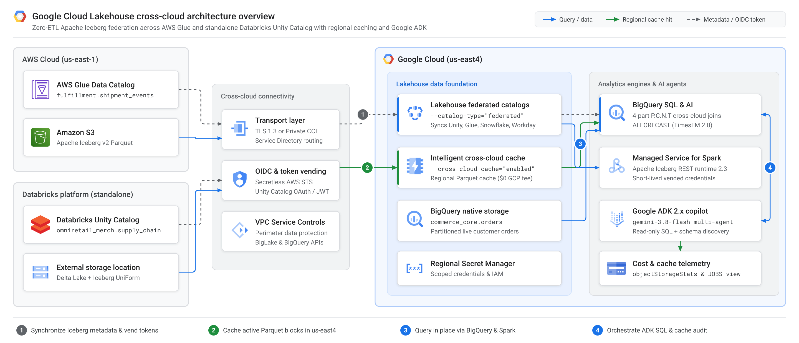
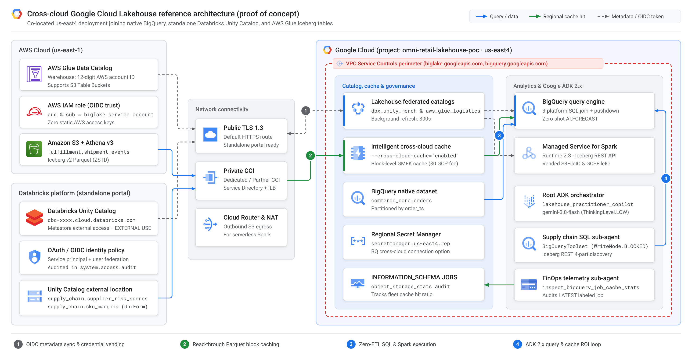
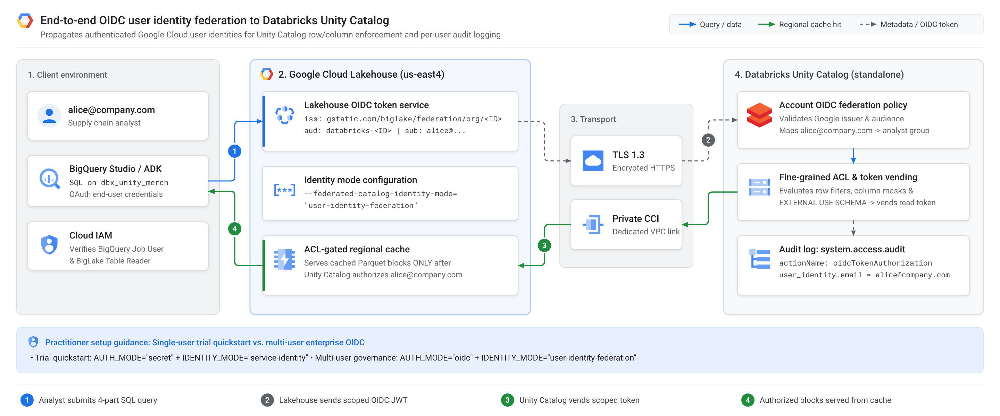
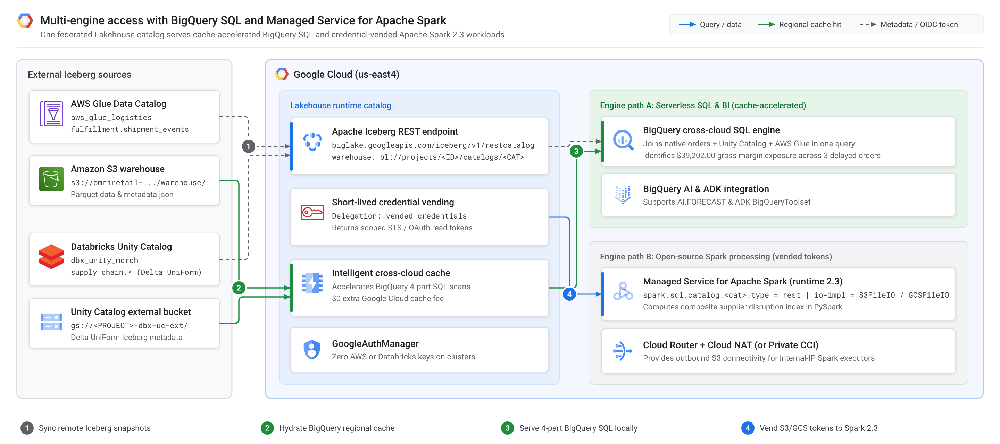
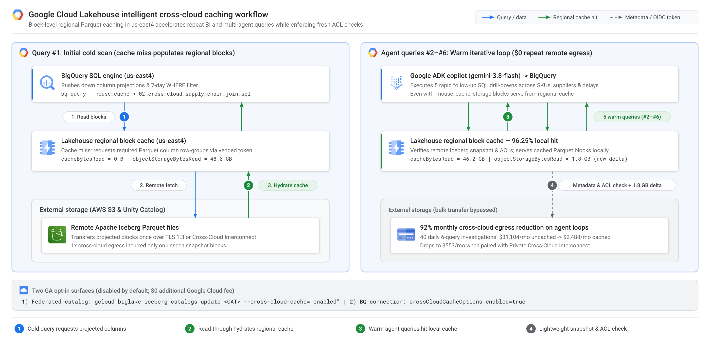
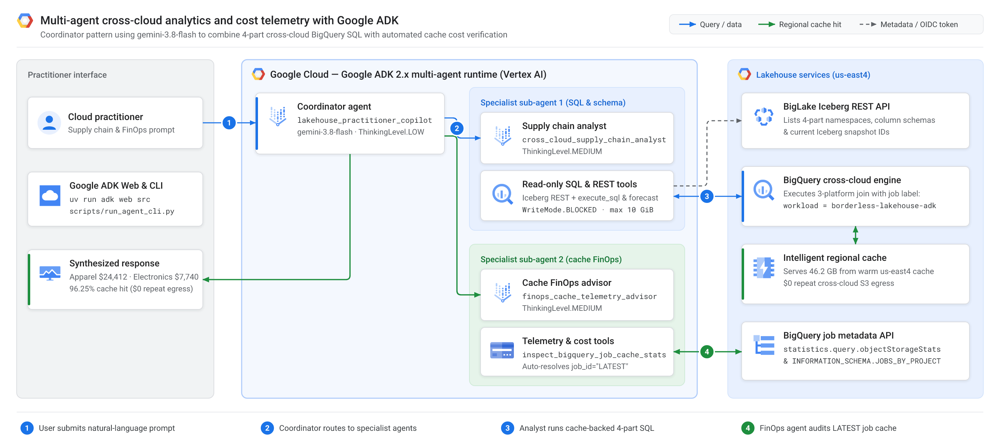

# How to query Databricks Unity Catalog and AWS Glue in place with Google Cloud Lakehouse, cross-cloud caching, and Google ADK



When an autonomous AI agent investigates a production supply chain anomaly, it rarely runs a single SQL query—it loops through five or six follow-up queries in seconds to isolate root causes across regions, suppliers, and carriers. Across 40 daily investigations over a 48 GB cross-cloud table on Amazon S3, uncached federation transfers **345.6 TB per month**—generating roughly **\$31,104/month** in cloud storage egress fees before a single dashboard refreshes.

With the General Availability (GA) of [cross-cloud federated catalogs and cross-cloud caching in Google Cloud Lakehouse](https://docs.cloud.google.com/lakehouse/docs/release-notes), cloud practitioners can query remote **Apache Iceberg** tables in **Databricks Unity Catalog**, **AWS Glue Data Catalog**, **Snowflake Horizon Catalog**, and **Workday Data Lake** directly from **BigQuery** and **Apache Spark** without building brittle ETL pipelines—while caching active Parquet blocks inside your Google Cloud region at **\$0 additional Google Cloud fee**.

First, we unpack the core architecture of Google Cloud Lakehouse, including background metadata synchronization, short-lived credential vending, OpenID Connect (OIDC) user identity federation, and regional block caching. Second, we walk step by step through provisioning AWS Glue, a standalone Databricks Unity Catalog workspace, BigQuery, Managed Service for Apache Spark, and a multi-agent copilot built with **Google Agent Development Kit (Google ADK)** and **Gemini 3.8 Flash**. Finally, we evaluate a real-world retail supply chain scenario, measure 30-day multi-agent egress savings, and clean up every proof-of-concept resource.

> **Proof-of-concept disclaimer:** Everything in this article and the [companion GitHub repository (`cmanikandan/gcp-borderless-lakehouse-adk`)](https://github.com/cmanikandan/gcp-borderless-lakehouse-adk) is an educational proof of concept (POC) built from a cloud practitioner's perspective to validate cross-cloud capabilities hands-on. Before deploying production workloads, always consult the official [Google Cloud Lakehouse documentation](https://docs.cloud.google.com/lakehouse/docs/about-cross-cloud-data-access), [Databricks Unity Catalog documentation](https://docs.databricks.com/en/data-governance/unity-catalog/index.html), and [AWS Glue Apache Iceberg documentation](https://docs.aws.amazon.com/glue/latest/dg/aws-glue-programming-etl-format-iceberg.html) for production security hardening, IAM least-privilege policies, networking, and service limits.

---

## Understanding core Google Cloud Lakehouse concepts

Enterprise datasets rarely live in a single cloud. Historically, analytics teams faced an expensive trade-off: maintain fragile copy pipelines that duplicate terabytes across clouds, or query remote object storage directly and absorb high latency and unpredictable network egress charges.

**Google Cloud Lakehouse** (built on **BigLake** and **BigQuery**) resolves that trade-off by combining open table standards with cloud-spanning governance and regional block caching.

* **Open-format interoperability on Apache Iceberg:** Google Cloud Lakehouse exposes a unified Apache Iceberg REST Catalog (`https://biglake.googleapis.com/iceberg/v1/restcatalog`) over native Apache Iceberg tables as well as Delta Lake tables configured with Iceberg UniForm. **BigQuery**, **Google Cloud Managed Service for Apache Spark**, and open-source **Apache Spark** read the exact same table snapshots in place with zero duplicate copies.
* **Zero-ETL cross-cloud federated catalogs (GA):** Configuring `--catalog-type="federated"` synchronizes catalog namespaces and Iceberg snapshot pointers in the background from **Databricks Unity Catalog** (on AWS, Azure, or Google Cloud, or via the standalone Databricks portal), **AWS Glue Data Catalog** (including Amazon S3 Table Buckets), **Snowflake Horizon Catalog**, and **Workday Data Lake**.
* **Intelligent cross-cloud caching (GA):** Disabled by default and available at **\$0 additional Google Cloud fee**, opting into cross-cloud caching stores active remote Parquet column blocks in Google-managed regional cache inside your Google Cloud region. Every query still checks remote snapshot metadata and access control lists (ACLs) so stale or unauthorized blocks are never served, while warm BigQuery reads execute at local speed with **\$0 repeat cross-cloud egress**.
* **Secretless credential vending, private routing, and user identity federation:** Compute clusters never store static AWS keys or long-lived tokens; Lakehouse vends short-lived, table-scoped credentials on demand. Traffic routes over TLS 1.3 or privately over **Cross-Cloud Interconnect** inside **VPC Service Controls** perimeters (`biglake.googleapis.com` and `bigquery.googleapis.com`), and **Databricks Unity Catalog** supports end-to-end **OIDC user identity federation** for row filters, column masks, and per-user audit logging in `system.access.audit`.
* **Agent-ready analytics foundation:** Because federated tables behave like native tables in BigQuery—supporting predicate pushdown and zero-shot time-series forecasting (`AI.FORECAST` with TimesFM 2.0)—multi-agent applications built with **Google ADK** and **Gemini 3.8 Flash** can run iterative SQL investigations without multiplying cross-cloud egress costs.

---

## Step-by-step implementation and code walkthrough

You do not need pre-existing tables in AWS, Databricks, or Google Cloud to reproduce this guide. Clone the [companion GitHub repository](https://github.com/cmanikandan/gcp-borderless-lakehouse-adk) to run the local 30-second simulator (`make install && make test && make demo-finops`) or provision all three environments end to end.



### 1. Federating AWS Glue and Amazon S3 with OpenID Connect

First, run [`00_bootstrap_aws_s3_glue_iceberg.sh`](https://github.com/cmanikandan/gcp-borderless-lakehouse-adk/blob/main/infra/aws-glue/00_bootstrap_aws_s3_glue_iceberg.sh) to provision a private encrypted Amazon S3 bucket in `us-east-1`, create the `fulfillment` database in AWS Glue, and use serverless **Amazon Athena Engine v3** to seed an Apache Iceberg v2 table (`fulfillment.shipment_events`).

Next, [`setup_glue_federation.sh`](https://github.com/cmanikandan/gcp-borderless-lakehouse-adk/blob/main/infra/aws-glue/setup_glue_federation.sh) creates the federated catalog in Google Cloud (`us-east4`) with cross-cloud caching enabled and binds Google's auto-provisioned BigLake service account to an AWS IAM role via OpenID Connect (OIDC)—eliminating static AWS access keys:

```bash
export PROJECT_ID="your-gcp-project-id"
export GCP_REGION="us-east4"      # Co-located near AWS us-east-1
export AWS_REGION="us-east-1"

# 1. Seed S3 bucket + Glue database + Apache Iceberg v2 table via Athena v3
bash infra/aws-glue/00_bootstrap_aws_s3_glue_iceberg.sh

# 2. Create the federated Glue catalog with cross-cloud caching enabled
gcloud biglake iceberg catalogs create aws_glue_logistics \
  --project="${PROJECT_ID}" \
  --catalog-type="federated" \
  --federated-catalog-type="glue" \
  --glue-warehouse="${AWS_ACCOUNT_ID}" \
  --glue-aws-region="us-east-1" \
  --glue-aws-role-arn="arn:aws:iam::${AWS_ACCOUNT_ID}:role/lakehouse_glue_federation_role" \
  --cross-cloud-cache="enabled" \
  --primary-location="us-east4"
```

### 2. Connecting standalone Databricks Unity Catalog

Google Cloud Lakehouse connects to **Databricks Unity Catalog** directly over its REST endpoint (`dbc-xxxx.cloud.databricks.com`), independent of where Databricks is hosted. Follow the portal checklist in [`infra/databricks-unity/README.md`](https://github.com/cmanikandan/gcp-borderless-lakehouse-adk/blob/main/infra/databricks-unity/README.md) *(note: Databricks Free Edition uses a shared metastore where **External data access** is locked, so use a 14-day Databricks Free Trial or standard workspace for Unity Catalog federation, or pass `--glue-only` to test BigQuery + AWS Glue standalone)*:

1. Enable **External data access** in **Catalog > Metastore Settings**.
2. Store federated schemas in a registered **Unity Catalog External Location** ([`00_prepare_uc_external_storage.sh`](https://github.com/cmanikandan/gcp-borderless-lakehouse-adk/blob/main/infra/databricks-unity/00_prepare_uc_external_storage.sh)).
3. Grant **`EXTERNAL USE SCHEMA`** to your service principal or federated user group.

Run [`databricks_uc_setup.sql`](https://github.com/cmanikandan/gcp-borderless-lakehouse-adk/blob/main/infra/databricks-unity/databricks_uc_setup.sql) in the Databricks SQL Editor to seed `supplier_risk_scores` and `sku_margins` with **Delta UniForm (`iceberg`)** enabled, then connect Unity Catalog with [`setup_unity_federation.sh`](https://github.com/cmanikandan/gcp-borderless-lakehouse-adk/blob/main/infra/databricks-unity/setup_unity_federation.sh):

```bash
gcloud biglake iceberg catalogs create dbx_unity_merch \
  --project="${PROJECT_ID}" \
  --catalog-type="federated" \
  --federated-catalog-type="unity" \
  --unity-instance-name="dbc-a1b2c3d4-e5f6.cloud.databricks.com" \
  --unity-catalog-name="omniretail_merch" \
  --secret-name="projects/${PROJECT_ID}/locations/us-east4/secrets/dbx-unity-sp-oauth" \
  --refresh-interval="300s" \
  --cross-cloud-cache="enabled" \
  --primary-location="us-east4"
```



### 3. Joining tables across BigQuery and Managed Service for Apache Spark

Seed the native BigQuery orders table (`bash infra/gcp-bigquery/setup_bigquery_native.sh`), then join **BigQuery + standalone Databricks Unity Catalog + AWS Glue** in one SQL query ([`02_cross_cloud_supply_chain_join.sql`](https://github.com/cmanikandan/gcp-borderless-lakehouse-adk/blob/main/sql/02_cross_cloud_supply_chain_join.sql)) using **4-part table identifiers** (`` `project.catalog.namespace.table` ``):

```sql
SELECT
  o.customer_region,
  m.category,
  r.supplier_name,
  r.geopolitical_risk_score,
  s.carrier,
  s.delay_hours,
  COUNT(DISTINCT o.order_id) AS affected_orders,
  ROUND(SUM(o.quantity * (o.unit_sale_price_usd - m.unit_cost_usd)), 2) AS gross_margin_exposure_usd
FROM `omni-retail-lakehouse-poc.commerce_core.orders` AS o
INNER JOIN `omni-retail-lakehouse-poc.dbx_unity_merch.supply_chain.sku_margins` AS m
  ON o.sku_id = m.sku_id
INNER JOIN `omni-retail-lakehouse-poc.dbx_unity_merch.supply_chain.supplier_risk_scores` AS r
  ON m.supplier_id = r.supplier_id
INNER JOIN `omni-retail-lakehouse-poc.aws_glue_logistics.fulfillment.shipment_events` AS s
  ON o.order_id = s.order_id
WHERE o.order_ts >= TIMESTAMP_SUB(CURRENT_TIMESTAMP(), INTERVAL 7 DAY)
  AND (s.delay_hours > 12 OR r.geopolitical_risk_score >= 0.65)
GROUP BY 1, 2, 3, 4, 5, 6
ORDER BY gross_margin_exposure_usd DESC;
```



You can also run **PySpark** feature engineering over the exact same federated catalogs in **Google Cloud Managed Service for Apache Spark** (runtime `2.3`) via [`cross_cloud_margin_risk_job.py`](https://github.com/cmanikandan/gcp-borderless-lakehouse-adk/blob/main/spark/cross_cloud_margin_risk_job.py), using `GoogleAuthManager` and `X-Iceberg-Access-Delegation=vended-credentials` so zero cloud keys live on executors.

### 4. Enabling and verifying cross-cloud caching in Google Cloud Lakehouse



Cross-cloud caching is disabled by default (`\$0` extra Google Cloud fee) and supports two GA opt-in surfaces: `--cross-cloud-cache="enabled"` on federated catalogs, or `crossCloudCacheOptions.enabled=true` on BigQuery cross-cloud connections ([`setup_bq_cross_cloud_connection_cache.sh`](https://github.com/cmanikandan/gcp-borderless-lakehouse-adk/blob/main/infra/gcp-bigquery/setup_bq_cross_cloud_connection_cache.sh)). Running [`run_cross_cloud_join.sh`](https://github.com/cmanikandan/gcp-borderless-lakehouse-adk/blob/main/scripts/run_cross_cloud_join.sh) twice with `--nouse_cache` verifies storage-level caching via `statistics.query.objectStorageStats` and `INFORMATION_SCHEMA.JOBS_BY_PROJECT` ([`04_finops_org_cache_audit.sql`](https://github.com/cmanikandan/gcp-borderless-lakehouse-adk/blob/main/sql/04_finops_org_cache_audit.sql)).

### 5. Building a multi-agent copilot with Google ADK and Gemini 3.8 Flash



In [`src/lakehouse_agent/agent.py`](https://github.com/cmanikandan/gcp-borderless-lakehouse-adk/blob/main/src/lakehouse_agent/agent.py), our Coordinator agent (`lakehouse_practitioner_copilot`, powered by `gemini-3.8-flash`) pairs a cross-cloud SQL analyst sub-agent (`WriteMode.BLOCKED`, 4-part Iceberg REST schema discovery, and zero-shot `AI.FORECAST`) with a FinOps sub-agent that automatically audits `job_id="LATEST"`.

---

## Real-world application and multi-cloud cost impact

In our *OmniRetail Horizon* supply chain scenario, BigQuery prunes healthy order `ORD-8803` (`2h` delay, `0.14` risk on `NordicFreight`) and identifies **\$39,202.00** in gross margin exposure across three delayed shipments (`PacificAirCargo` \$24,412.00, `OceanicExpress` \$7,740.00, and `GreatLakesRail` \$7,050.00). Across 40 daily 6-query agent investigations over a 48 GB table, regional caching lowers monthly cross-cloud egress from **\$31,104/month** (`345.6 TB`) to **\$2,488/month** (**92% savings**)—or **\$553/month** over Cross-Cloud Interconnect.

### Cleaning up your proof-of-concept resources

Run [`infra/teardown_all.sh`](https://github.com/cmanikandan/gcp-borderless-lakehouse-adk/blob/main/infra/teardown_all.sh) to tear down all Google Cloud and AWS resources in one command, then run `DROP CATALOG IF EXISTS omniretail_merch CASCADE;` along with `DROP EXTERNAL LOCATION` and `DROP STORAGE CREDENTIAL` in your Databricks SQL Editor.

---

## Conclusion and next steps

Clone [`cmanikandan/gcp-borderless-lakehouse-adk`](https://github.com/cmanikandan/gcp-borderless-lakehouse-adk) (and see [`blog/discuss_google_dev_post.md`](discuss_google_dev_post.md) for the full `discuss.google.dev` forum edition), test the hands-on scripts, and review the official [Google Cloud Lakehouse](https://docs.cloud.google.com/lakehouse/docs/release-notes), [Databricks Unity Catalog](https://docs.databricks.com/en/data-governance/unity-catalog/index.html), and [AWS Glue](https://docs.aws.amazon.com/glue/latest/dg/aws-glue-programming-etl-format-iceberg.html) documentation before production rollouts.
